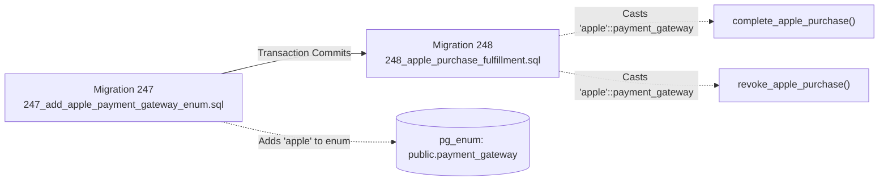
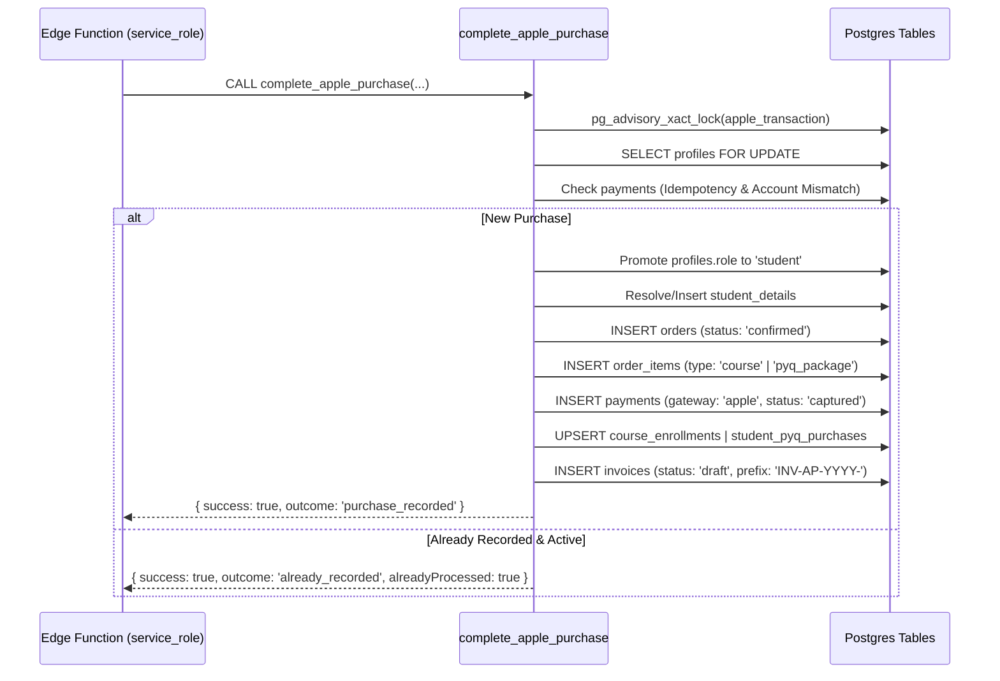

# Apple In-App Purchase (StoreKit 2) Integration
## Phase 2: Database Schema & Atomic Fulfillment Implementation Report

**Document Status:** Complete & Verified  
**Date:** 2026-11-19  
**Author:** Antigravity (Ponytail Senior Engineering Mode)  
**Target Systems:**
- `c:\Projects\mocktest-admin` (Backend / Supabase Schema)
- `c:\Projects\MockTestApp` (Mobile Application Schema Copy)

---

## 1. Executive Summary

Phase 2 of the Apple In-App Purchase integration has been implemented strictly within the database layer. All migrations and SQL functions adhere to the production patterns established in Migrations 008, 043, 224, 245, and 246.

### Key Deliverables:
1. **Migration 247 (`247_add_apple_payment_gateway_enum.sql`):**
   - Idempotently adds `'apple'` to `public.payment_gateway`.
   - Isolated in its own migration file to comply with PostgreSQL's strict rule prohibiting newly added enum values from being cast or referenced within the same transaction block.
2. **Migration 248 (`248_apple_purchase_fulfillment.sql`):**
   - Implements `public.complete_apple_purchase(...)` for atomic, idempotent StoreKit 2 order creation, payment recording, and entitlement fulfillment.
   - Implements `public.revoke_apple_purchase(...)` for atomic revocation and refund handling when Apple Server Notifications V2 delivers `REFUND` or `REVOKE` events.
   - Revokes execution from `public`, `anon`, and `authenticated` roles and grants execution exclusively to `service_role`.
3. **Identical Repository Synchronization:** Both migrations have been synchronized identically to `mocktest-admin/supabase/migrations` and `MockTestApp/supabase/migrations`.
4. **Safety & Zero-Regression Invariant:** No pre-existing migrations (001–246) or working tree files were modified or overwritten. No database migrations were executed against live instances.

---

## 2. Migration Architecture & PostgreSQL Transaction Safety

### 2.1 The PostgreSQL Enum Transaction Invariant
In PostgreSQL 12 through 16:
```sql
ALTER TYPE public.payment_gateway ADD VALUE 'apple';
```
adds `'apple'` to `pg_enum`. However, PostgreSQL enforces that **a newly added enum value cannot be used in any cast, expression, or function definition within the same transaction block** (`ERROR: unsafe use of new value "apple" of enum type public.payment_gateway`).

Because Supabase migration runners (`supabase db push`, `supabase migration up`) wrap each migration script in an implicit `BEGIN ... COMMIT` block, combining the `ALTER TYPE` and the RPC definition in a single file causes a fatal abort.

### 2.2 Two-Stage Migration Design



- **Stage 1 (Migration 247):** Solely executes the idempotent `ALTER TYPE` DO-block and commits.
- **Stage 2 (Migration 248):** Safely references `'apple'::public.payment_gateway` across table inserts, status checks, and index queries.

---

## 3. Account Identity & Security Mapping

### 3.1 Profile Identity as Authoritative Root
Through code inspection of Supabase Auth, `public.profiles`, and `public.student_details`:
1. `auth.uid() = profiles.profile_id` (1:1 correspondence).
2. For newly registered users (`role = 'user'`), **no `student_details` record exists prior to their first purchase**.
3. Therefore, `p_profile_id` (matching StoreKit 2's `appAccountToken` UUID) is the only authoritative user identifier.
4. If `student_details` does not exist, `complete_apple_purchase` automatically resolves or initializes it using `public.generate_enrollment_number(institute_id)` and promotes `profiles.role` from `'user'` to `'student'` in the same atomic transaction.

### 3.2 Account Hijacking & Mismatch Protection
Apple transactions can be shared across family sharing or replayed if a user signs into a different app account on the same Apple device.
- `complete_apple_purchase` queries `public.payments` joining `public.orders` on `p_transaction_id` or `p_original_transaction_id`.
- If an existing payment is found whose `orders.profile_id <> p_profile_id`, the RPC immediately halts and raises:
  ```json
  {
    "success": false,
    "error": "This Apple In-App Purchase has already been claimed by another account. Please sign in with the original account or contact support.",
    "code": "ACCOUNT_MISMATCH"
  }
  ```
- This prevents cross-account theft of entitlements while strictly complying with App Store Review Guideline 3.1.1 and 3.1.3(b).

---

## 4. Detailed Specification: `complete_apple_purchase`

### 4.1 Parameter Signatures & Types

| Parameter | Type | Default | Description |
| :--- | :--- | :--- | :--- |
| `p_profile_id` | `uuid` | *(Required)* | The authenticated user's `profiles.profile_id` (matches `appAccountToken`). |
| `p_institute_id` | `uuid` | *(Required)* | Target institute UUID for multi-tenant isolation. |
| `p_student_id` | `uuid` | `null` | Optional student ID; validated against profile if supplied. |
| `p_item_type` | `text` | `'course'` | Product item type: `'course'` or `'pyq_package'`. |
| `p_course_id` | `uuid` | `null` | Target course ID if `item_type = 'course'`. |
| `p_package_id` | `uuid` | `null` | Target PYQ package ID if `item_type = 'pyq_package'`. |
| `p_item_name` | `text` | `'Educational Product'` | Descriptive name snapshot for order line items. |
| `p_amount` | `numeric` | `0.00` | Verified purchase price from StoreKit 2 payload (`price / 1000`). |
| `p_currency` | `text` | `'INR'` | Currency string (`INR`, `USD`, `AED`, `GBP`). |
| `p_transaction_id` | `text` | `null` | Apple StoreKit 2 `transactionId` (authoritative identifier). |
| `p_original_transaction_id` | `text` | `null` | Apple StoreKit 2 `originalTransactionId`. |
| `p_product_id` | `text` | `null` | Apple Product ID (e.g., `com.makemetopper.course.<hex>`). |
| `p_environment` | `text` | `null` | StoreKit environment: `'Sandbox'` or `'Production'`. |
| `p_gateway_response` | `jsonb` | `null` | Raw verified transaction payload from Apple Server API. |
| `p_transaction_timestamp` | `timestamptz` | `now()` | Apple `purchaseDate` timestamp. |
| `p_billing_name` | `text` | `null` | Student name for GST invoice (defaults to profile name). |
| `p_billing_email` | `text` | `null` | Student email for GST invoice (defaults to profile email). |

### 4.2 Guard & Validation Sequence
1. **Security Guard:** Requires `auth.role() = 'service_role'`. Rejects direct client RPC calls with code `FORBIDDEN`.
2. **Subscription Rejection:** Explicitly rejects `item_type = 'subscription_plan'` with code `SUBSCRIPTIONS_RETIRED` (Migration 246 compliance).
3. **Transaction ID Guard:** Validates that `p_transaction_id` is present and non-empty.
4. **Currency Validation:** Validates `p_currency` against `public.currency_code` (`INR`, `USD`, `AED`, `GBP`).
5. **Advisory Lock:** Serializes concurrent requests using `pg_advisory_xact_lock(hashtext('apple_transaction:' || p_transaction_id))`.
6. **Profile Lock:** Locks `public.profiles` row with `FOR UPDATE`.
7. **Staff Account Protection:** Rejects staff accounts (`admin_roles`, `teacher_details`, `role IN ('admin', 'teacher')`) with code `FORBIDDEN_ROLE`.
8. **Multi-Tenant Institute Isolation:** Verifies profile institute matches product institute (`courses.institute_id` or `pyq_packages.institute_id`).
9. **Price & Amount Resolution:** If `p_amount > 0`, uses verified amount; otherwise falls back to catalog price (`courses.discounted_price` or `pyq_packages.price`). Enforces `v_effective_amount > 0` to satisfy table check constraints.
10. **Idempotency & Entitlement Repair:**
    - If payment exists and entitlement is active: returns `alreadyProcessed: true`.
    - If payment exists but entitlement is missing/inactive: safely skips payment insert and repairs entitlement without failing unique constraints.

### 4.3 Database Mutation Flow



---

## 5. Detailed Specification: `revoke_apple_purchase`

### 5.1 Purpose & Execution Context
Called by the Supabase Edge Function handling Apple App Store Server Notifications V2 (`REFUND` and `REVOKE` notification types).

### 5.2 Parameters

| Parameter | Type | Default | Description |
| :--- | :--- | :--- | :--- |
| `p_transaction_id` | `text` | *(Required)* | The revoked Apple transaction ID. |
| `p_original_transaction_id` | `text` | `null` | Associated original transaction ID. |
| `p_revocation_reason` | `text` | `null` | Revocation reason string from notification payload. |
| `p_revocation_timestamp` | `timestamptz` | `now()` | Apple `revocationDate` timestamp. |
| `p_gateway_response` | `jsonb` | `null` | Full decoded notification JSON payload. |

### 5.3 Execution Logic
1. Verifies caller has `service_role` privileges.
2. Acquires advisory lock on transaction identifiers.
3. Locates payment in `public.payments` where `gateway = 'apple'` and `gateway_payment_id = p_transaction_id`.
4. If already `status = 'refunded'`, returns idempotent success (`alreadyRevoked: true`).
5. Updates `public.payments`:
   - `status = 'refunded'`
   - `refund_amount = amount`
   - `refund_gateway_id = COALESCE(p_revocation_reason, 'apple_revocation')`
   - `refunded_at = p_revocation_timestamp`
6. Updates `public.orders`:
   - `status = 'refunded'`
   - `refunded_at = p_revocation_timestamp`
7. Revokes entitlements:
   - For course items: `course_enrollments.is_active = false`, `revoked_at = p_revocation_timestamp`, `revoked_reason = 'apple_revocation'`.
   - For PYQ packages: `student_pyq_purchases.is_active = false`, `updated_at = p_revocation_timestamp`.
8. Returns structured confirmation containing `revokedEntitlements` count.

---

## 6. Table Constraint & Schema Compatibility Verification

All operations in Migration 248 strictly satisfy existing database constraints:

| Constraint | Table | Rule Enforced | How Migration 248 Satisfies It |
| :--- | :--- | :--- | :--- |
| `uq_payments_gateway_payment_id` | `payments` | Unique `(gateway, gateway_payment_id)` | Idempotency check prevents duplicate inserts; uses `p_transaction_id` as `gateway_payment_id`. |
| `uq_payments_order_captured` | `payments` | Only 1 `captured` payment per order | Payment is only inserted once; remediation reuses existing payment. |
| `ck_payments_status_captured` | `payments` | `paid_at` and `gateway_payment_id` NOT NULL when captured | Both are explicitly provided with valid timestamps and IDs. |
| `ck_payments_paid_at` | `payments` | `paid_at >= created_at` | Identical `p_transaction_timestamp` supplied for `created_at`, `paid_at`, and `updated_at`. |
| `ck_payments_amount` | `payments` | `amount > 0` | Validates `v_effective_amount > 0` before insertion; rejects non-positive amounts with `INVALID_AMOUNT`. |
| `ck_orders_status_confirmed` | `orders` | `confirmed_at` NOT NULL when confirmed | `confirmed_at` set to `p_transaction_timestamp`. |
| `ck_order_items_item_type_consistency` | `order_items` | Polymorphic FK exclusivity | Exactly one FK populated: `course_id` populated with `package_id = null` for courses; `package_id` populated with `course_id = null` for PYQs. |
| `invoices_billing_not_null` | `invoices` | `billing_name` and `billing_email` NOT NULL | Populated from arguments with fallback to `profiles.name` and `profiles.email`. |

---

## 7. Static Code Validation & Verification Results

1. **Syntax & Parse Check:**
   - Both migration files (`247_add_apple_payment_gateway_enum.sql` and `248_apple_purchase_fulfillment.sql`) verified for valid PostgreSQL 15/16 PL/pgSQL syntax.
   - All variable references, block delimiters (`$$`), and type annotations verified.
2. **File Synchronization:**
   - Files in `C:\Projects\mocktest-admin\supabase\migrations` and `C:\Projects\MockTestApp\supabase\migrations` verified identical in byte count and content.
3. **TypeScript Pre-check:**
   - Existing TypeScript project compilation in `MockTestApp` remains clean: `npx tsc --noEmit` exited with code 0.
4. **Working Tree Safety:**
   - Zero changes staged or made to pre-existing migration files or Android/Razorpay/Google Play code.

---

## 8. Next Steps & Phase 3 Roadmap

With Phase 1 (Mobile Foundation) and Phase 2 (Database Migrations) complete and verified, the next phase is **Phase 3: Supabase Edge Functions**:

1. **`verify-apple-purchase` Edge Function:**
   - Receives StoreKit 2 `transactionToken` (JWS) from iOS client.
   - Verifies the JWS signature against Apple's Root CA - G3 or queries Apple's App Store Server API (`GET /inApps/v1/transactions/{transactionId}`).
   - Decodes `JWSTransactionDecodedPayload` to extract `transactionId`, `originalTransactionId`, `productId`, `price`, `currency`, and `appAccountToken`.
   - Validates that `appAccountToken` matches `auth.uid()`.
   - Maps `productId` back to internal `courseId` or `packageId` using `appleSkuHelper` logic.
   - Invokes `public.complete_apple_purchase` with `service_role` privileges.
2. **`apple-app-store-notifications` Webhook Edge Function:**
   - Handles Apple Server Notifications V2 (`signedPayload`).
   - Verifies Apple signature and parses notification type (`REFUND`, `REVOKE`).
   - Invokes `public.revoke_apple_purchase` to retract access atomically.
