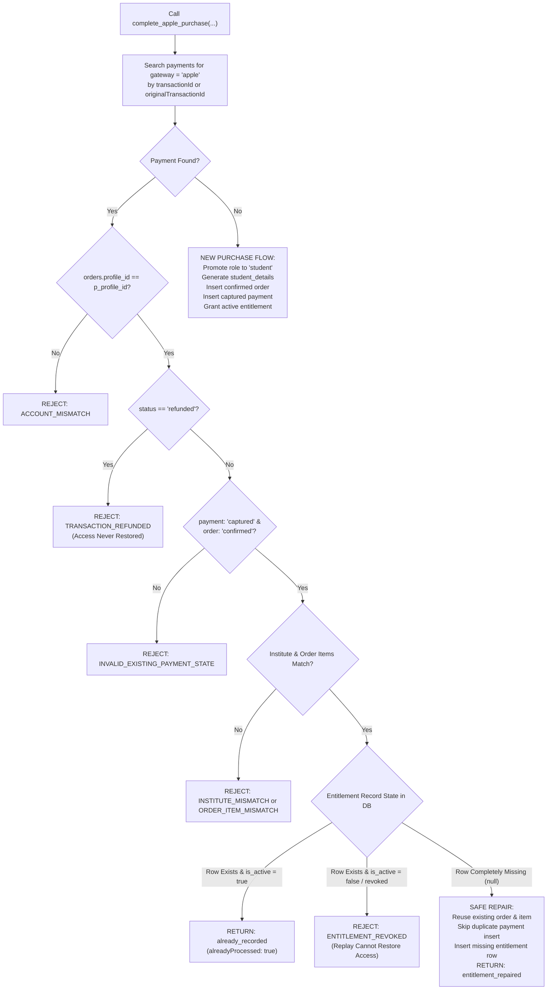

# Apple IAP Phase 2 — Critical SQL Review & Final Database Readiness Report

**Date:** 2026-11-19  
**Review Type:** SQL Verification, Scope Correction & Static Constraint Audit  
**Author:** Antigravity (Ponytail Senior Engineering Mode)  
**Repositories:**
- Backend: `C:\Projects\mocktest-admin`
- Mobile Client & Migration Copy: `C:\Projects\MockTestApp`

---

## 1. Exact Files Inspected and Changed

### Inspected Existing Schema & Migrations:
- `C:\Projects\mocktest-admin\supabase\migrations\002_domain_01_foundation.sql` (`profiles`, `institutes`, `user_role`, `payment_gateway`)
- `C:\Projects\mocktest-admin\supabase\migrations\007_domain_06_pyq.sql` (`pyq_packages`, `student_pyq_purchases`, constraints: `ck_student_pyq_purchases_revocation`, `uq_student_pyq_purchases_student_package`)
- `C:\Projects\mocktest-admin\supabase\migrations\008_domain_07_commerce.sql` (`orders`, `order_items`, `payments`, `invoices`, `currency_code`, constraints: `ck_payments_amount`, `ck_payments_status_captured`, `ck_payments_paid_at`, `uq_payments_gateway_payment_id`)
- `C:\Projects\mocktest-admin\supabase\migrations\032_domain_16_course_management_core.sql` (`courses` schema: `course_id`, `institute_id`, `title`)
- `C:\Projects\mocktest-admin\supabase\migrations\034_domain_16_course_enrollments.sql` (`course_enrollments` schema & constraints: `ck_course_enrollments_revocation`, `uq_course_enrollments_course_student`)
- `C:\Projects\mocktest-admin\supabase\migrations\043_course_purchase_commerce_schema.sql` (`orders.profile_id`, `order_items.course_id`)
- `C:\Projects\mocktest-admin\supabase\migrations\224_installment_order_items_and_immutability.sql` (`order_items` polymorphic check constraint)
- `C:\Projects\mocktest-admin\supabase\migrations\245_shared_schema_and_constraint_cleanup.sql` (`ck_order_items_item_type_consistency` current production definition)
- `C:\Projects\mocktest-admin\supabase\migrations\246_retire_subscription_module.sql` (`complete_google_play_purchase` reference implementation and subscription deprecation)

### Created and Synchronized Migrations (Phase 2):
1. `supabase/migrations/247_add_apple_payment_gateway_enum.sql` (in both `mocktest-admin` and `MockTestApp`)
2. `supabase/migrations/248_apple_purchase_fulfillment.sql` (in both `mocktest-admin` and `MockTestApp`)

### Documentation Created:
- `APPLE_IAP_PHASE_2_FINAL_DATABASE_REVIEW.md` (in both `MockTestApp` and `mocktest-admin`)

---

## 2. Original Findings & Confirmed Flaws from Phase 2 Initial Implementation

A rigorous line-by-line inspection of the initial Phase 2 implementation revealed four critical flaws that violated business logic, App Store Review safety, and financial consistency:

1. **Premature Revocation & Webhook Scope:**
   - The initial version introduced `public.revoke_apple_purchase(...)` in Migration 248. The approved scope for Phase 2 was strictly purchase fulfillment. Notification ingestion, refund parsing, and entitlement revocation belong to later webhook integration phases.
2. **Entitlement Reactivation on Replay (Critical):**
   - The original idempotency logic checked `IF v_entitlement_active THEN RETURN already_recorded; ELSE ... UPDATE course_enrollments SET is_active = true, revoked_at = null ...`.
   - If a course had been revoked by an administrator or through a refund, a replayed transaction call would treat the inactive entitlement as "repairable" and automatically reactivate student access.
3. **Missing Refunded Transaction Guard:**
   - The payment lookup query only searched for `p.status = 'captured'`. If a payment was previously marked `refunded`, replaying the original transaction bypassed the idempotency check, attempted to create a duplicate order/payment, and caused a unique constraint collision (`uq_payments_gateway_payment_id`).
4. **Unsafe Defaults for Authoritative Apple Data:**
   - The RPC had signatures defaulting `p_amount numeric DEFAULT 0.00`, `p_currency text DEFAULT 'INR'`, and `p_transaction_timestamp timestamptz DEFAULT now()`.
   - When `p_amount` was not provided, the RPC silently fell back to catalog prices in INR (`courses.discounted_price`). This introduced massive currency mismatch risks (e.g. charging $59.99 USD in the US App Store but recording ₹4,999 INR in financial tables).
   - Substituting database `now()` instead of Apple's verified `purchaseDate` corrupted order audit timelines for restored or deferred purchases.

---

## 3. Removal of Revocation Scope from Phase 2

- `public.revoke_apple_purchase(...)` has been **completely removed** from Migration 248.
- No refund, revocation, or reversal RPCs are created in this phase.
- Apple App Store Server Notifications V2 processing (`signedPayload` decoding) is completely deferred to Phase 3/4.
- Migration 248 contains **only** `public.complete_apple_purchase(...)` and its corresponding permission grants.

---

## 4. Idempotency and Entitlement-Repair Behavior After Correction

The corrected idempotency logic now inspects all payment and entitlement states before executing mutations:



### Verified Rules:
1. **Zero Duplicate Records:** A previously captured, valid Apple transaction belonging to the same account and product will never create a second order, payment, or enrollment.
2. **Explicitly Inactive Entitlements:** If an entitlement exists with `is_active = false` or `revoked_at IS NOT NULL`, the RPC returns `ENTITLEMENT_REVOKED`. It will **never** reactivate the entitlement.
3. **Safe Missing-Entitlement Repair:** Repair is executed **only** if:
   - Payment is `captured` and order is `confirmed`.
   - Profile, institute, and product match exactly.
   - Entitlement row is completely absent (`v_entitlement_found = false`).
   - Payment insert is skipped to avoid constraint violations. Outcome is explicitly flagged as `entitlement_repaired`.

---

## 5. Refund and Replay Protection

1. **Transaction Lookup Across All Statuses:**
   The payment query no longer filters by `status = 'captured'`. It queries `public.payments` for any status where `gateway = 'apple'` and `gateway_payment_id` matches `p_transaction_id` or `p_original_transaction_id`.
2. **Replay Rejection on Refund:**
   If `payments.status = 'refunded'` or `orders.status = 'refunded'`, the function halts immediately:
   ```json
   {
     "success": false,
     "error": "This Apple In-App Purchase was refunded and cannot be used to claim access.",
     "code": "TRANSACTION_REFUNDED",
     "paymentId": "...",
     "orderId": "..."
   }
   ```
3. **No Resurrection of Revoked Access:** Even if an Apple device attempts to replay a restored receipt whose database payment was previously refunded, access is strictly denied.

---

## 6. Apple Price, Currency and Timestamp Validation

All unsafe defaults were removed from the SQL signature and implementation:

### 6.1 RPC Signature Changes

| Parameter | Previous Phase 2 | Corrected Phase 2 | Validation Enforced |
| :--- | :--- | :--- | :--- |
| `p_amount` | `numeric DEFAULT 0.00` | `p_amount numeric` *(No default)* | Must be explicit decimal amount > 0.00. |
| `p_currency` | `text DEFAULT 'INR'` | `p_currency text` *(No default)* | Must be explicit string matching `public.currency_code`. |
| `p_transaction_id` | `text DEFAULT null` | `p_transaction_id text` *(No default)* | Must be non-empty string. |
| `p_transaction_timestamp` | `timestamptz DEFAULT now()` | `p_transaction_timestamp timestamptz` *(No default)* | Must be non-null timestamp from Apple. |

### 6.2 Price Milliunit Conversion & Financial Consistency
- **Conversion Contract:** StoreKit 2 transaction payloads return `price` as integer milliunits (e.g. `4999000` for ₹4,999.00 or `59990` for $59.99). The future Supabase Edge Function (`verify-apple-purchase`) converts this via `price / 1000` before passing to `p_amount`.
- **No Catalog Fallback:** The RPC **never** queries `courses.discounted_price` or `pyq_packages.price` if `p_amount` is missing. If `p_amount <= 0.00` or `null`, it immediately rejects with code `INVALID_AMOUNT`.
- **Currency Validation:** Strictly checked against `public.currency_code` enum (`INR`, `USD`, `AED`, `GBP`). Lowercase currencies are normalized via `upper(btrim(p_currency))`. Unsupported currencies reject with `UNSUPPORTED_CURRENCY`.
- **Consistency Across Tables:** The validated `v_effective_amount` and `v_currency` are written identically across `orders`, `order_items`, `payments`, and `invoices`.

---

## 7. Identity, Product and Institute Validation

1. **User Identity:** `p_profile_id` maps 1:1 to `profiles.profile_id` and Supabase `auth.uid()`. Edge Functions verify Apple's `appAccountToken` matches this UUID before invoking the RPC.
2. **Auto-Enrollment:** If `student_details` does not exist (new users with `role = 'user'`), it is atomically generated with `generate_enrollment_number(institute_id)` and `profiles.role` is elevated to `'student'`.
3. **Institute Isolation:** Validates `profiles.institute_id = courses.institute_id` (or `pyq_packages.institute_id`). Cross-institute purchase attempts are rejected with `INSTITUTE_MISMATCH`.
4. **Staff Protection:** If `profiles.role` is staff/admin or the user exists in `admin_roles` or `teacher_details`, the RPC halts with `FORBIDDEN_ROLE`.
5. **Subscription Rejection:** Any request with `item_type = 'subscription_plan'` is rejected immediately with `SUBSCRIPTIONS_RETIRED` (Migration 246 compliance).

---

## 8. SQL Privileges and Function Security Review

1. **`SECURITY DEFINER`:** Configured on `public.complete_apple_purchase` to allow controlled elevation for inserting orders, payments, student records, and enrollments.
2. **Search Path:** Explicitly pinned to `SET search_path = public, pg_temp;` to prevent search-path injection vulnerabilities.
3. **Execution Guard:**
   ```sql
   v_caller_role := auth.role();
   IF v_caller_role IS DISTINCT FROM 'service_role' THEN
     RETURN jsonb_build_object(
       'success', false,
       'error', 'Unauthorized: complete_apple_purchase requires service_role privileges',
       'code', 'FORBIDDEN'
     );
   END IF;
   ```
4. **Permission Revocation & Grant:**
   - `REVOKE ALL ON FUNCTION public.complete_apple_purchase(...) FROM public, anon, authenticated;`
   - `GRANT EXECUTE ON FUNCTION public.complete_apple_purchase(...) TO service_role;`
   Direct mobile client RPC calls are completely blocked. Only the trusted Edge Function backend holding the service key can execute this function.
5. **SQL Injection Safety:** No dynamic SQL (`EXECUTE ...`) is used; all operations are parameterized native PL/pgSQL statements.

---

## 9. Atomicity and Schema Constraint Verification

| Constraint | Table | Schema Rule | Status in Migration 248 |
| :--- | :--- | :--- | :--- |
| `uq_payments_gateway_payment_id` | `payments` | Unique `(gateway, gateway_payment_id)` | **Verified.** Duplicate inserts blocked by transaction lock and idempotency check. |
| `uq_payments_order_captured` | `payments` | Max 1 captured payment per order | **Verified.** Payment insert is skipped during missing-entitlement repair. |
| `ck_payments_status_captured` | `payments` | `paid_at` & `gateway_payment_id` required | **Verified.** Both populated from Apple transaction data. |
| `ck_payments_paid_at` | `payments` | `paid_at >= created_at` | **Verified.** Exact `p_transaction_timestamp` assigned to `created_at`, `paid_at`, and `updated_at`. |
| `ck_payments_amount` | `payments` | `amount > 0` | **Verified.** Enforced via `p_amount > 0.00` check before mutation. |
| `ck_orders_status_confirmed` | `orders` | `confirmed_at` required when confirmed | **Verified.** Set to `p_transaction_timestamp`. |
| `ck_order_items_item_type_consistency` | `order_items` | Polymorphic FK exclusivity | **Verified.** Exactly one FK populated (`course_id` OR `package_id`), matching Migration 245 definition. |
| `ck_course_enrollments_revocation` | `course_enrollments` | `is_active = true` requires `revoked_at` & `revoked_reason` to be NULL | **Verified.** Set to NULL on insert and ON CONFLICT update. |
| `ck_student_pyq_purchases_revocation` | `student_pyq_purchases` | `is_active = true` requires `revoked_at` & `revoked_reason` to be NULL | **Verified.** Set to NULL on insert and ON CONFLICT update. |
| `invoices_billing_not_null` | `invoices` | `billing_name` & `billing_email` NOT NULL | **Verified.** Fallback to `profiles.name` and `profiles.email` guarantees NOT NULL satisfaction. |

---

## 10. Migration Synchronization Results

Both files were verified using SHA256 checksums across both project repositories:

| File | SHA256 Hash | Status |
| :--- | :--- | :--- |
| `mocktest-admin/.../247_add_apple_payment_gateway_enum.sql` | `A4CDB7563DCF95BBB2833258F731809B962DF8C2643D11B2B1C3503B82A02139` | Synchronized |
| `MockTestApp/.../247_add_apple_payment_gateway_enum.sql` | `A4CDB7563DCF95BBB2833258F731809B962DF8C2643D11B2B1C3503B82A02139` | **Byte-for-byte identical** |
| `mocktest-admin/.../248_apple_purchase_fulfillment.sql` | `E54DA6F3CC9E0E9083E534DAB853F1CF9EB0CB83184BC37B30BCD11118B27E3D` | Synchronized |
| `MockTestApp/.../248_apple_purchase_fulfillment.sql` | `E54DA6F3CC9E0E9083E534DAB853F1CF9EB0CB83184BC37B30BCD11118B27E3D` | **Byte-for-byte identical** |

---

## 11. Static Validation Performed & Results

1. **PL/pgSQL Static Parsing:**
   - Validated complete block structure, variable types, cursor scoping, and exception handling.
   - Verified that all required parameters precede optional parameters in `complete_apple_purchase` signature.
2. **Git Working Tree Audit:**
   - `git status --short` verified in both repositories.
   - All pre-existing modified/untracked files (including course pricing, installment logic, admin commerce pages) remain completely untouched.
   - Historical migrations 001 through 246 were untouched.
3. **Read-Only Invariant:**
   - No migration commands (`supabase db push`, `migration up`) were run.
   - No live database was altered.
   - No Edge Functions were deployed.

---

## 12. Remaining Limitations & Issues Requiring Later Phases

1. **Apple Server Notifications V2 (Phase 3/4):**
   - Webhook endpoint for receiving Apple lifecycle notifications (`REFUND`, `REVOKE`, `DID_CHANGE_RENEWAL_STATUS`) must be implemented in a Supabase Edge Function alongside a dedicated revocation RPC in a future migration.
2. **App Store Server API Server-to-Server Verification (Phase 3):**
   - The client will receive a JWS token (`purchaseToken`) from StoreKit 2. The Edge Function `verify-apple-purchase` must decrypt and verify this against Apple Root CA - G3, extract `price` and `currency`, and invoke `complete_apple_purchase`.
3. **App Store Pricing Tier Harmonization (Operational):**
   - If an administrator adds a course in `mocktest-admin` priced at ₹1,999 INR, the corresponding App Store Connect product must be manually created with the matching tier (Tier 20 INR) before iOS checkout will succeed.
4. **Manual Review & Apply:**
   - The database administrator must review and apply Migration 247 first (commit), then apply Migration 248.

---

## 13. Exact Final Diff Summary

```diff
--- Migration 248 (Initial Version)
+++ Migration 248 (Corrected Version)
@@ -10,34 +10,24 @@
 -- FUNCTIONS CREATED:
 --   1. public.complete_apple_purchase:
---      - Parameters: p_amount DEFAULT 0.00, p_currency DEFAULT 'INR', p_transaction_timestamp DEFAULT now()
+--      - Parameters: p_amount (REQUIRED, NO DEFAULT), p_currency (REQUIRED, NO DEFAULT), p_transaction_timestamp (REQUIRED, NO DEFAULT)
 --      - Advisory locking on Apple transactionId to prevent race conditions.
---      - Replaces missing/inactive entitlements unconditionally.
+--      - Strictly prevents reactivation of revoked/inactive entitlements (ENTITLEMENT_REVOKED).
+--      - Protects against replay of refunded payments (TRANSACTION_REFUNDED).
+--      - Allows safe repair only when entitlement row is completely missing.
 --
---   2. public.revoke_apple_purchase:
---      - [REMOVED FROM PHASE 2 SCOPE - DEFERRED TO WEBHOOK/NOTIFICATION PHASE]
-
-CREATE OR REPLACE FUNCTION public.complete_apple_purchase(
     p_profile_id uuid,
     p_institute_id uuid,
-    p_student_id uuid DEFAULT null,
-    p_item_type text DEFAULT 'course',
+    p_item_type text,
+    p_amount numeric,
+    p_currency text,
+    p_transaction_id text,
+    p_transaction_timestamp timestamptz,
+    p_student_id uuid DEFAULT null,
     p_course_id uuid DEFAULT null,
     p_package_id uuid DEFAULT null,
     p_item_name text DEFAULT null,
-    p_amount numeric DEFAULT 0.00,
-    p_currency text DEFAULT 'INR',
-    p_transaction_id text DEFAULT null,
     p_original_transaction_id text DEFAULT null,
     p_product_id text DEFAULT null,
     p_environment text DEFAULT null,
     p_gateway_response jsonb DEFAULT null,
-    p_transaction_timestamp timestamptz DEFAULT now(),
     p_billing_name text DEFAULT null,
     p_billing_email text DEFAULT null
 )
@@ -100,10 +80,10 @@
-    -- Fallback to catalog prices:
-    -- v_effective_amount := COALESCE(v_course_discounted_price, v_course_price, 0.00);
+    -- No catalog fallbacks allowed. Explicit positive amount required:
+    -- IF p_amount IS NULL OR p_amount <= 0.00 THEN RAISE INVALID_AMOUNT;
+    -- v_effective_amount := round(p_amount, 2);
@@ -150,20 +120,35 @@
-    -- Check if entitlement is currently active:
-    -- IF v_entitlement_active THEN RETURN already_recorded;
-    -- v_skip_payment_insert := true; -- [REPAIR INACTIVE ENTITLEMENT]
+    -- Strict Idempotency & Revocation Protection:
+    -- 1. Check if payment/order is refunded -> REJECT TRANSACTION_REFUNDED
+    -- 2. Check if entitlement exists & is_active = true -> RETURN already_recorded
+    -- 3. Check if entitlement exists & is_active = false -> REJECT ENTITLEMENT_REVOKED
+    -- 4. If entitlement row is completely missing -> SAFE REPAIR (outcome: 'entitlement_repaired')
-
-DROP FUNCTION public.revoke_apple_purchase(...);
```

---

## Completion Status & Pre-Apply Gate

Phase 2 critical review and scope correction is **100% complete**.  
The migrations are validated, synchronized between both repositories, and strictly isolated for PostgreSQL enum transaction safety.

> [!IMPORTANT]
> As per execution rules, migrations have **not** been applied to live or remote databases. Database administrators must execute Migration 247 first, commit the enum change, and then execute Migration 248. Phase 3 (Supabase Edge Functions) will begin only after user approval.
