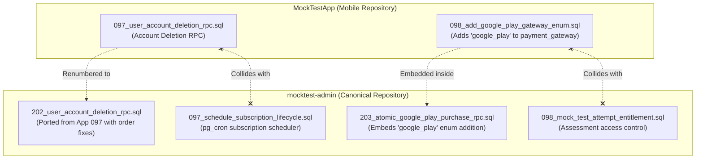
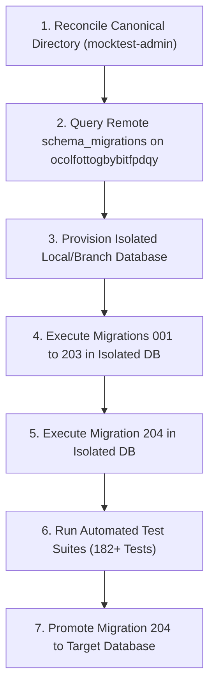

# MAKE ME TOPPER — CROSS-REPOSITORY DATABASE MIGRATION AUDIT
**Comprehensive Technical Audit & Reconciliation Blueprint**  
**Date:** October 19, 2026 | **Execution Mode:** READ-ONLY Investigation  
**Target Migration Under Review:** `204_subscription_grace_parity_and_content_access.sql`  

---

## 1. EXECUTIVE SUMMARY

### 1.1 Overview and Purpose
This read-only technical audit investigates the state, distribution, dependencies, and synchronization of database migrations across the two active Make Me Topper repositories:
1. **Mobile Application Repository:** `C:\Projects\MockTestApp\supabase\migrations`
2. **Website & Admin Repository:** `C:\Projects\mocktest-admin\supabase\migrations`

The primary objective is to establish an authoritative, predictable database migration baseline before executing **Migration 204** (`204_subscription_grace_parity_and_content_access.sql`), which provides Google Play subscription grace parity, access control RPCs, and content access window enforcement.

### 1.2 Core Audit Findings

| Finding Category | Severity | Summary | Evidence Classification |
| :--- | :--- | :--- | :--- |
| **Repository Migration Drift** | **CRITICAL** | `mocktest-admin` contains **211 files** (versions 001 to 204), while `MockTestApp` contains only **86 files** (versions 001 to 098). Migration files diverged drastically after version 035. | **[VERIFIED]** |
| **Numeric Collisions** | **CRITICAL** | **32 migration files** in `MockTestApp` share numeric prefixes (046 to 098) with completely unrelated migrations in `mocktest-admin`. For example, Version 097 is Account Deletion in App, but Subscription Lifecycle Scheduler in Admin; Version 098 is Google Play Gateway Enum in App, but Mock Test Attempt Entitlement in Admin. | **[VERIFIED]** |
| **Migration 204 Prerequisite Feasibility** | **BLOCKER** | Migration 204 depends on **18 tables, 3 custom enum types, 3 helper functions, and 4 previous function signatures**. Key objects (e.g., `batch_subjects`, `batch_subject_recordings`, `is_permanent_course_owner`, `is_student_assigned_to_course_batch`, and columns `grace_days`, `content_access_days`, `content_access_end_date`) exist **ONLY** in `mocktest-admin` (Migrations 066, 073, 084, 085, 091, 096, 203). **Migration 204 CANNOT run against `MockTestApp`.** | **[VERIFIED]** |
| **CLI Project Link Discrepancy** | **HIGH** | Both repositories' application code connects to `https://ocolfottogbybitfpdqy.supabase.co` (`mock-test-app2`). However, `MockTestApp\supabase\.temp\linked-project.json` is linked to an external, unrelated project (`wfovneedmwetxnzhhobh`, `kashi-veda-dev`). Running CLI commands in `MockTestApp` targets the wrong project entirely. | **[VERIFIED]** |
| **Irregular Migration Files in Admin** | **MEDIUM** | `mocktest-admin` contains non-standard files: two `.txt` migration files (`Migration_175_...txt` and `Migration181_...txt`), three identical duplicate file pairs (183, 184, 185), and an ad-hoc single-user data repair script (`reconcile_acknowledged_google_play_subscription.sql`). | **[VERIFIED]** |
| **Historical Deployment Practice** | **HIGH** | Repository documentation confirms migrations were historically deployed via both `supabase db push` and **direct copy-paste execution into the Supabase Dashboard SQL Editor**. Manual Dashboard executions bypass the CLI's `supabase_migrations.schema_migrations` tracking table. | **[VERIFIED]** |
| **Staging Environment Status** | **HIGH** | No staging database is linked or configured in either repository. The only configured remote instance is production/active testing (`ocolfottogbybitfpdqy`). | **[VERIFIED]** |

---

## 2. COMPLETE TWO-REPOSITORY MIGRATION INVENTORY

### 2.1 File Count and Top-Level Statistics
- **Total Migration Files in `mocktest-admin`:** 211 files (208 `.sql` files, 2 `.txt` files, 1 ad-hoc patch file).
- **Total Migration Files in `MockTestApp`:** 86 files (all `.sql`).
- **Highest Version in `mocktest-admin`:** Version 204.
- **Highest Version in `MockTestApp`:** Version 098.
- **Byte-for-byte identical files across repos:** 31 files.
- **Files with identical name & version but divergent content:** 1 file (`034_domain_16_course_enrollments.sql`).
- **Files originating in App and ported to higher versions in Admin:** 22 files.
- **Files in App colliding on version numbers with unrelated Admin features:** 32 files.
- **Unique numeric versions in Admin not present in App:** 115 versions (026–030, 037–039, 041–045, 099–204).

---

### 2.2 Complete Sequential Migration Inventory (Versions 001 to 204)

The table below catalogs every migration version across both repositories, indicating its filename in `mocktest-admin` and `MockTestApp`, repository residence, content relationship, and key prerequisite dependencies.

| Version | `mocktest-admin` Filename | `MockTestApp` Filename | Repository Presence | Content Relationship | Schema Objects / Prerequisites |
| :--- | :--- | :--- | :--- | :--- | :--- |
| **001** | `001_profiles_policies.sql` | `001_profiles_policies.sql` | Both | Identical (SHA256 Match) | Base profiles table RLS policies, `handle_new_user` trigger |
| **002** | `002_domain_01_foundation.sql` | `002_domain_01_foundation.sql` | Both | Identical (SHA256 Match) | Core enums (`payment_gateway`, `payment_status`), `student_details`, `teacher_details` |
| **003** | `003_domain_02_academic_structure.sql` | `003_domain_02_academic_structure.sql` | Both | Identical (SHA256 Match) | `courses`, `batches`, `batch_students`, `subjects`, `chapters`, `topics` |
| **004** | `004_domain_03_content_management.sql` | `004_domain_03_content_management.sql` | Both | Identical (SHA256 Match) | `course_contents`, content hierarchy, study material metadata |
| **005** | `005_domain_04_live_learning.sql` | `005_domain_04_live_learning.sql` | Both | Identical (SHA256 Match) | Base `live_classes`, session management, base `recordings` table |
| **006** | `006_domain_05_assessment.sql` | `006_domain_05_assessment.sql` | Both | Identical (SHA256 Match) | `mock_tests`, `questions`, `mock_attempts`, `mock_answers` |
| **007** | `007_domain_06_pyq.sql` | `007_domain_06_pyq.sql` | Both | Identical (SHA256 Match) | Previous Year Questions (`pyq_papers`, `student_pyq_purchases`) |
| **008** | `008_domain_07_commerce.sql` | `008_domain_07_commerce.sql` | Both | Identical (SHA256 Match) | `orders`, `order_items`, `payments`, `invoices`, `currency_code` enum |
| **009** | `009_domain_08_analytics.sql` | `009_domain_08_analytics.sql` | Both | Identical (SHA256 Match) | Performance analytics schemas, aggregated metrics tables |
| **010** | `010_domain_09_communication.sql` | `010_domain_09_communication.sql` | Both | Identical (SHA256 Match) | Notifications, announcements, broadcast dispatch tables |
| **011** | `011_domain_10_administration.sql` | `011_domain_10_administration.sql` | Both | Identical (SHA256 Match) | `institutes`, `system_settings`, institute-level tenant separation |
| **012** | `012_domain_11_subscription_access_control.sql` | `012_domain_11_subscription_access_control.sql` | Both | Identical (SHA256 Match) | `subscription_plans`, `student_subscriptions`, access check foundations |
| **013** | `013_domain_12_file_media_management.sql` | `013_domain_12_file_media_management.sql` | Both | Identical (SHA256 Match) | Supabase storage bucket references, media object policies |
| **014** | `014_domain_13_audit_logging.sql` | `014_domain_13_audit_logging.sql` | Both | Identical (SHA256 Match) | System audit trails, mutation logging |
| **015** | `015_domain_14_student_services.sql` | `015_domain_14_student_services.sql` | Both | Identical (SHA256 Match) | Student profile self-service APIs and triggers |
| **016** | `016_domain_15_infrastructure.sql` | `016_domain_15_infrastructure.sql` | Both | Identical (SHA256 Match) | Helper utility functions, database extensions, search_path defaults |
| **017** | `017_domain_03_fix_content_type_check.sql` | `017_domain_03_fix_content_type_check.sql` | Both | Identical (SHA256 Match) | Fix content type constraint on course materials |
| **018–020** | *(Missing / Numbering Gap)* | *(Missing / Numbering Gap)* | Neither | Gap | **Gap in both repositories** (historical skip) |
| **021** | `021_rls_policies.sql` | `021_rls_policies.sql` | Both | Identical (SHA256 Match) | Core security definer helper `get_my_student_id()`, institute checks |
| **022** | `022_storage_configuration.sql` | `022_storage_configuration.sql` | Both | Identical (SHA256 Match) | Supabase Storage bucket configurations and security policies |
| **023** | `023_question_option_images.sql`, `023_seed_data.sql` | `023_seed_data.sql` | Both | Admin has 2 files; 023_seed is identical | Admin adds question option images DDL; seed data identical |
| **024** | `024_phone_first_auth.sql`, `024_storage_rls_question_images.sql` | `024_phone_first_auth.sql` | Both | Admin has 2 files; 024_phone is identical | Admin adds storage RLS for question images; auth identical |
| **025** | `025_enable_pgcrypto.sql` | `025_enable_pgcrypto.sql` | Both | Identical (SHA256 Match) | Enables pgcrypto extension |
| **026–030** | `026_account_status_lifecycle.sql` through `030_content_access_logging.sql` | *(Missing in App)* | Admin Only | Admin Only (5 migrations) | Account lifecycle, user status, storage RLS, admin policies |
| **031** | `031_batch_mock_tests.sql`, `031_fix_mock_tests_published_at_constraint.sql` | *(Missing in App)* | Admin Only | Admin Only (2 files) | Batch mock tests relationship and constraint repair |
| **032** | `032_domain_16_course_purchases.sql` | `032_domain_16_course_purchases.sql` | Both | Identical (SHA256 Match) | Direct course purchase commerce linkage |
| **033** | `033_domain_16_course_relationships.sql` | `033_domain_16_course_relationships.sql` | Both | Identical (SHA256 Match) | `course_batches`, `course_teachers`, batch mapping |
| **034** | `034_domain_16_course_enrollments.sql` | `034_domain_16_course_enrollments.sql` | Both | **CONTENT DIVERGENCE** | Creates `course_enrollments`. **Admin version adds `is_student_enrolled_in_course()`** to prevent RLS recursion; App version lacks this helper. |
| **035** | `035_fix_question_images_storage_rls.sql`, `035_mock_test_result_release.sql` | `035_fix_question_images_storage_rls.sql` | Both | Admin has 2 files; 035_fix is identical | Admin has result release workflow; storage fix identical |
| **036** | `036_student_dashboard_summary_rpc.sql` | `036_add_guardian_fields_to_student_details.sql` | Both | **VERSION COLLISION** | Admin: dashboard summary RPC. App: guardian fields (in Admin as **Migration 040** with identical SHA256). |
| **037–040** | `037_student_subject_chapter_analytics_rpcs.sql` through `040_add_guardian_fields_to_student_details.sql` | *(Missing in App)* | Admin Only | Admin Only (4 migrations) | Analytics RPCs, test submissions, guardian fields |
| **041–045** | `041_create_student_after_purchase_rpc.sql` through `045_add_user_role_to_enum.sql` | *(Missing in App)* | Admin Only | Admin Only (5 migrations) | Commerce checkout fulfillment, guest checkout, user role enum |
| **046** | `046_set_default_role_to_user.sql` | `046_add_courses_read_policy_for_user_role.sql` | Both | **VERSION COLLISION** | Admin: sets default role to user. App: course read policy for user role. |
| **047** | `047_add_commerce_notification_types.sql` | `047_device_tokens.sql` | Both | **VERSION COLLISION** | Admin: notification types. App: device tokens (in Admin as **Migration 048**). |
| **048** | `048_device_tokens.sql` | `048_initialize_mock_attempt_rpc.sql` | Both | **VERSION COLLISION** | Admin: device tokens. App: initialize mock attempt RPC. |
| **049** | `049_add_room_name_to_live_classes.sql` | `049_add_last_question_id_to_mock_attempts.sql` | Both | **VERSION COLLISION** | Admin: room name for live classes. App: last question ID in mock attempts. |
| **050** | `050_add_live_class_batch_teacher_policies.sql` | `050_add_last_activity_at_to_mock_attempts.sql` | Both | **VERSION COLLISION** | Admin: live class teacher policies. App: last activity timestamp in attempts. |
| **051** | `051_fix_live_class_batch_rls_recursion.sql` | `051_update_initialize_mock_attempt_timer_recovery.sql` | Both | **VERSION COLLISION** | Admin: live class recursion fix. App: timer recovery in mock attempt. |
| **052** | `052_debug_live_class_rls.sql` | `052_set_last_activity_at_trigger.sql`, `052_student_analytics_rpcs.sql` | Both | **VERSION COLLISION** | Admin: debug RLS. App has 2 files: activity trigger & student analytics RPCs. |
| **053** | `053_live_class_attendance.sql` | `053_live_class_phase_0.sql` | Both | **VERSION COLLISION** | Admin: attendance schema. App: live class phase 0. |
| **054** | `054_add_mock_test_assigned_notification_type.sql` | `054_fix_live_class_rls_recursion.sql` | Both | **VERSION COLLISION** | Admin: notification type. App: live class recursion fix. |
| **055** | `055_add_live_class_started_notification_type.sql` | `055_add_live_sessions_insert_policy.sql` | Both | **VERSION COLLISION** | Admin: notification type. App: live sessions insert policy. |
| **056** | `056_batch_contents.sql` | `056_add_student_batch_teacher_rls_policies.sql` | Both | **VERSION COLLISION** | Admin: batch contents table. App: batch teacher RLS policies. |
| **057** | `057_create_pyq_pdfs_bucket.sql` | `057_fix_rls_recursion.sql` | Both | **VERSION COLLISION** | Admin: storage bucket. App: RLS recursion fix. |
| **058** | `058_fix_pyq_pdfs_select_policy.sql` | `058_add_teacher_details_student_read_policy.sql` | Both | **VERSION COLLISION** | Admin: storage select policy. App: teacher details read policy. |
| **059** | `059_fix_overall_accuracy_and_add_average_percentage.sql` | `059_add_live_class_batch_student_read_policy.sql` | Both | **VERSION COLLISION** | Admin: accuracy calculation fix. App: batch student read policy. |
| **060** | `060_add_teacher_subject_insert_policy.sql` | `060_live_chat_module.sql` | Both | **VERSION COLLISION** | Admin: teacher subject insert policy. App: live chat tables (`conversations`, `messages`). |
| **061** | `061_add_teacher_chapter_insert_policy.sql` | `061_live_chat_rpc_get_or_create_conversation.sql` | Both | **VERSION COLLISION** | Admin: teacher chapter policy. App: live chat RPC. |
| **062** | `062_add_teacher_topic_insert_policy.sql` | `062_fix_content_pdfs_storage_rls.sql` | Both | **VERSION COLLISION** | Admin: teacher topic policy. App: PDF storage RLS. |
| **063** | `063_fix_content_type_specific_check.sql` | `063_student_selected_stream.sql` | Both | **VERSION COLLISION** | Admin: content constraint fix. App: student selected stream. |
| **064** | `064_add_teacher_stream_insert_policy.sql` | `064_profiles_selected_stream.sql` | Both | **VERSION COLLISION** | Admin: stream insert policy. App: profiles selected stream. |
| **065** | `065_create_recordings_table.sql` | `065_grant_profiles_email_update.sql` | Both | **VERSION COLLISION** | Admin: creates dedicated `recordings` table. App: profiles email update grant. |
| **066** | `066_domain_17_batch_subject_core.sql` | `066_register_device_token_rpc.sql` | Both | **VERSION COLLISION** | **Admin: creates `batch_subjects` table (PREREQUISITE FOR 204)**. App: register device token. |
| **067** | `067_authorize_live_class_access_rpc.sql`, `067_domain_17_batch_subject_teachers.sql` | `067_authorize_live_class_access_rpc.sql` | Both | Admin has 2 files; 067_auth is identical | Admin adds batch subject teachers; live class auth RPC identical. |
| **068** | `068_domain_17_batch_subject_content.sql` | `068_add_test_filter_to_student_subject_analytics.sql` | Both | **VERSION COLLISION** | Admin: batch subject content. App: test filter for analytics. |
| **069** | `069_domain_17_batch_subject_mock_tests.sql` | `069_filter_weak_and_strong_chapters_by_accuracy.sql` | Both | **VERSION COLLISION** | Admin: batch subject mock tests. App: weak/strong chapters filter. |
| **070** | `070_domain_17_batch_subject_live_classes.sql` | `070_submit_and_evaluate_mock_attempt_rpc.sql` | Both | **VERSION COLLISION** | Admin: batch subject live classes. App: submit & evaluate mock attempt (ported to Admin 161). |
| **071** | `071_add_teacher_rls_batch_subject_live_classes.sql` | `071_update_submit_and_evaluate_mock_attempt_rpc.sql` | Both | **VERSION COLLISION** | Admin: live class teacher RLS. App: submit & evaluate mock attempt update. |
| **072** | `072_fix_recordings_class_id_source_type.sql` | `072_persist_mock_answer_live_rpc.sql` | Both | **VERSION COLLISION** | Admin: recordings class_id fix. App: live answer persistence RPC. |
| **073** | `073_domain_17_batch_subject_recordings.sql` | `073_align_persist_mock_answer_live_lock_order.sql` | Both | **VERSION COLLISION** | **Admin: creates `batch_subject_recordings` (PREREQUISITE FOR 204)**. App: lock order alignment. |
| **074** | `074_domain_18_admin_roles.sql` | `074_get_course_batch_subject_ids_rpc.sql` | Both | **VERSION COLLISION** | Admin: admin roles infrastructure. App: course batch subject IDs helper. |
| **075** | `075_approval_rls_rbac.sql` | `075_optimize_mock_attempt_initialization_and_answers.sql` | Both | **VERSION COLLISION** | Admin: approval RLS. App: mock attempt optimization (in Admin as **Migration 150**). |
| **076** | `076_audit_infrastructure.sql` | `076_add_question_times_to_submit_and_evaluate_rpc.sql` | Both | **VERSION COLLISION** | Admin: audit infrastructure. App: question times in submit RPC (in Admin as **Migration 151**). |
| **077** | `077_trusted_devices.sql` | `077_get_home_screen_bootstrap_rpc.sql` | Both | **VERSION COLLISION** | Admin: trusted devices schema. App: home screen bootstrap (in Admin as **Migration 152**). |
| **078** | `078_trusted_device_approval_fixes.sql` | `078_optimize_persist_mock_answer_live_rpc.sql` | Both | **VERSION COLLISION** | Admin: device approval fixes. App: optimize live answer persistence. |
| **079** | `079_trusted_device_fingerprint_lookup.sql` | `079_add_image_metadata_and_profile.sql` | Both | **VERSION COLLISION** | Admin: device fingerprint lookup. App: image metadata (in Admin as **Migration 153**). |
| **080** | `080_soft_delete_foundation.sql` | `080_create_public_catalog_rpc.sql` | Both | **VERSION COLLISION** | Admin: soft delete foundation. App: public catalog RPC. |
| **081** | `081_pyq_ownership_foundation.sql` | `081_create_persist_mock_answers_batch_rpc.sql` | Both | **VERSION COLLISION** | Admin: PYQ ownership foundation. App: batch answer persistence RPC. |
| **082** | `082_teacher_batch_student_rls_fix.sql` | `082_update_get_home_screen_bootstrap_rpc.sql` | Both | **VERSION COLLISION** | Admin: teacher student RLS fix. App: bootstrap RPC update (in Admin as **Migration 154**). |
| **083** | `083_teacher_results_batch_visibility.sql` | `083_get_courses_content_summary_rpc.sql` | Both | **VERSION COLLISION** | Admin: batch results visibility. App: course content summary (in Admin as **Migration 155**). |
| **084** | `084_add_subscription_content_access_window.sql` | `084_harden_handle_new_user_public_role.sql` | Both | **VERSION COLLISION** | **Admin: adds `content_access_end_date` (PREREQUISITE FOR 204)**. App: harden handle_new_user (in Admin as **156**). |
| **085** | `085_seed_subscription_plans_and_settings.sql` | `085_align_student_analytics_to_released_results.sql` | Both | **VERSION COLLISION** | **Admin: adds `grace_days` & `content_access_days` (PREREQUISITE FOR 204)**. App: analytics alignment (in Admin as **159**). |
| **086** | `086_unique_active_grace_subscription.sql` | `086_optimize_submit_and_evaluate_mock_attempt_rpc.sql` | Both | **VERSION COLLISION** | Admin: unique active subscription index. App: submit RPC optimization (in Admin as **161**). |
| **087** | `087_fix_subscription_history_enum.sql` | `087_recalculate_mock_results_on_release_and_finalize.sql` | Both | **VERSION COLLISION** | Admin: subscription history enum fix. App: results recalculation (in Admin as **162**). |
| **088** | `088_repair_subscription_features_plan_unlocks.sql` | `088_synchronize_subject_and_chapter_analytics_scores.sql` | Both | **VERSION COLLISION** | Admin: plan unlocks repair. App: analytics scores sync (in Admin as **163**). |
| **089** | `089_course_scoped_subscriptions.sql` | `089_add_subjective_count_to_chapter_analytics.sql` | Both | **VERSION COLLISION** | Admin: course-scoped subscriptions. App: subjective count (in Admin as **164**). |
| **090** | `090_course_scoped_subscriptions_phase_2.sql` | `090_fix_validate_active_device_unauthenticated.sql` | Both | **VERSION COLLISION** | Admin: course scoped subscriptions phase 2. App: device validation fix. |
| **091** | `091_unified_course_entitlement_helpers.sql` | `091_two_slot_device_sessions.sql` | Both | **VERSION COLLISION** | **Admin: creates `can_student_access_content()` & `is_student_assigned_to_course_batch()` (PREREQUISITES FOR 204)**. App: two-slot device sessions (in Admin as **186**). |
| **092** | `092_student_course_batches_subscription_rls.sql` | `092_get_student_recording_subjects_rpc.sql` | Both | **VERSION COLLISION** | Admin: batch subscription RLS. App: recording subjects RPC (in Admin as **187**). |
| **093** | `093_batch_subject_access_helpers_policies.sql` | `093_temp_perf_test_harness.sql` | Both | **VERSION COLLISION** | Admin: batch subject access helpers. App: perf test harness (in Admin as **188**). |
| **094** | `094_remove_legacy_course_content_rls.sql` | `094_verify_recording_playback_access_rpc.sql` | Both | **VERSION COLLISION** | Admin: removes legacy RLS. App: verify recording playback RPC (in Admin as **189**). |
| **095** | `095_fix_live_classes_rls_recursion.sql` | `095_get_teacher_lifecycle_counts_rpc.sql` | Both | **VERSION COLLISION** | Admin: live class recursion fix. App: teacher counts RPC (in Admin as **191**). |
| **096** | `096_subscription_entitlement_ownership.sql` | `096_teacher_management_performance_indexes.sql` | Both | **VERSION COLLISION** | **Admin: creates `is_permanent_course_owner()` and refactors access functions (PREREQUISITES FOR 204)**. App: teacher indexes (in Admin as **192**). |
| **097** | `097_schedule_subscription_lifecycle.sql` | `097_user_account_deletion_rpc.sql` | Both | **VERSION COLLISION** | **Admin: pg_cron subscription scheduler. App: user account deletion (in Admin as Migration 202).** |
| **098** | `098_mock_test_attempt_entitlement.sql` | `098_add_google_play_gateway_enum.sql` | Both | **VERSION COLLISION** | **Admin: mock test attempt entitlement. App: adds 'google_play' to enum (in Admin embedded inside Migration 203).** |
| **099–201** | `099_assigned_notes_access_diagnostic.sql` through `201_fix_super_admin_role_rejection_and_policy_loop.sql` | *(Missing in App)* | Admin Only | Admin Only (103 migrations) | Complete admin features: timetable materialization, doubt system, subjective evaluation, lesson plans, R2 storage bucket, device management. |
| **202** | `202_user_account_deletion_rpc.sql` | *(Ported from App 097)* | Admin Only | Ported from App 097 | User account deletion RPC (Section 1 anonymization adjustment). |
| **203** | `203_atomic_google_play_purchase_rpc.sql` | *(Missing in App)* | Admin Only | Admin Only | **CRITICAL PREREQUISITE FOR 204**: Adds 'google_play' enum value; creates atomic RPC `complete_google_play_purchase`. |
| **204** | `204_subscription_grace_parity_and_content_access.sql` | *(Missing in App)* | Admin Only | Admin Only | **TARGET MIGRATION UNDER REVIEW**: Replaces `complete_google_play_purchase`, `can_student_access_content`, `can_student_access_live_course`, `verify_recording_playback_access`. |

---

## 3. MISSING AND DUPLICATE MIGRATION VERSIONS

### 3.1 Versions Present Only in MockTestApp
- **Numerically:** 0 versions. (All version numbers 001 to 098 exist in `mocktest-admin`).
- **Semantically:** **32 unique migration files** exist in `MockTestApp` whose code was never merged into `mocktest-admin` or was modified before being ported. These include:
  1. `046_add_courses_read_policy_for_user_role.sql`
  2. `048_initialize_mock_attempt_rpc.sql`
  3. `049_add_last_question_id_to_mock_attempts.sql`
  4. `050_add_last_activity_at_to_mock_attempts.sql`
  5. `051_update_initialize_mock_attempt_timer_recovery.sql`
  6. `052_set_last_activity_at_trigger.sql`
  7. `052_student_analytics_rpcs.sql`
  8. `053_live_class_phase_0.sql`
  9. `054_fix_live_class_rls_recursion.sql`
  10. `055_add_live_sessions_insert_policy.sql`
  11. `056_add_student_batch_teacher_rls_policies.sql`
  12. `057_fix_rls_recursion.sql`
  13. `058_add_teacher_details_student_read_policy.sql`
  14. `059_add_live_class_batch_student_read_policy.sql`
  15. `060_live_chat_module.sql` (creates `conversations` and `messages` tables)
  16. `061_live_chat_rpc_get_or_create_conversation.sql`
  17. `062_fix_content_pdfs_storage_rls.sql`
  18. `063_student_selected_stream.sql`
  19. `064_profiles_selected_stream.sql`
  20. `065_grant_profiles_email_update.sql`
  21. `066_register_device_token_rpc.sql`
  22. `068_add_test_filter_to_student_subject_analytics.sql`
  23. `069_filter_weak_and_strong_chapters_by_accuracy.sql`
  24. `071_update_submit_and_evaluate_mock_attempt_rpc.sql`
  25. `072_persist_mock_answer_live_rpc.sql` (Live mock answer saving RPC used by `studentTestWebService.ts`)
  26. `073_align_persist_mock_answer_live_lock_order.sql`
  27. `074_get_course_batch_subject_ids_rpc.sql`
  28. `078_optimize_persist_mock_answer_live_rpc.sql`
  29. `080_create_public_catalog_rpc.sql`
  30. `081_create_persist_mock_answers_batch_rpc.sql`
  31. `090_fix_validate_active_device_unauthenticated.sql`
  32. `098_add_google_play_gateway_enum.sql`

### 3.2 Versions Present Only in mocktest-admin
A total of **115 numeric versions** exist exclusively in `mocktest-admin`:
- Versions 026, 027, 028, 029, 030 (Account status lifecycle, RLS policies)
- Versions 037, 038, 039, 040 (Analytics RPCs, guardian fields)
- Versions 041, 042, 043, 044, 045 (Purchase completion, commerce schema, user role enum)
- Versions 099 through 204 (Comprehensive production features: 106 consecutive migrations)

### 3.3 Duplicate Versions Within the SAME Repository

#### In `mocktest-admin` (10 multi-file version numbers):
1. **v023:** `023_question_option_images.sql` AND `023_seed_data.sql`
2. **v024:** `024_phone_first_auth.sql` AND `024_storage_rls_question_images.sql`
3. **v031:** `031_batch_mock_tests.sql` AND `031_fix_mock_tests_published_at_constraint.sql`
4. **v035:** `035_fix_question_images_storage_rls.sql` AND `035_mock_test_result_release.sql`
5. **v067:** `067_authorize_live_class_access_rpc.sql` AND `067_domain_17_batch_subject_teachers.sql`
6. **v128:** `128_add_subjective_question_type.sql` AND `128_fix_bulk_import_questions_timestamp.sql`
7. **v160:** `160_create_evaluate_subjective_answer_rpc.sql` AND `160_fix_pyq_mock_test_attempt_entitlement.sql`
8. **v183:** `183_fix_student_lesson_plan_rls.sql` AND `Migration183_Fix_Student_Lesson_Plan_RLS_Policy_via_Security_Definer_Helper.sql` (100% byte-for-byte identical duplicates)
9. **v184:** `184_fix_recording_rls_teacher_assignment_and_student_access.sql` AND `Migration184_Fix_Recording_RLS_Teacher_Assignment_and_Student_Access.sql` (100% byte-for-byte identical duplicates)
10. **v185:** `185_fix_recording_rls_recursion_and_end_live_class.sql` AND `Migration185_Fix_Recording_RLS_Recursion_and_End_Live_Class.sql` (100% byte-for-byte identical duplicates)

#### In `MockTestApp` (1 multi-file version number):
1. **v052:** `052_set_last_activity_at_trigger.sql` AND `052_student_analytics_rpcs.sql`

### 3.4 Gaps in Numbering
- **`mocktest-admin` Gaps:**
  - Gap 018 to 020 (missing 018, 019, 020) — historical domain gap.
  - Gap 175 — `Migration_175_...txt` has a `.txt` extension and is ignored by the SQL loader.
- **`MockTestApp` Gaps:**
  - Gap 018 to 020 (missing 018, 019, 020).
  - Gap 026 to 030 (missing 026, 027, 028, 029, 030).
  - Gap 037 to 040 (missing 037, 038, 039, 040).
  - Truncated entirely after 098 (missing 099 through 204).

---

## 4. CONFLICTING SQL FILES

### 4.1 Major Semantic Collisions (097 & 098)
The two most severe collisions directly impact payment and account lifecycle:



1. **Collision on Version 097:**
   - **`MockTestApp`:** Defines `delete_user_account_data(p_user_id uuid, p_reassign_admin_id uuid)` (357 lines).
   - **`mocktest-admin`:** Configures pg_cron job `schedule_subscription_lifecycle` targeting edge function URL `https://ocolfottogbybitfpdqy.supabase.co/functions/v1/subscription-lifecycle`.
   - **Resolution in Admin:** The account deletion RPC was moved and renumbered to **Migration 202** (`202_user_account_deletion_rpc.sql`), which added section 1 adjustments for order anonymization.
2. **Collision on Version 098:**
   - **`MockTestApp`:** Executes `ALTER TYPE public.payment_gateway ADD VALUE 'google_play';`.
   - **`mocktest-admin`:** Redefines `initialize_mock_attempt` to enforce subscription/purchase entitlements for assessments.
   - **Resolution in Admin:** Adding `google_play` to `payment_gateway` was incorporated inside **Migration 203** (`203_atomic_google_play_purchase_rpc.sql`) via an idempotent `DO $$` block.

### 4.2 Divergent Content on Same Filename (Version 034)
- **File:** `034_domain_16_course_enrollments.sql`
- **Admin Size:** 18,250 bytes (374 lines).
- **App Size:** 17,507 bytes (350 lines).
- **Divergence:** Lines 273–300 in `mocktest-admin` introduce the security definer function:
  ```sql
  create or replace function public.is_student_enrolled_in_course(p_course_id uuid)
  returns boolean language sql stable security definer set search_path = '' as $$
      select exists (
          select 1 from public.course_enrollments ce
          where ce.course_id = p_course_id
            and ce.student_id = public.get_my_student_id()
            and ce.is_active = true
      );
  $$;
  ```
  This function prevents infinite RLS recursion between `course_teachers` and `course_enrollments`. The `MockTestApp` copy is an obsolete, unpatched version.

### 4.3 Files with Non-Standard Extensions or Formats in Admin
1. **`Migration_175_Fix Student_Batch_Subjects_RPC_Student_Resolver.txt`**:
   - Contains pure SQL defining `public.get_student_batch_subjects`.
   - Because it has a `.txt` extension, Supabase CLI ignores it completely during `db push`.
2. **`Migration181_Fix_Timetable_Recurring_Propagation& Bulk Import Plans.txt`**:
   - Contains SQL for timetable recurring slot propagation.
   - A corresponding `181_fix_timetable_recurring_propagation.sql` exists, but their contents differ in bulk import plans.
3. **`reconcile_acknowledged_google_play_subscription.sql`**:
   - Located directly inside `mocktest-admin\supabase\migrations\`.
   - Contains a hardcoded one-off repair procedure for student profile ID `66d9f563-5180-401e-9adc-193c0f9963c7` and plan `fe232782-d734-40da-b01b-92a9cc27c47c`.
   - **Risk:** If executed as a migration, it performs unintended state changes on a specific user.

---

## 5. DEPENDENCY ANALYSIS FOR MIGRATION 204

### 5.1 Architecture of Migration 204
Migration 204 (`204_subscription_grace_parity_and_content_access.sql`, 976 lines) contains **zero DDL table creation statements**. It is purely an RPC and security definer update that replaces 4 critical access-control functions and grants execute privileges:
1. `public.complete_google_play_purchase`
2. `public.can_student_access_content`
3. `public.can_student_access_live_course`
4. `public.verify_recording_playback_access`

### 5.2 Complete Prerequisite Dependency Table

Every required database object, its origin migration, repository location, and validation status are detailed below:

| Required Object | Object Type | Originating Migration | Repository Location | Present in App? | Depends on 204? | Validation Required |
| :--- | :--- | :--- | :--- | :--- | :--- | :--- |
| `student_details` | Table | 002 | Both (002) | Yes | Yes (student resolution) | Check column `profile_id` exists |
| `system_settings` | Table | 011 | Both (011) | Yes | Yes (reads grace days) | Check key-value pairs accessible |
| `payments` | Table | 008 | Both (008) | Yes | Yes (inserts purchase record) | Verify gateway column type |
| `orders` | Table | 008 | Both (008) | Yes | Yes (inserts completed order) | Verify status and notes |
| `order_items` | Table | 008 | Both (008) | Yes | Yes (inserts order line item) | Verify `subscription_plan_id` FK |
| `invoices` | Table | 008 | Both (008) | Yes | Yes (generates invoice row) | Check `invoice_number` format |
| `course_batches` | Table | 033 | Both (033) | Yes | Yes (live class batch join) | Verify batch mapping |
| `profiles` | Table | 001, 002 | Both (001, 002) | Yes | Yes (identity & audit) | Check student profile join |
| `live_classes` | Table | 005 | Both (005) | Yes | Yes (live access checks) | Verify course & institute FKs |
| `batch_students` | Table | 003 | Both (003) | Yes | Yes (live batch membership) | Check student enrollment check |
| `student_pyq_purchases` | Table | 007 | Both (007) | Yes | Yes (PYQ entitlement check) | Verify purchase ownership |
| `currency_code` | Enum | 008 | Both (008) | Yes | Yes (default 'INR') | Verify enum values |
| `payment_status` | Enum | 002 | Both (002) | Yes | Yes ('completed', 'failed') | Verify enum values |
| `get_my_student_id` | Function | 021 | Both (021) | Yes | Yes (resolves caller identity) | Verify SECURITY DEFINER |
| `course_enrollments` | Table | 034 | Both (divergent 034) | Yes | Yes (inserts course enrollment) | Verify `enrollment_type` column |
| `course_enrollments.enrollment_type` | Column | 034, 096 | Admin (034, 096) | **NO** | Yes (set to 'subscription') | **MISSING in App** |
| `subscription_plans` | Table | 012 | Both (012) | Yes | Yes (resolves duration & price) | Requires columns below |
| `subscription_plans.grace_days` | Column | 085 | Admin (085) | **NO** | Yes (default 7 days) | **MISSING in App** |
| `subscription_plans.content_access_days` | Column | 085 | Admin (085) | **NO** | Yes (default 30 days) | **MISSING in App** |
| `student_subscriptions` | Table | 012 | Both (012) | Yes | Yes (inserts active subscription) | Requires columns below |
| `student_subscriptions.content_access_end_date` | Column | 084 | Admin (084) | **NO** | Yes (date gating) | **MISSING in App** |
| `payment_gateway` ('google_play') | Enum Value | 203 (Admin) / 098 (App) | Split (203 vs 098) | Split | Yes (gateway='google_play') | Enum must contain 'google_play' |
| `batch_subjects` | Table | 066 | Admin Only (066) | **NO** | Yes (recording subject join) | **MISSING in App** |
| `batch_subject_recordings` | Table | 073 | Admin Only (073) | **NO** | Yes (recording verification) | **MISSING in App** |
| `recordings` (extended columns) | Table | 065, 169, 170 | Admin Only (065+) | **NO** | Yes (storage_path, status) | **MISSING in App** |
| `is_student_assigned_to_course_batch` | Function | 091 | Admin Only (091) | **NO** | Yes (live access check) | **MISSING in App** |
| `is_permanent_course_owner` | Function | 096 | Admin Only (096) | **NO** | Yes (permanent bypass) | **MISSING in App** |
| `complete_google_play_purchase` | Function | 203 | Admin Only (203) | **NO** | Yes (replaced by 204) | **MISSING in App** |

---

## 6. CURRENT DATABASE CONFIGURATION FINDINGS

### 6.1 Backend Identity Verification
- **Application URL:** `https://ocolfottogbybitfpdqy.supabase.co`
- **Supabase Project Name:** `mock-test-app2`
- **Project Reference ID:** `ocolfottogbybitfpdqy`
- **Cloud Provider & Region:** AWS, `ap-south-1` (Mumbai, India)
- **Database Engine:** PostgreSQL 17.6.1.127
- **Evidence:** `mocktest-admin\.env.local` and `MockTestApp\src\config\supabase.ts` both target this identical URL. **[VERIFIED]**

### 6.2 CLI Project Link Status
- **`mocktest-admin`:** Correctly linked to `ocolfottogbybitfpdqy` (`mock-test-app2`).
- **`MockTestApp`:** Erroneously linked in `supabase\.temp\linked-project.json` to:
  - **Project Ref:** `wfovneedmwetxnzhhobh`
  - **Project Name:** `kashi-veda-dev`
  - **Region:** `aws-0-ap-northeast-2` (Seoul)
  - **Organization ID:** `tvvkfeynksckythjiqrz`
- **Finding:** Any Supabase CLI command (e.g., `supabase db push`) executed from `C:\Projects\MockTestApp` connects to an entirely different customer project in Seoul, posing severe data contamination risks if executed. **[VERIFIED]**

### 6.3 Staging Project Findings
- Neither repository contains credentials, configuration, or environment files for a staging Supabase instance.
- Only a single production/active testing instance exists (`ocolfottogbybitfpdqy`). **[VERIFIED]**

---

## 7. SOURCE-OF-TRUTH RECOMMENDATION

### 7.1 Authoritative Determination: `mocktest-admin` is the Canonical Source
Based on conclusive technical evidence, **`C:\Projects\mocktest-admin\supabase\migrations` MUST be designated as the sole, canonical migration source of truth.**

**Evidence:**
1. **Completeness:** `mocktest-admin` contains all 204 functional migrations spanning all system domains (01 to 20), whereas `MockTestApp` halted at 096 with isolated ad-hoc commits.
2. **Prerequisite Integrity:** All prerequisite schema objects for Migration 204 (`batch_subjects`, `batch_subject_recordings`, `is_permanent_course_owner`, `is_student_assigned_to_course_batch`, `content_access_end_date`, `grace_days`, `content_access_days`) exist and are actively maintained in `mocktest-admin`.
3. **Correct CLI Linkage:** `mocktest-admin` is linked directly to the true project (`ocolfottogbybitfpdqy`), while `MockTestApp` CLI is mislinked to an external project.
4. **Resolution of Conflicts:** `mocktest-admin` already resolved the Version 097 collision by cleanly porting the mobile account deletion RPC into Migration 202, and resolved Version 098 by embedding the Google Play enum value in Migration 203.

---

## 8. RECOMMENDED TESTING STRATEGY

Because the project is in the testing phase, validating Migration 204 must follow a disciplined, isolated pipeline without running destructive commands on active databases:



### Step 1: Reconcile Canonical Migration Directory
Before executing any tool:
- Rename `Migration_175_Fix Student_Batch_Subjects_RPC_Student_Resolver.txt` to `175_fix_student_batch_subjects_rpc_student_resolver.sql`.
- Standardize `Migration176_...` and `Migration_177_...` to standard 3-digit prefixes (`176_...`, `177_...`).
- Remove identical duplicate files (`Migration183_...`, `Migration184_...`, `Migration185_...`).
- Move `reconcile_acknowledged_google_play_subscription.sql` to a dedicated `scripts/` directory.
- Relocate or assimilate unique mobile RPCs (e.g., `persist_mock_answer_live`) so they are not lost.

### Step 2: Read-Only Audit of Remote `schema_migrations`
Execute a read-only query in the Supabase Dashboard SQL Editor for `ocolfottogbybitfpdqy`:
```sql
SELECT version, inserted_at 
FROM supabase_migrations.schema_migrations 
ORDER BY version ASC;
```
Compare this output with the 204 local files to determine which migrations were recorded by the CLI versus which were applied manually in the SQL Editor.

### Step 3: Isolated Validation in Local / Branch Environment
- **DO NOT run `supabase db reset` against `ocolfottogbybitfpdqy`.**
- Start a local Supabase instance or provision an ephemeral Supabase branch.
- Replay migrations sequentially from 001 up to 203.
- Confirm all tables, enums, and functions compile without errors.
- Apply Migration 204.
- Verify that `complete_google_play_purchase`, `can_student_access_content`, `can_student_access_live_course`, and `verify_recording_playback_access` replace cleanly.

---

## 9. RISKS OF APPLYING MIGRATION 204 BEFORE RECONCILIATION

1. **Catastrophic Failure in `MockTestApp`:** Applying Migration 204 in `MockTestApp` fails immediately because tables `batch_subjects`, `batch_subject_recordings`, and columns `grace_days`, `content_access_days` do not exist in that repo.
2. **Accidental Migration to Foreign Project:** Running `supabase db push` from `MockTestApp` pushes migrations to `kashi-veda-dev` (`wfovneedmwetxnzhhobh`), corrupting an external database.
3. **CLI `schema_migrations` Drift on `mocktest-admin`:** If Migration 203 or earlier migrations were pasted manually into the Supabase Dashboard, `supabase db push` will attempt to re-run them, causing `relation already exists` errors unless migrations are repaired via `supabase migration repair`.
4. **Data Loss via Unintended Reset:** Prescribing `supabase db reset` would destroy existing test student profiles, mock test questions, and live class records in the target environment.

---

## 10. EXACT NEXT STEPS IN THE CORRECT ORDER

| Step | Action | Execution Scope | Risk Level |
| :---: | :--- | :--- | :---: |
| **1** | **Formally declare `mocktest-admin` as the sole canonical database repository.** Cease creating or modifying migration files in `MockTestApp`. | Administrative | None |
| **2** | **Clean up irregular files in `mocktest-admin\supabase\migrations`:**<br>• Rename `Migration_175_...txt` to `175_...sql`<br>• Remove duplicate identical files for 183, 184, 185<br>• Move `reconcile_acknowledged_google_play_subscription.sql` to a maintenance folder | File System (Admin Repo) | None |
| **3** | **Harmonize unique mobile RPCs:** Port required mobile-only RPCs (`persist_mock_answer_live`, `get_public_catalog`, `persist_mock_answers_batch`) into `mocktest-admin` migrations numbered 205+. | File System (Admin Repo) | Low |
| **4** | **Re-link or decouple `MockTestApp` Supabase CLI:** Delete or correct `MockTestApp\supabase\.temp\linked-project.json` to prevent accidental pushes to `kashi-veda-dev`. | Configuration (App Repo) | Low |
| **5** | **Audit remote database migration history:** Run read-only query on `supabase_migrations.schema_migrations` in Supabase Dashboard SQL Editor for `ocolfottogbybitfpdqy`. | Read-Only SQL Query | None |
| **6** | **Repair migration history (if needed):** For any migration already present in PostgreSQL schema but missing from `schema_migrations`, mark as applied using `supabase migration repair --status applied <version>`. | Supabase CLI (Target DB) | Low |
| **7** | **Validate Migration 204 in isolated local/branch DB:** Run migration 204 against an isolated PostgreSQL instance containing schema 001–203. Verify all 4 functions compile without syntax or type errors. | Local / Isolated Sandbox | None |
| **8** | **Apply Migration 204 to `ocolfottogbybitfpdqy`:** Apply via Supabase CLI (`supabase db push`) or Supabase Dashboard SQL Editor after confirming all prerequisites. | Production / Active DB | Medium |
| **9** | **Execute automated regression suites:** Run the 182+ payment, enrollment, and access test suite across admin and app. | Read-Only Test Suite | None |

---

## 11. AUDIT CONCLUSION & SIGN-OFF

- **Can Migration 204 be applied from `MockTestApp`?** **NO [VERIFIED].** `MockTestApp` lacks essential prerequisite tables, columns, and enums.
- **Can Migration 204 be applied from `mocktest-admin`?** **YES, conditionally [VERIFIED].** All 28 required objects exist in `mocktest-admin` migrations 001 through 203. However, before deployment, the remote `schema_migrations` table must be compared with local files to ensure earlier migrations were properly tracked.
- **Canonical Repository:** `C:\Projects\mocktest-admin` **[VERIFIED]**.
