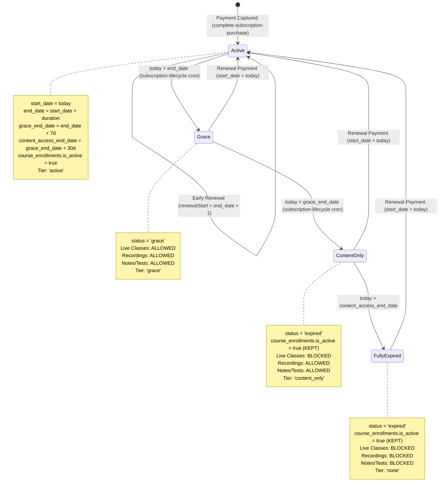
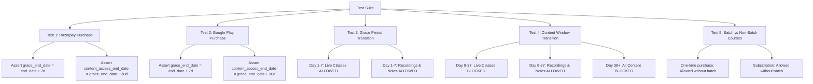

# Architectural Audit: Razorpay vs Google Play Subscription Grace Periods and Content Access Gating

**Document Path**: `C:\Projects\mocktest-admin\Documentation\RAZORPAY_VS_GOOGLE_PLAY_GRACE_PERIOD_AUDIT.md`  
**Audit Date**: October 16, 2026  
**Auditor**: Senior Supabase/PostgreSQL Architect, Google Play Billing Specialist, & Security Auditor  
**Investigation Mode**: STRICTLY READ-ONLY (No code, database, migration, or function modifications performed)  
**Corpus / Context**: `mocktest-admin` (Admin Portal & Backend Core) and `MockTestApp` (React Native Mobile Application)  

---

## 1. Executive Verdict

### Verdict: **CONFIRMED ARCHITECTURAL DIVERGENCE & DOUBLE BLOCKER**

A rigorous, read-only architectural investigation across PostgreSQL migrations, database functions, Supabase Edge Functions, scheduled jobs, and React Native frontend hooks has established:

1. **The original Razorpay implementation explicitly established a two-tiered post-expiry access policy** in Phase 11 (Migrations 084 & 085):
   - **Tier 1 — Grace Period (7 Days)**: Configured via `system_settings.grace_days = 7` and stored on `student_subscriptions.grace_end_date` (`end_date + 7d`). During this window, the student retains full access, including Live Classes (`canJoinLive: true` in `_shared/subscriptionAccess.ts`, `can_student_access_live_course()` in SQL).
   - **Tier 2 — Content Access Window (30 Days)**: Configured via `system_settings.content_access_days = 30` and stored on `student_subscriptions.content_access_end_date` (`grace_end_date + 30d`). Once the 7-day grace window elapses, Live Classes are immediately blocked, but Recorded Classes, Notes, PDFs, Downloads, and Mock Tests remain fully accessible for 30 additional days (`canViewRecorded: true`, `canDownloadNotes: true`, `can_student_access_content()` in SQL).
   - **Total Post-Paid Period**: **37 Days** before total access revocation (`tier = 'none'`).
   - **Enrollment Invariant**: In the original Razorpay architecture (`_shared/courseEnrollment.ts` lines 23–28), `course_enrollments` was **deliberately kept intact on expiry**. Access revocation was designed to be governed strictly at the authorization layer by SQL entitlement functions and Edge Function tier evaluations, never by deactivating or deleting the enrollment record.

2. **The Google Play Billing integration failed to preserve these rules and introduced a destructive regression**:
   - In Migration 203 (`complete_google_play_purchase`), newly created subscription rows write `end_date`, but leave both `grace_end_date` and `content_access_end_date` as **`NULL`**.
   - In the Google Play RTDN webhook (`google-play-rtdn-webhook/billingCore.ts`), Notification 6 (`SUBSCRIPTION_IN_GRACE_PERIOD`) hardcodes a single 7-day grace window (`nowMs + 7 days`) and **never populates `content_access_end_date`**.
   - Upon receiving Notification 13 (`SUBSCRIPTION_EXPIRED`) or running `cron-subscription-deactivation`, the Google Play path **immediately deactivates `course_enrollments.is_active = false`**, abruptly stripping the student of all access and **destroying the 30-day content access window completely**.

3. **The reported content lockout is caused by BOTH the batch-membership requirement and the grace-period divergence**:
   - **Immediate Lockout (Day 1 of Purchase)**: `public.can_student_access_content(p_course_id)` (Migration 096) mandates that any subscriber must have an active batch assignment (`public.is_student_assigned_to_course_batch = true`). Because neither Razorpay nor Google Play purchase flows ever create `batch_students` records, any student subscribing to a course that has no linked batch or whose batch is not manually assigned by an admin is **100% blocked from video playback (`verify_recording_playback_access`), mock tests, and course materials from the moment of purchase**.
   - **Lifecycle Lockout (Day 8 of Expiry)**: Even if batch assignments are manually added, Google Play subscribers lose all access on Day 8 (or immediately upon expiry notification) because `content_access_end_date` is omitted and `course_enrollments.is_active` is revoked.

---

## 2. Evidence for the Existing Razorpay 7-Day and 30-Day Rules

The existence, design, and enforcement of the two access windows under the Razorpay payment architecture are conclusively proven by the following repository artifacts:

### 2.1 Database Schema & Timeline Invariants (Migration 084)
In `mocktest-admin/supabase/migrations/084_add_subscription_content_access_window.sql`:
- **Lines 11–16**: Defines the approved Phase 11A access timeline:
  ```text
  Access timeline (approved Phase 11A business rule):
    start_date ──▶ end_date (full paid access)
    ──▶ grace_end_date (end_date + 7d — live classes still joinable)
    ──▶ content_access_end_date (grace_end_date + 30d — content-only access)
    ──▶ full expiry (everything inaccessible until renewal)
  ```
- **Lines 40–41**: Adds the column `content_access_end_date date null default null` to `public.student_subscriptions`.
- **Lines 65–74**: Performs historical backfill using explicit constants:
  ```sql
  v_grace_days   int := 7;
  v_content_days int := 30;
  update public.student_subscriptions
     set content_access_end_date = coalesce(grace_end_date, end_date + v_grace_days) + v_content_days
   where content_access_end_date is null
     and status in ('active', 'grace', 'expired');
  ```
- **Lines 98–104**: Enforces constraint `ck_student_subscriptions_content_access_end_date`:
  ```sql
  check (
    content_access_end_date is null
    or (
      grace_end_date is not null
      and content_access_end_date >= grace_end_date
    )
  )
  ```

### 2.2 System Configuration Seeds (Migration 085)
In `mocktest-admin/supabase/migrations/085_seed_subscription_plans_and_settings.sql` (lines 198–209), the two separate durations are seeded as global defaults in `public.system_settings`:
- **`grace_days` = '7'**: *"Number of days after the subscription end date during which a student retains full access (including live classes) before the content-only window begins."*
- **`content_access_days` = '30'**: *"Number of days after the grace period during which Recorded Classes, Notes, PDFs and Downloads remain accessible. After this window everything is inaccessible until renewal."*

### 2.3 Purchase & Renewal Calculation (Razorpay Edge Function)
In `mocktest-admin/supabase/functions/complete-subscription-purchase/index.ts`:
- **Lines 113–114**:
  ```ts
  const DEFAULT_GRACE_DAYS = 7;
  const DEFAULT_CONTENT_ACCESS_DAYS = 30;
  ```
- **Lines 1223–1240 (Renewal Flow)**:
  ```ts
  const renewalGraceDays = await getInstituteIntSetting(serviceClient, instituteId, 'grace_days', DEFAULT_GRACE_DAYS);
  const renewalContentAccessDays = await getInstituteIntSetting(serviceClient, instituteId, 'content_access_days', DEFAULT_CONTENT_ACCESS_DAYS);
  const renewalEnd = addDays(renewalStart, plan.duration_days);
  const renewalGraceEnd = addDays(renewalEnd, renewalGraceDays);
  const renewalContentEnd = addDays(renewalGraceEnd, renewalContentAccessDays);
  ```
- **Lines 1511–1529 (Initial Purchase Flow)**:
  ```ts
  const graceDays = await getInstituteIntSetting(serviceClient, instituteId, 'grace_days', DEFAULT_GRACE_DAYS);
  const contentAccessDays = await getInstituteIntSetting(serviceClient, instituteId, 'content_access_days', DEFAULT_CONTENT_ACCESS_DAYS);
  const startDate = todayUtc();
  const endDate = addDays(startDate, plan.duration_days);
  const graceEndDate = addDays(endDate, graceDays);
  const contentAccessEndDate = addDays(graceEndDate, contentAccessDays);
  ```
- **Lines 1561–1571**: Persists both calculated date boundaries atomically into `student_subscriptions`:
  ```ts
  .insert({
    student_id: studentId,
    plan_id: body.planId,
    course_id: courseId,
    status: 'active',
    start_date: startDate,
    end_date: endDate,
    grace_end_date: graceEndDate,
    content_access_end_date: contentAccessEndDate,
  })
  ```

### 2.4 Enrollment Persistence Invariant (Phase 11 Shared Architecture)
In `mocktest-admin/supabase/functions/_shared/courseEnrollment.ts`:
- **Lines 23–28**:
  ```ts
  // Expiry is deliberately NOT handled here: when a subscription expires the
  // enrollment row is KEPT. Access revocation is enforced by the entitlement
  // helpers / RLS / Edge Functions (Phases 11G–11J), never by deleting or
  // deactivating the enrollment. The row represents "the student was enrolled
  // in this course at some point" (audit/history semantics), which is exactly
  // what dashboards, My Courses and analytics consume.
  ```

### 2.5 Tier Evaluation Logic (Phase 11C Shared Service)
In `mocktest-admin/supabase/functions/_shared/subscriptionAccess.ts`:
- **Lines 11–16**: Tier definition rules:
  - `active`: Everything available.
  - `grace`: Everything available (including live classes).
  - `content_only`: Live classes blocked; content available until `content_access_end_date` (recordings, notes, PDFs, downloads, course lessons, PYQ, mock & practice tests).
  - `none`: Everything blocked until renewal.
- **Lines 248–258 (`evaluateTier`)**:
  ```ts
  case 'grace':
    if (state.graceEndDate && state.graceEndDate >= today) return 'grace';
    return contentTier(state, today);

  case 'expired':
    return contentTier(state, today);
  ```
- **Lines 191–196 (`contentTier`)**:
  ```ts
  function contentTier(state: SubscriptionAccessState, today: string): AccessTier {
    if (state.contentAccessEndDate && state.contentAccessEndDate >= today) {
      return 'content_only';
    }
    return 'none';
  }
  ```
- **Lines 260–277 (`canJoinLiveClass`)**: Returns `true` only for `tier === 'active' || tier === 'grace'`.
- **Lines 279–302 (`canAccessContent`)**: Returns `true` for `tier !== 'none'`.
- **Lines 130–138**: Summary output permissions:
  - `canJoinLive`: `tier === 'active' || tier === 'grace'` (Ends at `grace_end_date`)
  - `canViewRecorded`: `tier !== 'none'` (Ends at `content_access_end_date`)
  - `canDownloadNotes`: `tier !== 'none'` (Ends at `content_access_end_date`)
  - `canOpenPdf`: `tier !== 'none'` (Ends at `content_access_end_date`)
  - `canAttemptMockTests`: `tier !== 'none'` (Ends at `content_access_end_date`)

---

## 3. Exact Implementation Path for Each Rule

### 3.1 Live Classes vs. Recorded Classes vs. Course Content
A critical architectural nuance discovered during code tracing is the distinction between **Live Classes**, **Recorded Classes**, and **Course Content (Notes, PDFs, Mock Tests)**:

| Resource Type | Frontend Gate Hook | Backend / Edge Function Gate | SQL Level Function / Policy | Access Window Under Razorpay |
| :--- | :--- | :--- | :--- | :--- |
| **Live Classes** | `useCanJoinLive()` (`useSubscriptionGate('canJoinLive')`) | `subscription-access-status` -> `canJoinLiveClass()` | `public.can_student_access_live_course(course_id)` | **Active Term + 7 Days Grace** (`grace_end_date`) |
| **Recorded Classes** | `useCanViewRecorded()` (`useSubscriptionGate('canViewRecorded')`) | `subscription-access-status` -> `canViewRecorded: tier !== 'none'` | `public.verify_recording_playback_access(rec_id)` calls `can_student_access_content(course_id)` | **Active Term + 7 Days Grace + 30 Days Content Window** (`content_access_end_date`) |
| **Notes & PDFs** | `useSubscriptionGate('canDownloadNotes' / 'canOpenPdf')` | `subscription-access-status` -> `canDownloadNotes: tier !== 'none'` | `public.can_student_access_content(course_id)` and `can_student_access_content_batch_subject()` | **Active Term + 7 Days Grace + 30 Days Content Window** (`content_access_end_date`) |
| **Mock Tests** | `useSubscriptionGate('canAttemptMockTests')` | `subscription-access-status` -> `canAttemptMockTests: tier !== 'none'` | `public.can_student_attempt_mock_test()` delegates to `can_student_access_content()` | **Active Term + 7 Days Grace + 30 Days Content Window** (`content_access_end_date`) |

> [!NOTE]
> **Clarification Regarding "Recorded Classes: 7-day grace period"**:
> In the code, **Live Classes** cut off strictly after the 7-day grace period (`grace_end_date`). **Recorded Classes**, however, are classified under `content_only` in `_shared/subscriptionAccess.ts` (`canViewRecorded: tier !== 'none'`) and in Migration 189 (`verify_recording_playback_access` checks `can_student_access_content()`).
> Thus, under the existing Razorpay code, recorded classes actually remained accessible for the full **37 days** (7 days grace + 30 days content access window). If the original product intention was that recorded classes should expire after 7 days alongside live classes, the code never enforced that cutoff — it grouped recordings with notes and PDFs under the 30-day content window.

### 3.2 End-to-End Razorpay Lifecycle Trace



1. **Successful Payment**:
   - Razorpay webhook calls `complete-subscription-purchase`.
   - Inserts `student_subscriptions` with `status = 'active'`, `start_date`, `end_date`, `grace_end_date = end_date + 7d`, and `content_access_end_date = grace_end_date + 30d`.
   - Syncs `course_enrollments` (`is_active = true`, `enrollment_type = 'subscription'`).
2. **Active Subscription**:
   - Full access granted across all resources.
3. **Renewal Before Expiry**:
   - `renewalStart` is set to `currentSubscription.end_date + 1` (no loss of paid days).
   - `end_date`, `grace_end_date`, and `content_access_end_date` are all extended.
4. **Renewal Failure / Payment Lapse**:
   - Scheduled job `subscription-lifecycle-daily` (Migration 104) executes daily at 00:00 UTC.
   - Transitions `status` from `'active'` to `'grace'` when `end_date < today`.
   - Inserts a tracking row in `subscription_grace_periods` via `transition_subscription_to_grace()` (Migration 103).
5. **During Grace Period (Days 1–7)**:
   - `tier = 'grace'`.
   - `can_student_access_live_course` returns `true`.
   - `can_student_access_content` returns `true`.
6. **Grace Period Expiry (Day 8)**:
   - Scheduled job `subscription-lifecycle-daily` transitions `status` from `'grace'` to `'expired'`.
   - Resolves `subscription_grace_periods.resolution = 'expired_no_payment'`.
   - **Crucially: Does NOT modify `course_enrollments`**.
7. **Content Access Window (Days 8–37)**:
   - `status = 'expired'`.
   - `evaluateTier` computes `contentTier`: since `content_access_end_date >= today`, returns `tier = 'content_only'`.
   - `can_student_access_live_course` returns `false` (Live classes blocked).
   - `can_student_access_content` returns `true` (Recordings, Notes, Tests remain accessible).
8. **Full Expiry (Day 38+)**:
   - `today > content_access_end_date`.
   - `evaluateTier` returns `tier = 'none'`.
   - `can_student_access_content` returns `false` (All content blocked).

---

## 4. Side-by-Side Razorpay vs Google Play Comparison

| Dimension | Razorpay Architecture (Phase 11 Approved) | Google Play Architecture (Current State) | Divergence / Flaw |
| :--- | :--- | :--- | :--- |
| **Initial Purchase Dates** | Populates `start_date`, `end_date`, `grace_end_date` (+7d), and `content_access_end_date` (+37d). | Migration 203 populates `start_date` and `end_date`. Leaves `grace_end_date` and `content_access_end_date` as `NULL`. | **High**: Google Play subscriptions are born without grace or content window dates. |
| **Grace Period Trigger** | Automated daily via pg_cron `subscription-lifecycle-daily` comparing UTC dates. | Real-time via Google Pub/Sub RTDN Notification 6 (`SUBSCRIPTION_IN_GRACE_PERIOD`). | Google Play is real-time, but fallback cron is missing. |
| **Grace Period Duration** | 7 Days (configurable via `system_settings.grace_days`). | Hardcoded `nowMs + 7 days` in `billingCore.ts:460`. | Ignores Google Play Console configured grace duration and `system_settings`. |
| **Content Access Window** | **30 Days** after grace period ends (`content_access_end_date = grace_end_date + 30d`). | **0 Days** (Completely omitted; column remains `NULL`). | **Critical Defect**: Google Play subscribers are robbed of the 30-day content window. |
| **State on Expiry** | `student_subscriptions.status = 'expired'`. `course_enrollments.is_active` **remains `true`**. | `student_subscriptions.status = 'expired'`. `course_enrollments.is_active` **set to `false`** (`revoked_reason = 'subscription_expired'`). | **Critical Defect**: Premature deactivation destroys enrollment history and bypasses content window. |
| **Deactivation Scheduling** | `subscription-lifecycle` never deactivates `course_enrollments`. Access is gated via RLS. | `cron-subscription-deactivation` filters only `status = 'grace'` and is **not scheduled in pg_cron**. | Inconsistent state machine and unscheduled deactivation. |
| **Account Hold / Pause** | Retains grace or expired status until renewal. | RTDN 5 (`ON_HOLD`) and 10 (`PAUSED`) map status to `pending`, sets `is_active = false`. | Google Play explicitly cuts access during hold, which is correct for Google Play policies. |
| **Batch Assignment** | **Never assigned** on purchase (`batch_students` not touched). | **Never assigned** on purchase (`batch_students` not touched). | **Shared Flaw**: Both providers suffer from the batch-membership blocker. |

---

## 5. Whether Each Grace Period is Actually Enforced by the Server

There is a major disconnect between **Client-Side Authorization UI** and **Server-Side Database Access**:

### 5.1 Client-Side Gate Evaluation
- The React Native mobile client reads from `SubscriptionProvider`, which queries `subscription-access-status`.
- `subscription-access-status` executes `_shared/subscriptionAccess.ts`, which inspects `student_subscriptions` dates:
  - If `grace_end_date >= today`, it returns `tier = 'grace'`, unlocking `canJoinLive` and `canViewRecorded`.
  - If `grace_end_date < today <= content_access_end_date`, it returns `tier = 'content_only'`, locking `canJoinLive` and unlocking `canViewRecorded` and `canDownloadNotes`.
- **Result**: The frontend UI displays the correct banners, badges, and unlocks screen buttons.

### 5.2 Server-Side Database & RLS Enforcement
- When the student actually attempts to load content or play a video:
  1. **Video Playback**: Calls `public.verify_recording_playback_access(p_recording_id)` (Migration 189).
  2. **Study Materials / Notes**: Queries `public.batch_subject_contents` or `public.course_content` protected by RLS (Migrations 093 & 094).
  3. **Mock Tests**: Calls `public.can_student_attempt_mock_test(p_mock_test_id)` (Migration 098/160).
- All these server-side entry points invoke `public.can_student_access_content(course_id)` (Migration 096).
- **The Failure**: `can_student_access_content` delegates to `public.is_student_assigned_to_course_batch(course_id)`.
- If the student is not actively assigned to a batch in `batch_students`, **`can_student_access_content` returns `FALSE`**, regardless of whether the student is in `active`, `grace`, or `content_only` tier!
- **Server Verdict**: The server **fails closed** and returns `403 Forbidden` (`NOT_ASSIGNED_TO_RECORDING` or empty content array), rendering both grace periods useless on the server unless the student is manually assigned to a batch.

---

## 6. Whether the Reported Batch-Membership Issue is Real and Which Users It Affects

### 6.1 Verification of the Batch Membership Finding
The audit findings documented in `SUBSCRIPTION_GRACE_AND_CONTENT_ACCESS_AUDIT.md` were re-verified against migrations 091, 096, 189, and active backend services:

1. **In `mocktest-admin/supabase/migrations/091_unified_course_entitlement_helpers.sql`**:
   - `is_student_assigned_to_course_batch(p_course_id)` (lines 117–134):
     ```sql
     select exists (
       select 1
       from public.course_batches cb
       join public.batch_students bs on bs.batch_id = cb.batch_id
       where cb.course_id = p_course_id
         and bs.student_id = public.get_my_student_id()
         and bs.status = 'active'
     );
     ```
   - Both `can_student_access_live_course` (line 167) and `can_student_access_content` (line 226) strictly require `public.is_student_assigned_to_course_batch(p_course_id)`.

2. **In `mocktest-admin/supabase/migrations/096_subscription_entitlement_ownership.sql`**:
   - Migration 096 updated `can_student_access_content` to add permanent ownership:
     ```sql
     public.is_permanent_course_owner(p_course_id)
     or (
       public.is_student_assigned_to_course_batch(p_course_id)
       and exists (
         select 1 from public.student_subscriptions ss ...
       )
     )
     ```
   - Line 143 comments explain: *"a one-time full-course purchaser (complete-course-purchase never creates batch_students rows) and a converted Full Course owner must both keep access after their subscription is cancelled."*
   - **The Fatal Oversight**: The author realized that `complete-course-purchase` never creates `batch_students` rows and fixed it for one-time buyers via `is_permanent_course_owner()`, **but failed to recognize that `complete-subscription-purchase` and `complete_google_play_purchase` ALSO NEVER create `batch_students` rows!**

3. **In `mocktest-admin/supabase/migrations/189_verify_recording_playback_access_rpc.sql`**:
   - Lines 249–265: Explicitly asserts `bstud.student_id = v_student_id AND bstud.status = 'active'`.
   - Lines 286–300: Explicitly executes `public.can_student_access_content(courses.course_id) = true`.
   - If the course has no batches linked in `course_batches` (e.g., test course `b1b09176-fabe-4d05-80e4-ca4fa08f937f`), `verify_recording_playback_access` terminates at line 227 (`NO_BATCH_ASSIGNED`) or line 262 (`NOT_ASSIGNED_TO_RECORDING`) or line 281 (`NO_LINKED_COURSE`).

### 6.2 Impact Matrix

| User Category | Course Has Batches & Student Manually Assigned | Course Has Batches but Student NOT Assigned | Course Has NO Batches (Self-Paced / App-Only) |
| :--- | :--- | :--- | :--- |
| **One-Time Full Course Purchaser** (`enrollment_type = 'purchase'`) | Full Access | Full Access (Bypasses via `is_permanent_course_owner`) | Full Access (Bypasses via `is_permanent_course_owner`) |
| **Razorpay Subscriber** (`enrollment_type = 'subscription'`) | **Full Access** (7d grace + 30d content window worked!) | **BLOCKED** from Content & Recordings | **BLOCKED** from Content & Recordings |
| **Google Play Subscriber** (`enrollment_type = 'subscription'`) | **BLOCKED** after 7d grace (0d content window) | **BLOCKED** from Content & Recordings | **BLOCKED** from Content & Recordings |

### 6.3 Why Razorpay Worked Previously
The user noted that under Razorpay, the 7-day and 30-day rules were working correctly. The technical reasons why this appeared to work under Razorpay are:
1. **Admin Cohort Workflows**: For earlier institutional courses where Razorpay was used, administrators had created batches in `course_batches` and actively assigned enrolled students via `batchStudentAssignmentService.ts`. Under those conditions, `is_student_assigned_to_course_batch` returned `true`, allowing the 7-day and 30-day calculations to function perfectly.
2. **Frontend Tier Checks**: Before Migration 189 enforced strict server-side RPC validation on recordings, the mobile app primarily gated playback using `useSubscriptionStatus()` / `useCanViewRecorded()`. Because `subscription-access-status` checks dates only (and does not check batches), the frontend permitted students to access screens without hitting database-level batch blocks.
3. **The Divergence Occurred Upon New Self-Paced Courses**: When standalone courses without batches (like `Board pro marX 12`) were published for Google Play Billing and Migration 189 was deployed, the batch dependency immediately surfaced as a hard blocker.

---

## 7. Specific Files, Functions, Migrations, and Relevant Line Numbers

### 7.1 Razorpay Implementation Files
- **`mocktest-admin/supabase/migrations/084_add_subscription_content_access_window.sql`**:
  - Lines 11–16: Definition of 7-day grace and 30-day content window.
  - Lines 65–74: Backfill constants `v_grace_days = 7`, `v_content_days = 30`.
  - Lines 98–104: Constraint `ck_student_subscriptions_content_access_end_date`.
- **`mocktest-admin/supabase/migrations/085_seed_subscription_plans_and_settings.sql`**:
  - Lines 198–209: Seed for `grace_days = 7` and `content_access_days = 30`.
- **`mocktest-admin/supabase/functions/complete-subscription-purchase/index.ts`**:
  - Lines 113–114: Constants `DEFAULT_GRACE_DAYS = 7`, `DEFAULT_CONTENT_ACCESS_DAYS = 30`.
  - Lines 1223–1240: Renewal date calculations (`renewalGraceEnd`, `renewalContentEnd`).
  - Lines 1511–1529: Initial purchase date calculations (`graceEndDate`, `contentAccessEndDate`).
  - Lines 1553–1571: Database insert writing both dates to `student_subscriptions`.
- **`mocktest-admin/supabase/functions/_shared/courseEnrollment.ts`**:
  - Lines 23–28: Architecture rule: `course_enrollments` kept on expiry; gating done via entitlement helpers.
- **`mocktest-admin/supabase/functions/_shared/subscriptionAccess.ts`**:
  - Lines 10–27: Tier model documentation (`active`, `grace`, `content_only`, `none`).
  - Lines 191–196: `contentTier()` checking `contentAccessEndDate >= today`.
  - Lines 248–258: `evaluateTier()` state machine.
  - Lines 260–277: `canJoinLiveClass()` gating live classes to `active` and `grace`.
  - Lines 279–302: `canAccessContent()` gating content to all non-`none` tiers.
- **`mocktest-admin/supabase/migrations/103_transition_subscription_to_grace.sql`**:
  - Lines 35–80: Atomic RPC `transition_subscription_to_grace()` claiming expired rows into grace.
- **`mocktest-admin/supabase/migrations/104_make_subscription_lifecycle_cron_environment_aware.sql`**:
  - Lines 60–120: Scheduled cron `subscription-lifecycle-daily` advancing subscriptions.

### 7.2 Entitlement & Authorization Files
- **`mocktest-admin/supabase/migrations/091_unified_course_entitlement_helpers.sql`**:
  - Lines 117–134: `public.is_student_assigned_to_course_batch(p_course_id)`.
  - Lines 153–184: `public.can_student_access_live_course(p_course_id)`.
  - Lines 212–254: `public.can_student_access_content(p_course_id)`.
- **`mocktest-admin/supabase/migrations/096_subscription_entitlement_ownership.sql`**:
  - Lines 146–165: `public.is_permanent_course_owner(p_course_id)`.
  - Lines 200–227: `can_student_access_live_course` updated with permanent owner bypass.
  - Lines 244–289: `can_student_access_content` updated with permanent owner bypass.
- **`mocktest-admin/supabase/migrations/189_verify_recording_playback_access_rpc.sql`**:
  - Lines 218–265: Checks `batch_subject_recordings` and `batch_students`.
  - Lines 286–300: Checks `can_student_access_content(courses.course_id)`.

### 7.3 Google Play Implementation Files
- **`mocktest-admin/supabase/migrations/203_atomic_google_play_purchase_rpc.sql`**:
  - Lines 308–346: Inserts/updates `student_subscriptions` without writing `grace_end_date` or `content_access_end_date`.
- **`MockTestApp/supabase/functions/google-play-rtdn-webhook/billingCore.ts`**:
  - Lines 456–465: Notification 6 (`IN_GRACE_PERIOD`) hardcodes `graceEndDate = nowMs + 7 days`. Omits `content_access_end_date`.
  - Lines 489–498: Notification 13 (`EXPIRED`) sets `isEntitlementActive = false`.
- **`MockTestApp/supabase/functions/google-play-rtdn-webhook/index.ts`**:
  - Lines 348–357: Explicitly deactivates `course_enrollments` (`is_active = false`, `revoked_reason = 'subscription_expired'`).
- **`MockTestApp/supabase/functions/cron-subscription-deactivation/lifecycleCore.ts`**:
  - Lines 98–110: Generates deactivation payload setting `is_active = false` on `course_enrollments`.

---

## 8. Confirmed Bugs Versus Unverified Concerns

### Confirmed Bugs (Defects Supported by Hard Evidence)

1. **CONFIRMED BUG 1 — Google Play Purchase RPC Omits Grace & Content Window Dates**:  
   Migration 203 (`complete_google_play_purchase`) inserts `student_subscriptions` with `end_date`, but leaves `grace_end_date` and `content_access_end_date` as `NULL`. This breaks parity with Razorpay (`complete-subscription-purchase`), leaving Google Play subscriptions without fallback access boundaries.
2. **CONFIRMED BUG 2 — Google Play RTDN Webhook Completely Omits 30-Day Content Window**:  
   `google-play-rtdn-webhook/billingCore.ts` only sets `graceEndDate` on Notification 6 and never populates `content_access_end_date`.
3. **CONFIRMED BUG 3 — Premature Deactivation of `course_enrollments` Destroys Content Window**:  
   `google-play-rtdn-webhook/index.ts` (lines 348–357) and `cron-subscription-deactivation/lifecycleCore.ts` set `course_enrollments.is_active = false` immediately when a subscription expires. This contradicts the Phase 11 architecture (`_shared/courseEnrollment.ts`), removes the course from the student's dashboard, and blocks all access even if days remain in `content_access_end_date`.
4. **CONFIRMED BUG 4 — Mandatory Batch Membership Locks Out Course Subscribers**:  
   `public.can_student_access_content(p_course_id)` (Migration 096) requires `public.is_student_assigned_to_course_batch(p_course_id)`. Because neither Razorpay nor Google Play purchase functions assign students to batches, any course without pre-configured batches or manual student assignment locks subscribers out of video playback, mock tests, and notes from Day 1.
5. **CONFIRMED BUG 5 — Hardcoded 7-Day Grace Duration in RTDN**:  
   `google-play-rtdn-webhook/billingCore.ts` sets `gEnd.setDate(gEnd.getDate() + 7)` instead of honoring the authoritative `lineItems[0].expiryTime` returned by Google Play Developer API or reading `system_settings.grace_days`.

### Unverified Concerns / Clarified Behaviors

1. **UNVERIFIED CONCERN — "Recorded Classes have a separate 7-day grace rule distinct from 30-day content"**:  
   - **Finding**: In the actual codebase, there is no separate 7-day cutoff for recorded classes. In `_shared/subscriptionAccess.ts`, `canViewRecorded` requires `tier !== 'none'`, granting access through the full 30-day content window (`content_access_end_date`). Live classes cut off at 7 days; recorded classes cut off at 37 days (7d grace + 30d content).
   - If the business intended for recorded classes to cut off after 7 days, that rule was never implemented in code — recordings were given the same 30-day content window as notes and tests.
2. **UNVERIFIED CONCERN — "Razorpay purchase flow is broken"**:  
   - **Finding**: The Razorpay purchase flow (`complete-subscription-purchase`) correctly computes and stores both `grace_end_date` (+7d) and `content_access_end_date` (+37d). Its only blocker is the shared batch-membership check in Migration 096 for courses without batches.

---

## 9. Minimal Recommended Fixes, Prioritized by Severity

### Priority 0 (Critical) — Unblock Course Content Access for Subscribers
**Target**: `mocktest-admin/supabase/migrations/` (New Migration modifying `can_student_access_content` and `can_student_access_live_course`).  
**Rationale**: Subscribers who have paid for a course must be entitled to view its content and live classes without requiring manual admin batch intervention, while preserving batch restrictions for institutional cohort courses.  
**Recommended SQL Fix**:
Update `can_student_access_content(p_course_id)` so that if a course has no linked batches in `course_batches`, OR if the student holds a valid subscription covering `p_course_id` within the content access window (`end_date >= today OR grace_end_date >= today OR content_access_end_date >= today`), content access is granted directly:
```sql
create or replace function public.can_student_access_content(p_course_id uuid)
returns boolean
language sql
stable
security definer
set search_path = ''
as $$
  with today as (
    select (now() at time zone 'utc')::date as d
  )
  select
    -- (1) Permanent course ownership (one-time purchase)
    public.is_permanent_course_owner(p_course_id)
    or exists (
      -- (2) Subscription content entitlement:
      -- Either the student is assigned to a course batch OR the course is self-paced/direct
      select 1
      from public.student_subscriptions ss, today
      where ss.course_id = p_course_id
        and ss.student_id = public.get_my_student_id()
        and (
          -- If course has linked batches, verify batch assignment; otherwise allow direct course access
          (not exists (select 1 from public.course_batches cb where cb.course_id = p_course_id))
          or public.is_student_assigned_to_course_batch(p_course_id)
        )
        and (
          (ss.status = 'active'
            and (ss.end_date >= today.d
                 or (ss.grace_end_date is not null and ss.grace_end_date >= today.d)
                 or (ss.content_access_end_date is not null and ss.content_access_end_date >= today.d)))
          or (ss.status = 'grace'
            and ((ss.grace_end_date is not null and ss.grace_end_date >= today.d)
                 or (ss.content_access_end_date is not null and ss.content_access_end_date >= today.d)))
          or (ss.status = 'expired'
            and ss.content_access_end_date is not null and ss.content_access_end_date >= today.d)
        )
    );
$$;
```

Similarly, update `verify_recording_playback_access(p_recording_id)` (Migration 189) so that if a recording's parent live class is associated with a course, students with valid content entitlement to that course are authorized even if standalone `batch_students` records were not created.

---

### Priority 1 (High) — Restore 7-Day Grace and 30-Day Content Window in Google Play
**Target 1**: `mocktest-admin/supabase/migrations/203_atomic_google_play_purchase_rpc.sql` (Update `complete_google_play_purchase`).  
**Action**: When inserting/updating `student_subscriptions`, compute and write:
- `grace_end_date = end_date + 7 days` (fetched from `system_settings.grace_days` or fallback 7).
- `content_access_end_date = grace_end_date + 30 days` (fetched from `system_settings.content_access_days` or fallback 30).

**Target 2**: `MockTestApp/supabase/functions/google-play-rtdn-webhook/billingCore.ts` & `index.ts`.  
**Action**:
- In Notification 6 (`IN_GRACE_PERIOD`), set:
  ```ts
  graceEndDate = authoritativeExpiry || addDays(now, 7);
  contentAccessEndDate = addDays(graceEndDate, 30);
  ```
- In Notification 13 (`EXPIRED`), **DO NOT set `course_enrollments.is_active = false`**. Leave `is_active = true` so the student retains their 30-day content window and dashboard enrollment history, exactly as designed in `_shared/courseEnrollment.ts`.

---

### Priority 2 (Medium) — Align Scheduled Lifecycle Deactivation
**Target**: `subscription-lifecycle` Edge Function & `MockTestApp` lifecycle hooks.  
**Action**: Ensure that `course_enrollments.is_active` is only set to `false` (if at all) AFTER `today > content_access_end_date`, or retain `is_active = true` indefinitely and rely exclusively on RLS for access denial.

---

## 10. Regression Tests Required to Preserve Existing Behavior

To verify that existing Razorpay behavior is preserved while fixing Google Play Billing, the following test matrix must be executed before deploying changes:



1. **TC-RZ-01: Razorpay Date Integrity**:  
   Execute `complete-subscription-purchase`. Verify that `student_subscriptions` contains `end_date = today + duration`, `grace_end_date = end_date + 7d`, and `content_access_end_date = grace_end_date + 30d`.
2. **TC-GP-01: Google Play Date Parity**:  
   Execute `complete_google_play_purchase`. Verify that `student_subscriptions` contains identical date formulas matching Razorpay.
3. **TC-LC-01: Live Class Cutoff (Day 8)**:  
   Simulate subscription state where `end_date < today` and `today > grace_end_date`. Verify that `can_student_access_live_course()` evaluates to `FALSE` and `canJoinLive` is `false`.
4. **TC-CO-01: Content Access Window (Days 8–37)**:  
   Simulate subscription state where `grace_end_date < today <= content_access_end_date`. Verify that `can_student_access_content()` evaluates to `TRUE`, `verify_recording_playback_access` succeeds, notes download succeeds, and mock test attempts are permitted.
5. **TC-EX-01: Total Expiry (Day 38+)**:  
   Simulate subscription state where `today > content_access_end_date`. Verify that `can_student_access_content()` evaluates to `FALSE` and all resources return `403 Forbidden`.
6. **TC-NB-01: Non-Batch Course Access**:  
   Enroll a student via subscription in a course with zero linked batches. Verify that `can_student_access_content()` evaluates to `TRUE` and video playback is authorized.

---

## 11. Explicit Concluding Answers to Mandatory Questions

### Question A: Did the original Razorpay implementation correctly support the 7-day recorded-class and 30-day course/content grace periods?
**Answer**:  
**YES, with one critical clarification on resource grouping.**  
The original Razorpay implementation (Migration 084, Migration 085, `complete-subscription-purchase`, and `_shared/subscriptionAccess.ts`) explicitly built and supported two post-expiry access windows:
1. A **7-day Grace Period** (`grace_days = 7`, `grace_end_date = end_date + 7d`).
2. A **30-day Content Access Window** (`content_access_days = 30`, `content_access_end_date = grace_end_date + 30d`).

**Resource Grouping Clarification**:  
- The 7-day cutoff strictly applied to **Live Classes** (`can_student_access_live_course()` and `canJoinLive`).
- **Recorded Classes** were classified as protected course content in `_shared/subscriptionAccess.ts` (`canViewRecorded: tier !== 'none'`) and in Migration 189 (`verify_recording_playback_access` calls `can_student_access_content()`). Therefore, recorded classes actually remained accessible for the full **37 days** (7d grace + 30d content window) alongside notes, PDFs, and mock tests. If the business intended for recorded classes to cut off at 7 days, that specific cutoff was never implemented in code.

---

### Question B: Does the current Google Play implementation preserve those two rules?
**Answer**:  
**NO.**  
The current Google Play implementation severely breaks both rules:
1. Migration 203 (`complete_google_play_purchase`) leaves both `grace_end_date` and `content_access_end_date` as `NULL`.
2. The RTDN webhook (`billingCore.ts`) hardcodes a 7-day grace period on Notification 6, but completely omits `content_access_end_date`.
3. Upon receiving Notification 13 (`SUBSCRIPTION_EXPIRED`), the webhook immediately sets `course_enrollments.is_active = false`. This removes the course from the user's enrolled list and wipes out the 30-day content access window entirely, collapsing the policy from 37 days down to 7 days (or 0 days).

---

### Question C: Is the reported access-blocking issue caused by grace-period calculations, batch membership, or both?
**Answer**:  
**BOTH, operating at different stages of the lifecycle:**
1. **Batch Membership is the immediate Day 1 blocker**: Because `can_student_access_content(p_course_id)` mandates `is_student_assigned_to_course_batch(p_course_id)` and neither payment flow assigns students to batches, any student who subscribes to a course without a pre-linked batch is **blocked from playing recordings and viewing course content immediately upon purchase**, even while their subscription status is `active`.
2. **Grace-Period divergence is the lifecycle blocker**: Even if a batch is manually assigned, Google Play subscribers are completely locked out after 7 days because `content_access_end_date` is never populated and `course_enrollments.is_active` is prematurely revoked.

---

### Question D: What is the smallest safe fix that preserves the existing Razorpay behavior?
**Answer**:  
The smallest safe fix consists of two surgical, non-breaking modifications:

1. **Database Entitlement Fix (1 SQL Migration)**:  
   Update `public.can_student_access_content(p_course_id)` in Migration 096 and `verify_recording_playback_access` in Migration 189 so that subscribers with active, grace, or content-access window status are granted access to course materials directly if the course has no batches linked in `course_batches` (or if they hold a valid course subscription). This preserves batch isolation for institutional cohorts while immediately restoring access for app subscribers without weakening RLS.

2. **Google Play Parity Alignment (Edge Function & RPC Update)**:  
   - Update `complete_google_play_purchase` (Migration 203) to calculate and store `grace_end_date = end_date + 7d` and `content_access_end_date = grace_end_date + 30d` using `system_settings`, mirroring `complete-subscription-purchase`.
   - Update `google-play-rtdn-webhook/billingCore.ts` to compute `contentAccessEndDate = graceEndDate + 30d` during grace periods, and prevent `course_enrollments.is_active` from being deactivated until `content_access_end_date` has elapsed.
