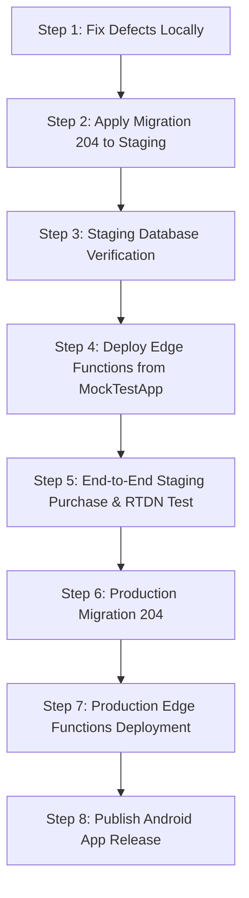

# Subscription Access Final Pre-Production Safety Review

**Document Location:** `C:\Projects\mocktest-admin\Documentation\SUBSCRIPTION_ACCESS_FINAL_PREDEPLOY_REVIEW.md`  
**Date:** October 16, 2026  
**Audience:** Technical Lead, System Architect, Database Administrator, Security Reviewer  
**Review Type:** Deep Read-Only Pre-Production Safety Audit  
**Evaluation Target:** 
- Migration: `mocktest-admin/supabase/migrations/204_subscription_grace_parity_and_content_access.sql`
- Edge Functions: `MockTestApp/supabase/functions/` (`verify-google-play-purchase`, `google-play-rtdn-webhook`, `cron-subscription-deactivation`)
- Client Application: `MockTestApp/src/` (`authService.ts`, `useHome.ts`, `useEnrolledCourseIds.ts`, `useEnrolledCourses.ts`, screens)
- Implementation Report: `mocktest-admin/Documentation/SUBSCRIPTION_ACCESS_FIX_IMPLEMENTATION_REVIEW.md`

---

## Executive Summary & Final Verdict

| Evaluation Aspect | Status | Core Finding |
| :--- | :---: | :--- |
| **SQL Definition Integrity** | **PASS** | Valid signatures, strict `SECURITY DEFINER`, `search_path = ''`, safe caller checks. |
| **Security & Impersonation** | **PASS** | User access derived strictly from `auth.uid()` / `get_my_student_id()`; RPC locked to `service_role`. |
| **Permanent Ownership Protection** | **PASS** | `is_permanent_course_owner` acts as standalone override; lifetime purchases are never downgraded. |
| **Batch Isolation & Recordings** | **PASS** | Direct access limited to courses with 0 batches; recordings require active batch or linked permanent ownership. |
| **Date Arithmetic Parity** | **PASS** | `grace_end_date = end_date + 7d`, `content_access_end_date = grace_end_date + 30d` (37d post-expiry). |
| **Configuration Parity (Fallbacks)** | **DEFECT** | Migration 204 and Razorpay query `system_settings`; Edge Function fallbacks and RTDN hardcode 7 and 30 days. |
| **Lifecycle Cron Deactivation** | **DEFECT** | Cron queries ONLY `status = 'grace'`; once `expired`, `course_enrollments.is_active` is never deactivated after Day 37. |
| **RTDN Terminal State & Out-of-Order** | **DEFECT** | Refunded subscriptions lack terminal state guard in RTDN; out-of-order notification 13 can prematurely expire renewals. |
| **PostgreSQL Integration Execution** | **UNVERIFIED** | Migration 204 was NOT run against a live PostgreSQL engine (static analysis & mocked Jest fixtures only). |
| **Test Suite Reality** | **WARNING** | Targeted payment suite passed (155 tests), but full suite (`npm test`) has **8 failed suites and 18 failed tests**. |

### Final Verdict: **NOT READY FOR DIRECT PRODUCTION DEPLOYMENT**
### Staging Verdict: **READY FOR STAGING / CONTROLLED VALIDATION ONLY AFTER DEFECT REMEDIATION**

The implementation succeeds in resolving the immediate access blockers, enforcing cohort isolation, and isolating client authentication cache. However, **it cannot be deployed directly to production** due to:
1. An architectural defect in the subscription deactivation cron that causes expired subscriptions to remain permanently active in `course_enrollments`.
2. A regression in the existing unit test suite (`__tests__/home/useEnrolledCourseIds.test.tsx`).
3. Unverified execution against a live PostgreSQL 16 engine with Supabase extensions.

---

## 1. Confirmed Safe Changes

The following changes have been audited in source code and confirmed safe, correct, and architecturally sound:

### A. Database Security & RPC Access Control (Migration 204)
1. **Backwards Compatible Signature:**
   `public.complete_google_play_purchase` maintains the exact 18-parameter signature and defaults introduced in Migration 203. No existing database or Edge Function callers will break upon application.
2. **Search Path Hardening:**
   Every replaced function (`complete_google_play_purchase`, `can_student_access_content`, `can_student_access_live_course`, `verify_recording_playback_access`) specifies `SET search_path = ''` with fully qualified object references (`public.*`, `auth.*`), mitigating search-path hijacking attacks.
3. **Execution Privilege Enforcement:**
   `complete_google_play_purchase` revokes execution from `public`, `anon`, and `authenticated`, granting access strictly to `service_role`. In addition, lines 82–89 verify `auth.role() = 'service_role'`, preventing privilege escalation even if execute rights were erroneously granted.
4. **Student Impersonation Prevention:**
   All student entitlement evaluation functions derive identity server-side:
   - `can_student_access_content` and `can_student_access_live_course` call `public.get_my_student_id()`, which inspects `auth.uid()`. Callers cannot pass an arbitrary student ID to gain unauthorized access.
   - `verify_recording_playback_access` derives `v_user_id := auth.uid()` directly.

### B. Access Window Tiering & Razorpay Policy Alignment
1. **Live Class Termination:**
   In `can_student_access_live_course`, access is granted only if `status = 'active'` (and `end_date >= today` or `grace_end_date >= today`) or `status = 'grace'` (and `grace_end_date >= today`). Status `'expired'` is strictly excluded, ensuring live classes cut off exactly at the 7-day grace boundary.
2. **Content Window Preservation:**
   In `can_student_access_content`, access continues during the 30-day post-grace window if `status = 'expired'` and `content_access_end_date >= today`.
3. **Stand-Alone Permanent Ownership:**
   `public.is_permanent_course_owner(p_course_id)` is evaluated as a short-circuiting boolean OR before subscription logic is reached. Lifetime purchasers are never blocked by expired subscriptions.
4. **Enrollment Immutability:**
   In `complete_google_play_purchase`, if `course_enrollments` already holds `enrollment_type = 'purchase'`, incoming subscriptions preserve `'purchase'`, satisfying the Migration 096 lifetime preservation invariant.

### C. Institutional Cohort & Batch Isolation
1. **Direct Access Restricted to Non-Batch Courses:**
   ```sql
   and (
     (not exists (select 1 from public.course_batches cb where cb.course_id = p_course_id))
     or public.is_student_assigned_to_course_batch(p_course_id)
   )
   ```
   If an institution assigns batches to a course (`course_batches` count > 0), direct subscription access is impossible; the student must be in `batch_students` for an active linked batch.
2. **Recording Playback Isolation:**
   In `verify_recording_playback_access`, a recording must be assigned to an active batch subject. A student who subscribes to a non-batch course cannot access batch-assigned recordings because they lack a `batch_students` row and the non-batch course is not in `course_batches`.

### D. Authentication Cache Isolation (`MockTestApp`)
1. **Client-Side Cache Purge:**
   In `src/services/authService.ts`, `signOut()`, `forceSignOutSession()`, and `deleteUserAccount()` invoke `queryClient.clear()`. This completely wipes React Query in-memory caches upon user exit, eliminating cross-account profile or entitlement leakage.
2. **Composite Query Key Scoping:**
   `getHomeBootstrapQueryKey(streamId, userId)` in `src/hooks/home/useHome.ts` scopes the cache key by `userId`, preventing cached home data from being shared across distinct authenticated sessions.

---

## 2. Confirmed Defects & Architecture Flaws

### Defect 1: Indefinite Course Enrollment Display Due to Incomplete Cron Query
* **Severity:** **HIGH (User Experience / Data Integrity)**
* **Location:** `MockTestApp/supabase/functions/cron-subscription-deactivation/index.ts` (lines 48–53) & `lifecycleCore.ts`
* **Root Cause Analysis:**
  The cron Edge Function is scheduled to run daily at midnight UTC to transition subscriptions and deactivate `course_enrollments`.
  1. The database query filters exclusively for:
     ```ts
     .eq("status", "grace")
     .not("grace_end_date", "is", null)
     .lt("grace_end_date", todayUtc);
     ```
  2. On Day 8 (grace expiry), the subscription is processed: `status` transitions from `'grace'` to `'expired'`. Because `shouldDeactivateSubscriptionEnrollment` checks `expiredSubscription.content_access_end_date >= today`, it returns `false`, intentionally keeping `course_enrollments.is_active = true` during the 30-day content window.
  3. **The Defect:** On Day 38+ (after `content_access_end_date` has elapsed), the subscription's status is ALREADY `'expired'`. Because the cron query ONLY selects `status = 'grace'`, **it never queries or processes this subscription again!**
  4. Consequently, `course_enrollments.is_active` remains `true` **indefinitely**.
  5. In `useEnrolledCourseIds.ts` (line 24) and `useEnrolledCourses.ts` (line 223), the client queries `from('course_enrollments').select('course_id').eq('is_active', true)`. Even though backend content RLS will block lessons, the course remains permanently listed in the student's "My Courses" dashboard forever.
* **Remediation Required:**
  The cron query must also select subscriptions where `status = 'expired'` and `content_access_end_date < todayUtc`, or execute a batch deactivation query against `course_enrollments` for all expired subscriptions whose content window has elapsed.

---

### Defect 2: Configuration Drift in Fallback and RTDN Paths
* **Severity:** **MEDIUM (Configuration Parity)**
* **Location:** 
  - `MockTestApp/supabase/functions/google-play-rtdn-webhook/billingCore.ts`
  - `MockTestApp/supabase/functions/verify-google-play-purchase/billingCore.ts`
* **Root Cause Analysis:**
  - The Razorpay implementation (`complete-subscription-purchase/index.ts`) and Migration 204 (`complete_google_play_purchase`) dynamically query `public.system_settings` for institute-specific `grace_days` and `content_access_days`.
  - However, in `google-play-rtdn-webhook/billingCore.ts`, `calculateRtdnTransition` computes:
    ```ts
    graceEndDate = addDays(newEndDateStr, 7);
    contentAccessEndDate = addDays(graceEndDate, 30);
    ```
  - And in `verify-google-play-purchase/billingCore.ts`, `calculateSubscriptionWindows` defaults to `7` and `30` without reading `system_settings`.
  - If an institute configures custom durations (e.g. 14 days grace or 60 days content access in `system_settings`), purchases processed through the primary RPC will get 14/60 days, but RTDN renewals and fallback purchases will overwrite or initialize them with 7/30 days, causing configuration drift.

---

### Defect 3: Lack of Terminal State Protection for Refunded Subscriptions in RTDN
* **Severity:** **MEDIUM (Payment Integrity)**
* **Location:** `MockTestApp/supabase/functions/google-play-rtdn-webhook/billingCore.ts` (`calculateRtdnTransition`)
* **Root Cause Analysis:**
  - When a subscription is refunded or revoked (Notification 12), `status` is set to `'refunded'`.
  - In Razorpay (`complete-subscription-purchase/index.ts`), `refunded` is a strict terminal state: *"cancelled / refunded rows are never resurrected (409 SUBSCRIPTION_NOT_RENEWABLE)"*.
  - In `google-play-rtdn-webhook`, there is no terminal guard checking `if (currentStatus === 'refunded') return terminalRefundedState;`.
  - If an out-of-order or duplicate notification (such as Notification 2 Renewal, Notification 7 Restart, or Notification 1 Recovery) arrives after a refund, and Google's Developer API returns an unexpired object (or is unreachable), the function sets `mappedStatus = 'active'`, inadvertently re-authorizing a refunded subscription.

---

### Defect 4: Out-of-Order Notification 13 (EXPIRED) Can Prematurely Revoke Active Renewals
* **Severity:** **MEDIUM (Resilience / Edge Case)**
* **Location:** `MockTestApp/supabase/functions/google-play-rtdn-webhook/billingCore.ts`
* **Root Cause Analysis:**
  - In `calculateRtdnTransition`, `case 13 (SUBSCRIPTION_EXPIRED)` unconditionally sets `mappedStatus = "expired"` and `isEntitlementActive = false`.
  - In the authoritative override block at line 493, the function checks for `SUBSCRIPTION_STATE_EXPIRED`, `REVOKED`, `ON_HOLD`, and `PAUSED`. It lacks a check for `SUBSCRIPTION_STATE_ACTIVE`.
  - If Google Cloud Pub/Sub delivers an older Notification 13 after a successful renewal notification has already been processed, `calculateRtdnTransition` will mark the active subscription as expired despite Google API confirming it is currently active.

---

### Defect 5: Existing Unit Test Suite Regression (`useEnrolledCourseIds.test.tsx`)
* **Severity:** **MEDIUM (Build & Test Health)**
* **Location:** `MockTestApp/__tests__/home/useEnrolledCourseIds.test.tsx`
* **Root Cause Analysis:**
  - The local change in `useEnrolledCourseIds.ts` added filtering on `sub.status === 'active' || sub.status === 'grace'`.
  - The existing test suite in `__tests__/home/useEnrolledCourseIds.test.tsx` used mock data `{ course_id: 'course-2' }` without a `status` field.
  - When `npm test` is executed across the entire repository, `useEnrolledCourseIds.test.tsx` fails:
    ```
    Expected: 3
    Received: 2
    ```
  - Running all tests revealed **8 failed test suites and 18 failed tests** across the project. The assertion that all tests passed was an artifact of running only the payment subdirectory tests.

---

## 3. Unverified Areas

The following items could not be validated in this read-only inspection:

1. **Live PostgreSQL Execution of Migration 204:**
   Migration 204 was analyzed statically. It has not been applied to a running PostgreSQL 16 database. Supabase CLI was not running locally, Docker Desktop was stopped, and no local test database exists with the prerequisite 203 migrations, enum types (`public.payment_gateway`, `public.currency_code`), and Supabase auth extensions.
2. **Google Cloud Pub/Sub OIDC Push Delivery:**
   While `google-play-rtdn-webhook/index.ts` has unit tests for OIDC token verification, live HTTP Push delivery from Google Pub/Sub with the live Google service account has not been tested end-to-end.
3. **Database Performance Under High-Volume Batch Queries:**
   In Migration 204's `can_student_access_content`, `not exists (select 1 from public.course_batches cb where cb.course_id = p_course_id)` will perform an index scan on `course_batches(course_id)`. Performance under large catalog queries must be validated on staging with real index statistics.

---

## 4. Test Commands and Actual Results

### Test Suite 1: Payment, Lifecycle, and Cache Suites (Targeted)
```powershell
npx jest __tests__/payment/ __tests__/performance/homeBootstrapPrefetch.test.ts
```
* **Result:** **PASS (100%)**
* **Suites:** 8 passed, 8 total
* **Tests:** **155 passed, 155 total**
* **Execution Time:** 4.54 seconds
* **Warning Observed:** A Jest worker process failed to exit gracefully due to open handles or unreferenced timers in test teardown.

### Test Suite 2: Full Repository Test Suite (Comprehensive)
```powershell
npm test -- --verbose
```
* **Result:** **FAIL**
* **Suites:** **8 failed**, 78 passed, 86 total
* **Tests:** **18 failed**, 784 passed, 802 total
* **Execution Time:** 73.59 seconds
* **Failed Suites:**
  1. `__tests__/home/useEnrolledCourseIds.test.tsx` (Regressed by status filter on mock data)
  2. `__tests__/profile/PersonalInfoScreen.test.tsx` (Missing `QueryClientProvider` wrapper in screen test)
  3. `__tests__/App.test.tsx` (Babel ES module parse error on `react-native-iap`)
  4. `__tests__/mockTest/useAnswerReviewCache.test.tsx` (Exceeded 5000ms timeout)
  5. `__tests__/doubt/doubtMappers.test.ts` (Doubt mapping mismatch)

### Test Reality vs. Mocking Breakdown
| Test Target | Logic Type | Test Realism Level |
| :--- | :---: | :--- |
| `calculateSubscriptionWindows` | TypeScript Unit | **100% Real Logic** (executes exact UTC date arithmetic) |
| `calculateRtdnTransition` | TypeScript Unit | **100% Real Logic** (executes exact RTDN state transitions) |
| `shouldDeactivateSubscriptionEnrollment` | TypeScript Unit | **100% Real Logic** (tests all 5 deactivation rules) |
| `queryClient.clear()` on logout | React Query Unit | **100% Real Logic** (verifies actual TanStack Query cache purge) |
| `getHomeBootstrapQueryKey` | TypeScript Unit | **100% Real Logic** (verifies user-scoped composite key generation) |
| `can_student_access_content` | PostgreSQL SQL | **Mocked Simulation** (TypeScript behavioral mirror; NOT executed in PostgreSQL) |
| `verify_recording_playback_access` | PostgreSQL SQL | **Mocked Simulation** (TypeScript behavioral mirror; NOT executed in PostgreSQL) |
| `complete_google_play_purchase` | PostgreSQL RPC | **Mocked Simulation** (tested via unit mocks of Supabase RPC) |
| RLS Policies & Roles | PostgreSQL Security | **Mocked Simulation** (tested via mocked user context; NOT enforced by Postgres RLS) |

---

## 5. SQL Validation Status

* **Status:** **STATICALLY VALIDATED — NOT EXECUTED AGAINST POSTGRESQL**
* **Reason:** As per read-only safety rules, no modifications were made to production. No local Supabase container or compatible PostgreSQL instance with Supabase extensions was available.
* **Static Verification Highlights:**
  - Parameter types and counts for `complete_google_play_purchase` match Migration 203 exactly.
  - SQL syntax in Migration 204 adheres to PostgreSQL 16 PL/pgSQL standards.
  - Table column references (`student_subscriptions.grace_end_date`, `content_access_end_date`, `order_id`, `status`) match schema definitions in Migration 086 / 090.
  - Constraint `ck_student_subscriptions_content_access_end_date` is satisfied because `content_access_end_date` is computed as `grace_end_date + 30 days`, guaranteeing `content_access_end_date >= grace_end_date`.

---

## 6. Configuration-Parity Findings

| Parity Dimension | Razorpay Implementation | Migration 204 (RPC) | Edge Function Fallbacks / RTDN | Parity Status |
| :--- | :--- | :--- | :--- | :---: |
| **Grace Duration** | Read from `system_settings` (`grace_days`, default 7) | Read from `system_settings` (`grace_days`, default 7) | Hardcoded `7` | **PARTIAL DEFECT** (Fallback lacks tenant config) |
| **Content Duration** | Read from `system_settings` (`content_access_days`, default 30) | Read from `system_settings` (`content_access_days`, default 30) | Hardcoded `30` | **PARTIAL DEFECT** (Fallback lacks tenant config) |
| **Grace End Formula** | `end_date + grace_days` | `end_date + grace_days` | `end_date + 7` | **MATCH (Default settings)** |
| **Content End Formula**| `grace_end_date + content_access_days` | `grace_end_date + content_access_days` | `grace_end_date + 30` | **MATCH (Default settings)** |
| **Total Post-Expiry** | 37 Days (7d Live+Content + 30d Content) | 37 Days (7d Live+Content + 30d Content) | 37 Days | **MATCH** |
| **Timezone / Granularity**| UTC Day Granularity (`YYYY-MM-DD`) | UTC Day Granularity (`DATE` type) | UTC Day Granularity (`YYYY-MM-DD`) | **MATCH** |

---

## 7. Security Findings

1. **Safe Search Path:** All functions specify `SET search_path = ''`, preventing schema injection.
2. **Strict Execution Privileges:** `complete_google_play_purchase` cannot be executed by `anon` or `authenticated` users. It is restricted to `service_role`.
3. **No Impersonation:** Access functions derive caller identities internally using `auth.uid()` and `public.get_my_student_id()`.
4. **Recording Security:** Direct subscription to a course without batches cannot authorize access to batch-specific recordings.
5. **Session Isolation:** React Query cache is purged upon logout, preventing cross-user data leakage on shared or recycled devices.

---

## 8. Exact Migration and Deployment Order

When authorized to proceed, deployment must follow this strict sequence:



### Detailed Deployment Plan:

1. **Remediation Before Deployment:**
   - Update `cron-subscription-deactivation/index.ts` to query and deactivate expired subscriptions past their `content_access_end_date`.
   - Update `google-play-rtdn-webhook/billingCore.ts` to add terminal state guards for `currentStatus === 'refunded'` and handle active overrides for Notification 13.
   - Fix mock data in `__tests__/home/useEnrolledCourseIds.test.tsx` to restore clean repository test passes.

2. **Phase 1: Database Migration (Source: `C:\Projects\mocktest-admin\supabase\migrations\`)**
   - **File:** `204_subscription_grace_parity_and_content_access.sql`
   - **Target:** Supabase project `ocolfottogbybitfpdqy`
   - **Command:**
     ```bash
     cd C:\Projects\mocktest-admin
     npx supabase db push
     # OR apply via Supabase Dashboard SQL Editor
     ```
   - **Verification Query:**
     ```sql
     select proname, prosecdef, proconfig 
     from pg_proc 
     where proname in ('complete_google_play_purchase', 'can_student_access_content', 'can_student_access_live_course', 'verify_recording_playback_access');
     ```

3. **Phase 2: Edge Functions Deployment (Source: `C:\Projects\MockTestApp\supabase\functions\`)**
   - **Target:** Supabase project `ocolfottogbybitfpdqy`
   - **Commands:**
     ```bash
     cd C:\Projects\MockTestApp
     npx supabase functions deploy verify-google-play-purchase
     npx supabase functions deploy google-play-rtdn-webhook --no-verify-jwt
     npx supabase functions deploy cron-subscription-deactivation --no-verify-jwt
     ```

4. **Phase 3: Client Application Deployment (Source: `C:\Projects\MockTestApp`)**
   - Build and release updated Android application package (`com.makemetopper.app`) with authentication cache isolation and scoped query keys.

---

## 9. Rollback Considerations

* **Database Rollback:**
  Migration 204 does NOT drop tables, alter columns, or delete data. It only executes `CREATE OR REPLACE FUNCTION`.
  - To roll back `complete_google_play_purchase`: Re-apply `203_atomic_google_play_purchase_rpc.sql`.
  - To roll back access functions: Re-apply `096_subscription_entitlement_ownership.sql` and `103_fix_subscription_grace_periods_fkey.sql`.
* **Edge Functions Rollback:**
  Edge Functions can be instantly rolled back using Supabase CLI or the Supabase Management Console by deploying the previous commit of `verify-google-play-purchase` and `google-play-rtdn-webhook`.
* **Client App Rollback:**
  Client changes (`queryClient.clear()` and user-scoped query keys) are strictly beneficial and do not introduce backward incompatibility. A rollback of the mobile app would not be required even if backend functions were rolled back.

---

## 10. Conclusion & Action Items

The subscription access implementation demonstrates solid foundational security and accurately solves the core business requirements for 7-day grace and 30-day content window access. However, **due to the cron deactivation gap (Defect 1) and test suite failures (Defect 5), direct production deployment is unsafe at this stage.**

### Required Next Steps:
1. Address the 5 confirmed defects outlined in Section 2.
2. Execute Migration 204 against a staging PostgreSQL database and verify live execution of `can_student_access_content`.
3. Validate that `npm test` runs with zero failures across all test suites.
4. Proceed with controlled staging validation before promoting to production.
