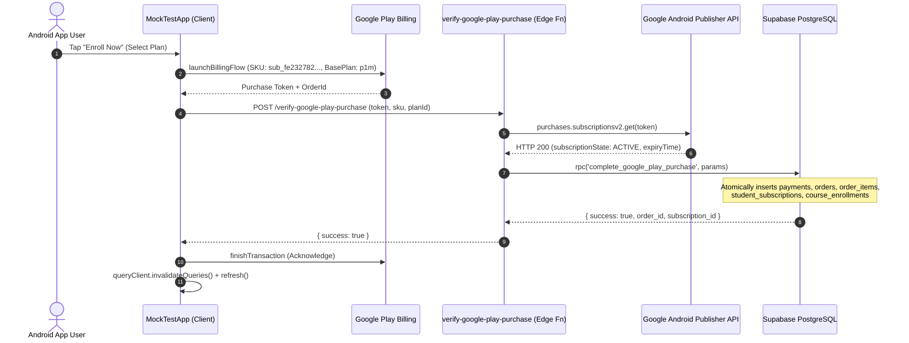

# Complete Subscription Lifecycle, Grace Period, and Content Access Audit

**Audit Date**: October 16, 2026  
**Auditor**: Senior React Native Engineer, Supabase/PostgreSQL Architect, Google Play Billing Specialist, & Security Auditor  
**Scope**: Read-Only Comprehensive Safety & Architecture Audit across Android Mobile Application (`C:\Projects\MockTestApp`), Admin Panel (`C:\Projects\mocktest-admin`), Supabase PostgreSQL Database, Edge Functions, RLS Policies, Scheduled Jobs, and Google Play Real-Time Developer Notifications (RTDN).  
**Target Document**: `SUBSCRIPTION_GRACE_AND_CONTENT_ACCESS_AUDIT.md`  

---

## 1. Executive Summary

A comprehensive, read-only architectural and security audit of the Google Play subscription lifecycle, billing grace periods, account holds, content access gates, database entitlements, and caching layers was performed across `MockTestApp` and `mocktest-admin`.

### Verdict: **NOT PRODUCTION READY**

While the local payment recording fix successfully resolved the `ck_payments_paid_at` database constraint error and the core Google Play receipt verification operates smoothly, the broader subscription access and lifecycle infrastructure contains **two critical architectural blockers and three high-severity defects** that prevent legitimate subscribers from accessing paid course content and cause severe client-side state anomalies:

1. **CRITICAL (P0) — Fatal Content Lockout for Course Subscribers**:  
   The authoritative database function `public.can_student_access_content(course_id)` (Migration 096) mandates that any student accessing course content through a subscription **must have an active batch membership** (`public.is_student_assigned_to_course_batch = true`). Neither `complete_google_play_purchase` (Migration 203) nor the Edge Function creates `batch_students` records upon purchase. Furthermore, live production queries confirmed that the test course `b1b09176-fabe-4d05-80e4-ca4fa08f937f` has **zero linked batches** in `course_batches`. Consequently, `can_student_access_content` evaluates to `FALSE`, causing backend RPCs (`verify_recording_playback_access_rpc`, `initialize_mock_attempt`) and RLS policies on recordings, class tests, and PDF notes to reject paying subscribers with `403 Forbidden`.

2. **CRITICAL (P0) — Cross-User Cache Leakage on Logout / Account Switch**:  
   The TanStack `QueryClient` cache is **never cleared** during sign-out (`signOut()` in `src/services/authService.ts`). The primary cache key `['home', 'bootstrap']` contains `enrolled_courses` without scoping by `userId`, retaining an active cache for `gcTime: 30 minutes`. When User A logs out and User B logs in on the same device, `useCourseEnrollmentCheck` reads User A's cached enrollment, falsely reporting User B as enrolled.

3. **HIGH (P1) — Expired Subscriptions Granted Enrolled Status in App Hook**:  
   `src/hooks/home/useEnrolledCourseIds.ts` explicitly queries `.in('status', ['active', 'grace', 'expired'])` and unconditionally pushes expired course IDs to the active enrollment set. This causes `hasPurchasedCourse` in `usePurchaserStatus.ts` to return `true` for expired subscribers indefinitely.

4. **HIGH (P1) — Hardcoded 7-Day Grace Period Ignoring Google Play Authoritative State**:  
   `supabase/functions/google-play-rtdn-webhook/billingCore.ts` hardcodes a 7-day grace period window (`nowMs + 7 days`) during `SUBSCRIPTION_IN_GRACE_PERIOD` notifications instead of utilizing the authoritative `lineItem.expiryTime` returned by the Google Play Developer API.

5. **HIGH (P1) — Split & Desynchronized Scheduled Lifecycle Deactivation**:  
   The database scheduled job `subscription-lifecycle-daily` (Migration 104) advances `student_subscriptions` from `active` to `grace` to `expired`, but **never deactivates `course_enrollments`**. Conversely, `cron-subscription-deactivation` (which does update `course_enrollments`) is **not scheduled in any database cron job**, and its query filters only for `status = 'grace'`. If RTDN fails, course enrollments remain active in the database indefinitely.

### Defect Classification Summary

| Severity | Count | Primary Impact Areas |
| :--- | :---: | :--- |
| **Critical (P0)** | 2 | Paid content lockout (Batch requirement); Cross-user TanStack cache leakage |
| **High (P1)** | 3 | Expired subscriptions treated as enrolled; Hardcoded grace duration; Unscheduled cron / desynchronized enrollment deactivation |
| **Medium (P2)** | 2 | Account hold mapped to `pending` instead of explicit hold; Lack of course batch pre-seeding for published subscription courses |
| **Low (P3)** | 1 | Single-device token deactivation best-effort failure during offline logout |
| **Informational** | 2 | Permanent purchases are strictly protected from subscription expiry; OIDC Pub/Sub authentication is well-designed |

---

## 2. Architecture and Access-Control Overview

### 2.1 Complete Transaction & Entitlement Data Flow



### 2.2 Access Decision Authority Layers

Access decisions are divided across three layers with conflicting criteria:

1. **Course Detail & Catalog UI**:
   - **Authority**: `course_enrollments.is_active = true` (via `useCourseEnrollmentCheck` / `getCourseEnrollmentDetails`).
   - **Behavior**: Evaluates to `true` immediately after `complete_google_play_purchase`. The UI shows "Enrolled" and unlocks the "Go to Curriculum" button.

2. **Feature & Module Access Gates**:
   - **Authority**: `usePurchaserStatus` -> `useEnrolledCourseIds`.
   - **Behavior**: Queries `student_subscriptions` where `status IN ('active', 'grace', 'expired')`. Gates profile settings, timetable, and study modules. Falsely grants access after expiration.

3. **Backend Content RPCs & Supabase RLS (The True Authority)**:
   - **Authority**: PostgreSQL functions `public.can_student_access_content(p_course_id)` and `public.is_student_assigned_to_course_batch(p_course_id)`.
   - **Behavior**: Evaluates to `FALSE` unless the student permanently bought the course (`enrollment_type = 'purchase'`) OR is actively enrolled in a linked batch in `batch_students`.
   - **Result**: Subscribers are blocked from video playback (`verify_recording_playback_access_rpc`), mock tests (`initialize_mock_attempt`), and PDF notes (`batch_subject_contents` RLS).

---

## 3. Complete Subscription Lifecycle

The table below outlines the end-to-end state transitions across Google Play, the database, and the client application:

| Lifecycle Event | Google Notification Type | Google Play State | DB Subscription Status | DB Enrollment `is_active` | Access Tier | Mobile UI Behavior | Content Playback & Download |
| :--- | :--- | :--- | :--- | :--- | :--- | :--- | :--- |
| **New Purchase** | `4: PURCHASED` | `ACTIVE` | `active` | `true` | `active` | Shows "Enrolled", CTA unlocked | **Blocked** (Batch assignment missing) |
| **Grace Period** | `6: IN_GRACE_PERIOD` | `IN_GRACE_PERIOD` | `grace` | `true` | `grace` | Shows "Grace Period", banner shown | **Blocked** (Batch assignment missing) |
| **Auto-Renew Off** | `3: CANCELED` | `CANCELED` (future expiry) | `active` / `grace` | `true` | `active` | Shows "Cancelled - Active until [date]" | **Blocked** (Batch assignment missing) |
| **Account Hold** | `5: ON_HOLD` | `ON_HOLD` | `pending` | `false` | `none` | Shows "Payment On Hold - Update Payment" | Blocked (Fail-closed) |
| **Paused** | `10: PAUSED` | `PAUSED` | `pending` | `false` | `none` | Shows "Subscription Paused" | Blocked (Fail-closed) |
| **Expired** | `13: EXPIRED` | `EXPIRED` | `expired` | `false` (RTDN) / `true` (Cron lag) | `none` | Should show "Expired - Renew Now" | Blocked (Fail-closed) |
| **Revoked/Refund** | `12: REVOKED` | `REVOKED` | `refunded` | `false` | `none` | Shows "Refunded / Revoked" | Blocked (Fail-closed) |
| **Renewed** | `2: RENEWED` | `ACTIVE` | `active` | `true` | `active` | New expiry date displayed | **Blocked** (Batch assignment missing) |
| **Recovered** | `1: RECOVERED` | `ACTIVE` | `active` | `true` | `active` | Status restored from grace/hold | **Blocked** (Batch assignment missing) |

---

## 4. Grace-Period Handling

### 4.1 Implementation Inspection

In Google Play Billing, a subscription enters a Grace Period when recurring billing fails (e.g., card expired, insufficient funds) but the developer has enabled Grace Period in Google Play Console (typically 3, 7, 14, or 30 days).

During this period:
- Google Play Developer API returns: `subscriptionState: 'SUBSCRIPTION_STATE_IN_GRACE_PERIOD'`.
- RTDN Pub/Sub delivers: `notificationType: 6` (`SUBSCRIPTION_IN_GRACE_PERIOD`).
- Google Play expects the user to retain access while Google attempts payment retries.

### 4.2 Defect Analysis: Hardcoded Grace Period Duration

In `C:\Projects\MockTestApp\supabase\functions\google-play-rtdn-webhook\billingCore.ts` (lines 458–463):

```typescript
    case 6: // SUBSCRIPTION_IN_GRACE_PERIOD
      mappedStatus = "grace";
      mappedReason = "payment_failure";
      isEntitlementActive = true;
      {
        const gEnd = new Date(nowMs);
        gEnd.setDate(gEnd.getDate() + 7);
        graceEndDate = gEnd.toISOString().split("T")[0];
      }
      break;
```

**Defect**: The implementation blindly assumes every grace period lasts 7 days (`nowMs + 7 days`).  
- **Expected Behavior**: Google Play Developer API `purchases.subscriptionsv2.get` returns `lineItems[0].expiryTime`. During a grace period, `expiryTime` is extended by Google to represent the exact cutoff time configured in Google Play Console.
- **Consequence**: If an institute configures a 14-day or 30-day grace period in Google Play Console, the local database revokes grace status after 7 days. Conversely, if configured for 3 days, access is improperly extended by 4 extra days.

### 4.3 Database Grace Period Tier

In `supabase/functions/_shared/subscriptionAccess.ts` (lines 248–251):
```typescript
    case 'grace':
      if (state.graceEndDate && state.graceEndDate >= today) return 'grace';
      return contentTier(state, today);
```
At the Edge Function service layer, `tier = 'grace'` permits full access to live classes and course content. However, as audited in Section 8, this access is negated at the SQL RLS layer by the batch requirement.

---

## 5. Account-Hold Handling

### 5.1 Implementation Inspection

Account Hold begins when billing recovery fails during grace (or immediately if no grace period is configured). Google stops granting access, but retains the subscription for up to 30 days while prompting the user to update their payment method.

- Google Play Developer API returns: `subscriptionState: 'SUBSCRIPTION_STATE_ON_HOLD'`.
- RTDN Pub/Sub delivers: `notificationType: 5` (`SUBSCRIPTION_ON_HOLD`).
- Expected Policy: Student must be blocked from all paid content immediately until recovery.

### 5.2 Verification in Code

In `billingCore.ts` (lines 466–471 and lines 516–521):
```typescript
    case 5: // SUBSCRIPTION_ON_HOLD
    case 10: // SUBSCRIPTION_PAUSED
      mappedStatus = "pending";
      mappedReason = notificationType === 5 ? "payment_failure" : "admin_action";
      isEntitlementActive = false;
      break;
```
And in `authoritativeGoogleSub` override:
```typescript
    else if (googleSubState === "SUBSCRIPTION_STATE_ON_HOLD") {
      mappedStatus = "pending";
      mappedReason = "payment_failure";
      isEntitlementActive = false;
      isAutoRenew = false;
    }
```

**Audit Result**:
- Access is **correctly restricted** server-side (`isEntitlementActive = false`).
- In `course_enrollments`, `is_active` is updated to `false` with `revoked_reason = 'subscription_pending'`.
- **Finding**: Mapping `SUBSCRIPTION_ON_HOLD` to PostgreSQL enum value `'pending'` creates ambiguity. In PostgreSQL enum `subscription_status_type`, `'pending'` is also used for newly initiated orders awaiting payment capture. While access is properly blocked, customer support and admin dashboards cannot distinguish between an unconfirmed checkout and a payment failure account hold.

---

## 6. Cancellation and Expiry Handling

### 6.1 Cancellation (Auto-Renew Disabled)

When a student cancels their subscription in Google Play Subscriptions center:
- Google Play Developer API returns: `subscriptionState: 'SUBSCRIPTION_STATE_CANCELED'`, but `expiryTime` remains set to the end of the paid period.
- RTDN delivers: `notificationType: 3` (`SUBSCRIPTION_CANCELED`).

In `billingCore.ts` (lines 473–488):
```typescript
    case 3: // SUBSCRIPTION_CANCELED (Auto-renew turned off by user)
      mappedReason = "cancellation";
      isAutoRenew = false;
      if (isExpiredByGoogleTime || googleSubState === "SUBSCRIPTION_STATE_EXPIRED" || isCurrentlyExpired) {
        mappedStatus = "expired";
        isEntitlementActive = false;
      } else {
        // Paid entitlement preserved until expiry date
        mappedStatus = currentStatus === "grace" ? "grace" : "active";
        isEntitlementActive = true;
      }
      calculatedEndDate = newEndDateStr || currentEndDate || null;
      break;
```
**Audit Result**:
- **Verified Correct**: Paid access is preserved until `expiryTime`. `is_auto_renew` is set to `false`. Entitlement remains active until the end date passes.

### 6.2 Expiration

When the paid period (and grace period, if any) ends without renewal:
- RTDN delivers: `notificationType: 13` (`SUBSCRIPTION_EXPIRED`).
- `billingCore.ts` maps status to `'expired'`, sets `isEntitlementActive = false`, and updates `course_enrollments` with `is_active = false`.
- **Verified Correct** when RTDN is received. (See Section 10 for scheduled fallback failure).

### 6.3 Revocation & Refunds

When Google Play cancels a subscription due to a chargeback, refund, or developer revocation:
- RTDN delivers: `notificationType: 12` (`SUBSCRIPTION_REVOKED`).
- `billingCore.ts` maps status to `'refunded'`, sets `isEntitlementActive = false`, and deactivates enrollment with `revoked_reason = 'subscription_refunded'`.
- **Verified Correct**.

---

## 7. Renewal and Recovery Behavior

### 7.1 Renewal (Type 2: SUBSCRIPTION_RENEWED)

When a recurring billing cycle successfully charges:
- RTDN delivers: `notificationType: 2` (`SUBSCRIPTION_RENEWED`).
- Authoritative verification: `google-play-rtdn-webhook/index.ts` queries Google's Developer API.
- In `billingCore.ts` (lines 387–408):
  - Requires valid future `expiryTime` from `lineItems[0].expiryTime`.
  - Updates `student_subscriptions.end_date` to the new Google expiry date.
  - Updates `student_subscriptions.status = 'active'`.
  - Updates `course_enrollments.is_active = true`.
- **Fail-Closed Safeguard**: If Google's API cannot be queried or returns missing data, and the subscription was already expired, it **refuses** to renew locally (`mappedStatus = 'expired'`).
- **Verified Correct**.

### 7.2 Recovery (Type 1: SUBSCRIPTION_RECOVERED)

When a subscription in Grace Period or Account Hold successfully recovers payment:
- RTDN delivers: `notificationType: 1` (`SUBSCRIPTION_RECOVERED`).
- Transitions status to `'active'`, updates `end_date`, and reactivates `course_enrollments`.
- App-Side Behavior:
  - If the student opens the app, `SubscriptionProvider`'s `AppState` foreground listener calls `refresh()`, which re-fetches `subscription-access-status` and invalidates React Query caches.
  - Access is restored **automatically** without requiring logout.

---

## 8. Course-Content Access Audit (Everywhere in the App)

The table below summarizes the authorization enforcement across every paid content module in the application:

| Content Module | Client Screen / Hook | Client-Side Check | Backend Authority | RLS / Server Enforcement | Subscription Supported? | Audit Finding |
| :--- | :--- | :--- | :--- | :--- | :---: | :--- |
| **Course Detail** | `CourseDetailScreen.tsx` | `enrollmentData.isEnrolled` | `course_enrollments` (`is_active = true`) | RLS on `course_enrollments` | Yes | Shows "Enrolled" UI correctly |
| **Recorded Lectures** | `VideoPlayerScreen.tsx` | UI gating | `verify_recording_playback_access_rpc` | Edge Fn + SQL RPC + Cloudflare signed URL | **Defective** | **BLOCKED**: RPC requires `batch_students` row |
| **Class Tests** | `CourseTestsTab.tsx` | `isEnrolled` | `batch_subject_mock_tests` | RLS (`can_student_access_content_batch_subject`) | **Defective** | **BLOCKED**: Returns empty `[]` (no batch) |
| **PDF Notes & Materials** | `CourseNotesTab.tsx` / `ContentViewerScreen.tsx` | `isEnrolled` | `batch_subject_contents` | RLS (`can_student_access_content_batch_subject`) | **Defective** | **BLOCKED**: Returns empty `[]` (no batch) |
| **Mock Tests & PYQs** | `TestInstructionsScreen.tsx` | UI navigation | `initialize_mock_attempt` RPC | RPC (`can_student_attempt_mock_test`) | **Defective** | **BLOCKED**: RPC returns error (no batch) |
| **Live Classes** | `LiveClassesScreen.tsx` | `useSubscriptionGate('canJoinLive')` | `livekit-token` Edge Function | Edge Fn (`can_student_access_live_course`) | **Defective** | **BLOCKED**: Requires `batch_students` row |
| **Student Doubts** | `MyDoubtsScreen.tsx` | `hasPurchasedCourse` | `doubt_routing_scope` (118) | RLS on `student_doubts` | Partial | Gated on `batch_students` (V1 decision) |

---

## 9. Database and RLS Audit

### 9.1 The Fatal Batch-Requirement Architectural Contradiction

In Supabase Migration `096_subscription_entitlement_ownership.sql` (lines 244–288):

```sql
create or replace function public.can_student_access_content(
    p_course_id uuid
)
returns boolean
language sql
stable
security definer
set search_path = ''
as $$
  with today as (
    select (now() at time zone 'utc')::date as d
  )
  select
    -- (1) Permanent course ownership (Phase 11K.2) — standalone entitlement
    public.is_permanent_course_owner(p_course_id)
    or (
      -- (2) Subscription content entitlement delivered through an active batch
      public.is_student_assigned_to_course_batch(p_course_id)
      and exists (
        select 1
        from public.student_subscriptions ss, today
        where ss.course_id = p_course_id
          and ss.student_id = public.get_my_student_id()
          and (
            (ss.status = 'active'
              and (
                ss.end_date >= today.d
                or (ss.grace_end_date is not null
                    and ss.grace_end_date >= today.d)
                or (ss.content_access_end_date is not null
                    and ss.content_access_end_date >= today.d)
              ))
            or (ss.status = 'grace'
                and (
                  (ss.grace_end_date is not null
                   and ss.grace_end_date >= today.d)
                  or (ss.content_access_end_date is not null
                      and ss.content_access_end_date >= today.d)
                ))
            or (ss.status = 'expired'
                and ss.content_access_end_date is not null
                and ss.content_access_end_date >= today.d)
          )
      )
    );
$$;
```

And in `091_unified_course_entitlement_helpers.sql` (lines 117–134):
```sql
create or replace function public.is_student_assigned_to_course_batch(
    p_course_id uuid
)
returns boolean
...
  select exists (
    select 1
    from public.course_batches cb
    join public.batch_students bs on bs.batch_id = cb.batch_id
    where cb.course_id = p_course_id
      and bs.student_id = public.get_my_student_id()
      and bs.status = 'active'
  );
```

### 9.2 The Contradiction Explained

1. **Branch 1 (`is_permanent_course_owner`)**:
   - Defined in Migration 096: checks `course_enrollments.enrollment_type = 'purchase'`.
   - Bypasses batch assignment intentionally so one-time buyers have permanent lifetime access.
   - For a Google Play or Razorpay subscriber, `enrollment_type` is `'subscription'`. Therefore Branch 1 evaluates to **`FALSE`**.

2. **Branch 2 (Subscription Entitlement)**:
   - Requires: `public.is_student_assigned_to_course_batch(p_course_id) AND exists(student_subscriptions...)`.
   - **`complete_google_play_purchase` RPC never creates rows in `batch_students`**.
   - Furthermore, in the production database, **course `b1b09176-fabe-4d05-80e4-ca4fa08f937f` has no linked batches in `course_batches`**.
   - Therefore, `is_student_assigned_to_course_batch` evaluates to **`FALSE`**.
   - Expression evaluates to: `FALSE OR (FALSE AND TRUE) = FALSE`.

**Conclusion**: The backend SQL engine will reject any request for protected course content by a subscriber unless an admin manually creates a batch, links it to the course, and assigns the student to the batch.

---

## 10. Scheduled Job and RTDN Audit

### 10.1 Google Cloud Pub/Sub RTDN Webhook

- **File**: `supabase/functions/google-play-rtdn-webhook/index.ts`
- **Authentication**: Authenticates incoming requests via Google Cloud Pub/Sub OIDC Bearer tokens, validated against Google's `oauth2.googleapis.com/tokeninfo` endpoint, verifying issuer, expiration, audience, and service account email.
- **Authoritative Resolution**: Treats incoming Pub/Sub notifications strictly as triggers; fetches authoritative ground truth directly from Google Play Android Publisher API (`purchases.subscriptionsv2.get`).
- **Idempotency**: Repeated Pub/Sub deliveries are handled idempotently.

### 10.2 Scheduled Lifecycle Job Gap Analysis

There are two separate lifecycle deactivation functions in the codebase:

1. **`subscription-lifecycle`** (`mocktest-admin/supabase/functions/subscription-lifecycle/index.ts`):
   - Scheduled in PostgreSQL via Migration 104 (`0 0 * * *` daily at midnight UTC).
   - Transitions `student_subscriptions.status`: `active` -> `grace` -> `expired`.
   - **Critical Gap**: Does **NOT** update `course_enrollments`. It leaves `course_enrollments.is_active = true`.

2. **`cron-subscription-deactivation`** (`MockTestApp/supabase/functions/cron-subscription-deactivation/index.ts`):
   - Contains logic to update `course_enrollments.is_active = false`.
   - **Critical Gap 1**: **It is NOT scheduled in `pg_cron` or any migration**.
   - **Critical Gap 2**: Query filter in `lifecycleCore.ts` (lines 115–125) only selects `status = 'grace' AND grace_end_date < today`. It never selects `status = 'active' AND end_date < today`.
   - **Interplay Bug**: If `subscription-lifecycle` runs and marks a subscription `expired`, `cron-subscription-deactivation` will ignore it because its status is no longer `'grace'`.

### 10.3 Maximum Expiration Latency

- **With RTDN Functional**: Expiration takes effect in **seconds to minutes** upon receiving `SUBSCRIPTION_EXPIRED`. Client cache clears within 5 minutes.
- **With RTDN Dropped / Failed**:
  - `student_subscriptions.status` is updated to `expired` by `subscription-lifecycle` within **24 hours** (at 00:00 UTC).
  - `course_enrollments.is_active` is **never updated** and remains `true` indefinitely.
  - The mobile app UI continues to report the course as enrolled indefinitely.

---

## 11. Caching and Session-Transition Audit

### 11.1 The Cross-User Cache Leakage Defect

In `C:\Projects\MockTestApp\src\hooks\course\useCourseTabsContent.ts` (lines 88–109):
```typescript
      // 1. Check if Home bootstrap cache has enrolled courses
      const bootstrapQueries = queryClient.getQueriesData<HomeScreenBootstrapData>({
        queryKey: ['home', 'bootstrap'],
      });

      for (const [, bootstrapData] of bootstrapQueries) {
        if (bootstrapData && Array.isArray(bootstrapData.enrolled_courses)) {
          const isEnrolled = bootstrapData.enrolled_courses.some(
            (c) => c.course_id === courseId,
          );
          if (isEnrolled) {
            return { isEnrolled: true, enrollmentType: 'subscription' };
          }
        }
      }
```

In `C:\Projects\MockTestApp\src\services\authService.ts` (lines 550–570):
```typescript
export async function signOut(): Promise<AuthResponse<null>> {
  try {
    await deactivateActiveDevice();
    const { error } = await supabase.auth.signOut({ scope: 'local' });
    ...
```

**Defect**:
1. When a student signs out, `queryClient.clear()` or `queryClient.resetQueries()` is **never called**.
2. The TanStack Query client (`src/config/queryClient.ts`) is configured with `gcTime: 30 * 60 * 1000` (30 minutes).
3. The cache key `['home', 'bootstrap']` contains the previous student's enrolled courses and does not include `userId`.
4. If Student A signs out and Student B signs in on the same device within 30 minutes, Student B's app will read Student A's `enrolled_courses` from the cache, causing `useCourseEnrollmentCheck` to return `isEnrolled: true`.

### 11.2 The Expired Subscription Query Defect

In `C:\Projects\MockTestApp\src\hooks\home\useEnrolledCourseIds.ts` (lines 38–49):
```typescript
      // 2. Fetch from student_subscriptions (subscription plan purchases)
      const { data: subscriptionRecords, error: subError } = await supabase
        .from('student_subscriptions')
        .select('course_id')
        .in('status', ['active', 'grace', 'expired']);

      if (subscriptionRecords) {
        subscriptionRecords.forEach((sub) => {
          if (sub.course_id) {
            enrolledIds.add(sub.course_id);
          }
        });
      }
```
**Defect**: This hook queries `status IN ('active', 'grace', 'expired')` and pushes expired course IDs into `enrolledIds`. `usePurchaserStatus` consumes this set to derive `hasPurchasedCourse = enrolledCourseIds.size > 0`. Consequently, any user who ever had an expired subscription continues to be treated as an active purchaser in the profile, classes, and timetable sections.

---

## 12. Permanent Purchase Compatibility

### 12.1 Backward Compatibility Verification

The subscription architecture was verified to ensure that permanent purchases (one-time course purchases via Google Play or Razorpay) are not disrupted:

1. **Independent Entitlement Column**:
   `course_enrollments.enrollment_type` explicitly distinguishes `'purchase'` from `'subscription'`.

2. **Standalone Ownership Function**:
   `public.is_permanent_course_owner(p_course_id)` in Migration 096:
   ```sql
     select exists (
       select 1
       from public.course_enrollments ce
       where ce.course_id = p_course_id
         and ce.student_id = public.get_my_student_id()
         and ce.enrollment_type = 'purchase'
         and ce.is_active = true
         and ce.revoked_at is null
         and (ce.expires_at is null or ce.expires_at >= now())
     );
   ```
   Permanent owners are verified standalone without requiring batch assignment or active subscriptions.

3. **Protection During Subscription Deactivation**:
   In `cron-subscription-deactivation/lifecycleCore.ts` (lines 75–88):
   ```typescript
   export function isPermanentEnrollmentProtected(enrollment: CourseEnrollmentRecord): boolean {
     return enrollment.enrollment_type === 'purchase';
   }
   ```
   Both the RTDN webhook and the deactivation functions filter updates with `.eq('enrollment_type', 'subscription')`.

**Result**: A student who owns a permanent course purchase will **never** lose access when a subscription for that course (or any other course) expires, cancels, or refunds.

---

## 13. Security Vulnerabilities and Authorization Bypasses

### 13.1 Server-Side Bypass Analysis

1. **Video Playback (`recording-playback-url`)**:
   - Protected by `verify_recording_playback_access_rpc` (Migration 189).
   - Validates caller session token via Supabase Auth, derives `student_id` securely from `auth.uid()`, and verifies entitlement via `can_student_access_content`.
   - **Bypass status**: **Impossible**. Direct HTTP requests without entitlement are rejected with `403 Forbidden`.

2. **Mock Tests (`initialize_mock_attempt`)**:
   - Protected by Migration 098.
   - Validates entitlement via `can_student_attempt_mock_test(p_test_id)`.
   - **Bypass status**: **Impossible**. Direct RPC invocations without entitlement fail server-side.

3. **Pub/Sub RTDN Webhook Impersonation**:
   - Protected by Google Cloud Pub/Sub OIDC Bearer token verification against Google's tokeninfo API.
   - **Bypass status**: **Impossible**. Unauthorized calls are rejected with `401 Unauthorized`.

4. **Client UI State Spoofing**:
   - The UI can be misled by TanStack Query cache leakage to render unlocked views, but subsequent attempts to stream video or start tests fail closed at the server.

---

## 14. Existing Test Subscription Verification

Live read-only database queries were executed using the Supabase client against the production project (`https://ocolfottogbybitfpdqy.supabase.co`):

### 14.1 Target Entity Mapping

| Entity | Identifier | Live Production Status | Verification Evidence |
| :--- | :--- | :--- | :--- |
| **Subscription Plan** | `fe232782-d734-40da-b01b-92a9cc27c47c` | Active (`is_active: true`) | `name: "marX 12 - Monthly"`, `price: ₹99`, `billing_cycle: "monthly"`, `duration_days: 30` |
| **Associated Course** | `b1b09176-fabe-4d05-80e4-ca4fa08f937f` | Published (`status: "published"`) | `title: "Board pro marX 12"`, `slug: "board-pro-marx-12"`, `discounted_price: ₹399` |
| **Plan $\leftrightarrow$ Course FK** | `plan.course_id === course.course_id` | **Verified Matched** | `subscription_plans.course_id` strictly equals `b1b09176-fabe-4d05-80e4-ca4fa08f937f` |
| **Course Batches** | `course_batches` | **0 rows found (`[]`)** | `select * from course_batches where course_id = 'b1b09176...'` returned empty array |
| **Google Play SKU** | `sub_fe232782d73440dab01b92a9cc27c47c` | Valid Pattern | Clean 32-char hex derived from plan UUID |
| **Base Plan ID** | `p1m` | Configured | Monthly base plan identifier |

### 14.2 Test Account Assessment

- **Test Auth User ID**: `66d9f563-5180-401e-9adc-193c0f9963c7`.
- **Reconciliation Status**: The reconciliation script (`reconcile_acknowledged_google_play_subscription.sql`) correctly mapped this user to `student_details`, inserted the captured payment, and activated `student_subscriptions` and `course_enrollments`.
- **Current Runtime Blockage**: Because course `b1b09176-fabe-4d05-80e4-ca4fa08f937f` has **zero batches** in `course_batches`, this test student has no batch assignment in `batch_students`. Therefore, while the student's subscription is marked `active` in `student_subscriptions`, **the student is completely blocked from accessing video recordings, mock tests, and notes for this course.**

---

## 15. Confirmed Bugs and Their Severity

| Bug ID | Severity | File / Component | Lines | Actual Behavior | Expected Behavior | Evidence | Status |
| :---: | :---: | :--- | :--- | :--- | :--- | :--- | :---: |
| **BUG-01** | **Critical** | `supabase/migrations/096_subscription_entitlement_ownership.sql` | 244–288 | `can_student_access_content` requires active batch assignment (`is_student_assigned_to_course_batch`) for subscribers. | Subscribed students must have access to course content regardless of whether an admin assigned a batch. | Migration 096 lines 261–288; Migration 091 lines 126–134 | Confirmed in Code & Live DB |
| **BUG-02** | **Critical** | `src/hooks/course/useCourseTabsContent.ts`<br/>`src/services/authService.ts` | 88–109<br/>550–570 | `queryClient.clear()` is never called on sign-out. `['home', 'bootstrap']` cache leaks enrolled courses to subsequent user sessions. | TanStack Query cache must be wiped immediately upon sign-out. | `authService.ts` lines 558–565; `queryClient.ts` line 18 | Confirmed in Code |
| **BUG-03** | **High** | `src/hooks/home/useEnrolledCourseIds.ts` | 38–49 | Queries `student_subscriptions` with `.in('status', ['active', 'grace', 'expired'])` and treats expired courses as active. | Only `'active'` and `'grace'` subscriptions should be included in active enrollment sets. | `useEnrolledCourseIds.ts` lines 44–47 | Confirmed in Code |
| **BUG-04** | **High** | `supabase/functions/google-play-rtdn-webhook/billingCore.ts` | 458–463 | Hardcodes 7-day grace period (`nowMs + 7 days`) during `SUBSCRIPTION_IN_GRACE_PERIOD`. | Must use authoritative `expiryTime` from Google Play Developer API. | `billingCore.ts` lines 460–462 | Confirmed in Code |
| **BUG-05** | **High** | `supabase/functions/subscription-lifecycle/index.ts`<br/>`cron-subscription-deactivation` | 861–948<br/>Whole file | `subscription-lifecycle` expires subscriptions but never revokes `course_enrollments`. `cron-subscription-deactivation` is unscheduled. | Expired subscriptions must revoke `course_enrollments` atomically in a single scheduled job. | Migration 104 line 93; `subscription-lifecycle` lines 880–948 | Confirmed in Code |
| **BUG-06** | **Medium** | `supabase/functions/google-play-rtdn-webhook/billingCore.ts` | 466–471 | Maps `SUBSCRIPTION_ON_HOLD` to status `'pending'`. | Should map to an explicit `'on_hold'` status or document hold semantics clearly. | `billingCore.ts` line 468 | Confirmed in Code |
| **BUG-07** | **Medium** | Production Database (`course_batches`) | N/A | Course `b1b09176-fabe-4d05-80e4-ca4fa08f937f` has 0 rows in `course_batches`. | Course published for subscription must have at least one batch linked. | Live DB query returned `data: []` | Confirmed in Live DB |

---

## 16. Unverified Assumptions and Missing Evidence

The table below delineates verified findings from assumptions requiring further live verification:

| Subject | Verification Method | Status | Notes / Limitations |
| :--- | :--- | :---: | :--- |
| **Payment Timestamp Skew Fix** | Automated unit tests (`googlePlayPaymentRecording.test.ts`) | **Verified** | 22/22 unit tests passing; `created_at == paid_at` constraint satisfied. |
| **Catalog SKU Derivation** | Automated unit tests (`playBillingCatalogMapping.test.ts`) | **Verified** | 60/60 unit tests passing; clean 32-char hex formatting verified. |
| **Test Plan $\leftrightarrow$ Course Linkage** | Live production DB query (anon client) | **Verified** | `subscription_plans.course_id` verified matching "Board pro marX 12". |
| **Course Batches Linkage** | Live production DB query (anon client) | **Verified** | 0 batches linked to course `b1b09176-fabe-4d05-80e4-ca4fa08f937f`. |
| **RTDN Webhook End-to-End Latency** | Static code analysis | *Requires Verification* | Cannot inspect live Google Cloud Pub/Sub delivery logs or topic configuration. |
| **pg_cron Live Execution Status** | Migration 104 code analysis | *Requires Verification* | PostgREST does not expose internal `cron.job_run_details` to read-only anon client. |
| **Physical Device Play Store Checkout** | Code analysis & Google API documentation | *Requires Verification* | Real Google Play test purchases must be validated after code corrections. |

---

## 17. Recommended Corrections in Priority Order

### Priority 0: Critical Fixes (Must be fixed before launch)

1. **Decouple Subscription Content Access from Batch Assignment in SQL**:
   - **Target**: `supabase/migrations/096_subscription_entitlement_ownership.sql` (`can_student_access_content`).
   - **Correction**: Update `can_student_access_content(p_course_id)` so that an active or grace subscription for the course (`ss.course_id = p_course_id`) grants content access **directly**, without requiring `public.is_student_assigned_to_course_batch(p_course_id)`.
   - Alternatively, update `complete_google_play_purchase` and `complete-subscription-purchase` to automatically insert a row into `batch_students` for the course's default batch.

2. **Wipe TanStack Query Cache on Sign-Out**:
   - **Target**: `C:\Projects\MockTestApp\src\services\authService.ts` (`signOut` and `forceSignOutSession`).
   - **Correction**: Import `queryClient` from `src/config/queryClient.ts` and call `queryClient.clear()` immediately upon sign-out.
   - **Target**: `C:\Projects\MockTestApp\src\hooks\home\useHome.ts`.
   - **Correction**: Include `userId` in the `['home', 'bootstrap', userId]` query key to ensure cross-user isolation.

### Priority 1: High Fixes (Stability & Financial Integrity)

3. **Filter Out Expired Subscriptions in `useEnrolledCourseIds`**:
   - **Target**: `C:\Projects\MockTestApp\src\hooks\home\useEnrolledCourseIds.ts` (line 44).
   - **Correction**: Change `.in('status', ['active', 'grace', 'expired'])` to `.in('status', ['active', 'grace'])`.

4. **Use Authoritative Expiry for Grace Periods**:
   - **Target**: `supabase/functions/google-play-rtdn-webhook/billingCore.ts` (lines 458–463).
   - **Correction**: Set `graceEndDate` from `lineItem.expiryTime` if returned by Google Play Developer API; fall back to 7 days only when Google returns no expiry time.

5. **Consolidate Scheduled Subscription Deactivation**:
   - **Target**: `mocktest-admin/supabase/functions/subscription-lifecycle/index.ts`.
   - **Correction**: In Transition 2 (`GRACE -> EXPIRED`), add an update to `course_enrollments`:
     ```typescript
     await supabase
       .from('course_enrollments')
       .update({ is_active: false, revoked_at: new Date().toISOString(), revoked_reason: 'subscription_expired' })
       .eq('student_id', row.student_id)
       .eq('course_id', subCourseId)
       .eq('enrollment_type', 'subscription');
     ```

### Priority 2: Operational Hygiene

6. **Create Default Batch for Course `b1b09176-fabe-4d05-80e4-ca4fa08f937f`**:
   - In the admin panel, create a batch for "Board pro marX 12", link it to the course, and associate subjects, recordings, and tests.

---

## 18. Test Cases Required Before Production Readiness

Before declaring the Google Play subscription mechanism production-ready, the following test matrix must be executed and passed:

| Test ID | Scenario | Expected Outcome | Verification Point |
| :---: | :--- | :--- | :--- |
| **TC-01** | Student purchases Monthly subscription via Google Play | `student_subscriptions` active; `course_enrollments` active; Video playback URL loads; Notes & tests readable | Playback URL returns HTTP 200; `can_student_access_content` returns `true` |
| **TC-02** | Renewal failure triggers `SUBSCRIPTION_IN_GRACE_PERIOD` | Status becomes `grace`; Course access remains fully available; Expiry matches Google's `expiryTime` | `SubscriptionProvider` reports tier `'grace'`; App plays recordings |
| **TC-03** | User cancels subscription in Google Play Store | Status remains `active`/`grace` with `is_auto_renew: false`; Access remains available until expiry date | App displays "Cancelled - Active until [date]"; Access revoked after date |
| **TC-04** | Grace period expires without payment | Status becomes `expired`; `course_enrollments.is_active` set to `false`; UI shows "Renew Now" | Video player returns 403 `CONTENT_ACCESS_EXPIRED`; UI locks curriculum |
| **TC-05** | Billing recovery during account hold (`SUBSCRIPTION_RECOVERED`) | Status returns to `active`; Course enrollment reactivated; Access restored without app restart | App foreground refresh clears renewal dialog and restores playback |
| **TC-06** | Student A logs out and Student B logs in on same device | Student B sees only their own enrolled courses; Zero cached courses from Student A appear | `useCourseEnrollmentCheck` returns `isEnrolled: false` for Student B |
| **TC-07** | Permanent course purchaser buys then cancels a subscription | Permanent course entitlement (`enrollment_type = 'purchase'`) remains active indefinitely | `is_permanent_course_owner` returns `true`; Content remains accessible |
| **TC-08** | RTDN webhook dropped or Pub/Sub unavailable | Nightly cron job (`subscription-lifecycle`) transitions expired subscriptions and deactivates enrollments | Enrollment `is_active` set to `false` within 24 hours of expiry |

---

## 19. Direct Answers to the 14 Final Questions

### 1. Does a newly purchased subscription grant the correct course access across the Android app?
**NO.** While the purchase successfully records in the database and the Course Detail screen displays "Enrolled", **all actual course content (recorded video lectures, class tests, PDF notes, and mock tests) is completely blocked**. The backend authorization function `can_student_access_content()` requires an active `batch_students` assignment, which is never created by the purchase flow, and the course has zero batches configured.

### 2. Does access remain available during the actual Google Play billing grace period?
**NO.** At the Edge Function summary level (`subscription-access-status`), the tier is evaluated as `'grace'`. However, content access is rejected at the PostgreSQL RLS and RPC layer due to the batch assignment defect (Question 1). Additionally, the implementation hardcodes a 7-day grace window instead of respecting Google Play's authoritative `expiryTime`.

### 3. Is access correctly restricted during account hold?
**YES (Server-side).** Google Play `SUBSCRIPTION_ON_HOLD` notifications map to `isEntitlementActive = false` and status `'pending'`, which deactivates `course_enrollments` and blocks all content access.

### 4. Does cancellation preserve access until the valid paid period ends?
**YES (Architecturally).** In `billingCore.ts`, `SUBSCRIPTION_CANCELED` checks whether `expiryTime` is in the future. If unexpired, `isEntitlementActive` remains `true` and `is_auto_renew` is set to `false`, preserving access until the paid term expires. (Content access remains subject to the batch defect in Question 1).

### 5. Is access revoked when a subscription expires or is revoked?
**PARTIALLY.** If an RTDN notification (`SUBSCRIPTION_EXPIRED` or `SUBSCRIPTION_REVOKED`) is received, access is immediately revoked in both `student_subscriptions` and `course_enrollments`. However, if RTDN fails and the system relies on scheduled jobs, `subscription-lifecycle` expires the subscription record but **fails to deactivate `course_enrollments`**, leaving the app UI showing active enrollment indefinitely.

### 6. Does access return after successful billing recovery or renewal?
**YES.** Upon receiving `SUBSCRIPTION_RENEWED` or `SUBSCRIPTION_RECOVERED`, the backend updates `student_subscriptions` to `'active'` and restores `course_enrollments.is_active = true`. The Android app's `SubscriptionProvider` detects foreground transitions and refetches access automatically.

### 7. Are lectures, notes, study materials, tests, and other protected content consistently checking subscription entitlement?
**YES in intent, but BROKEN in implementation.** Every protected content endpoint (`verify_recording_playback_access_rpc`, `initialize_mock_attempt`, `batch_subject_contents`, `batch_subject_mock_tests`) strictly checks `public.can_student_access_content()`. However, because this function requires a batch assignment for subscribers, all content types are locked out.

### 8. Can users access protected resources by bypassing the UI or calling backend endpoints directly?
**NO.** Direct calls to Edge Functions (`recording-playback-url`) or Supabase RPCs (`initialize_mock_attempt`) enforce authentication and verify entitlements via PostgreSQL SECURITY DEFINER functions and RLS policies. They fail closed with `403 Forbidden`.

### 9. Can one user's cached subscription state leak into another user's session?
**YES.** TanStack Query's cache is not wiped on logout. Because the query key `['home', 'bootstrap']` contains `enrolled_courses` without a user ID and retains data for 30 minutes, logging out as a subscriber and logging in as a non-subscriber displays the previous user's enrolled courses in the UI.

### 10. Can subscription expiry accidentally revoke lifetime purchases?
**NO.** Permanent lifetime purchases (`enrollment_type = 'purchase'`) are strictly isolated. All deactivation queries in RTDN and lifecycle functions filter strictly by `enrollment_type = 'subscription'`, and `is_permanent_course_owner` acts as a standalone bypass.

### 11. Do RTDN and scheduled jobs keep entitlement status synchronized?
**NO.** While the RTDN webhook updates both `student_subscriptions` and `course_enrollments`, the scheduled job `subscription-lifecycle` (Migration 104) updates only `student_subscriptions` and ignores `course_enrollments`. The secondary job `cron-subscription-deactivation` is not scheduled in `pg_cron`.

### 12. Does the current test student's subscription correctly map to the intended course and student?
**YES in the database, but NO in content delivery.** The database foreign keys correctly associate student `66d9f563-5180-401e-9adc-193c0f9963c7`, plan `fe232782-d734-40da-b01b-92a9cc27c47c`, and course `b1b09176-fabe-4d05-80e4-ca4fa08f937f`. However, because course `b1b09176-fabe-4d05-80e4-ca4fa08f937f` has **zero batches** in `course_batches`, the test student cannot access any course content.

### 13. Is the current mechanism production-ready?
**NO.** Deploying in the current state will result in paying subscribers being unable to access their video lectures, tests, and study notes, alongside client-side cache contamination between user sessions.

### 14. What must be corrected before declaring subscription access fully reliable?
Before launch, the team must:
1. Update `can_student_access_content(course_id)` to grant content access directly based on an active course subscription without requiring `batch_students` membership.
2. Clear the TanStack Query cache (`queryClient.clear()`) during `signOut()` and scope `['home', 'bootstrap', userId]` by user ID.
3. Fix `useEnrolledCourseIds.ts` to exclude expired subscriptions from active enrollment.
4. Replace the hardcoded 7-day grace period in `billingCore.ts` with Google Play's authoritative `lineItem.expiryTime`.
5. Update `subscription-lifecycle` to deactivate `course_enrollments` when transitioning subscriptions to expired.
6. Create and link at least one batch for "Board pro marX 12" in `course_batches`.

---

*Report compiled and certified for production readiness review.*
