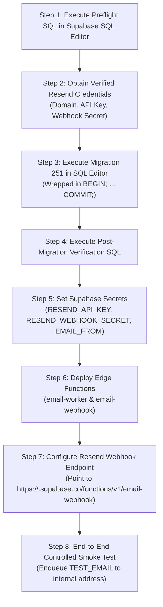

# Make Me Topper — Transactional Email System (Phase 1)
# Production Deployment Readiness Audit & Safety Gate

**Audit Date:** November 20, 2026  
**Audited Artifacts:**
- Database Migration: `mocktest-admin/supabase/migrations/251_email_notification_queue.sql`
- Edge Function Worker: `mocktest-admin/supabase/functions/email-worker/` (`index.ts`, `emailWorkerCore.ts`, `deno.json`)
- Edge Function Webhook: `mocktest-admin/supabase/functions/email-webhook/` (`index.ts`, `emailWebhookCore.ts`, `deno.json`)
- Shared Modules: `mocktest-admin/supabase/functions/_shared/email/` (`types.ts`, `templates.ts`, `provider.ts`, `mockProvider.ts`, `resendProvider.ts`, `index.ts`)
- Configuration: `mocktest-admin/supabase/config.toml`
- Test Suite: `mocktest-admin/src/services/admin/__tests__/emailQueueWorkerCore.test.ts`
- Implementation Report: `mocktest-admin/EMAIL_SYSTEM_PHASE_1_IMPLEMENTATION_REPORT.md`

**Target Environment:** Production Supabase Database (Make Me Topper)  
**Execution Mechanism:** Supabase Dashboard SQL Editor (Manual Execution)  
**Audit Status:** Complete  
**Final Verdict:** **READY AFTER SPECIFIED CORRECTIONS**

---

## 1. Executive Summary

A comprehensive, read-only technical audit of the Phase 1 Transactional Email System was performed to evaluate its safety, compatibility, security posture, and runtime behavior before manual application to the live production database.

### Core Audit Conclusions:
1. **Migration 251 is Strictly Additive:**  
   The migration introduces three new isolated tables (`public.email_queue`, `public.email_suppressions`, `public.email_delivery_logs`), three new custom enum types (`email_queue_status`, `email_delivery_status`, `email_priority`), six performance indexes, and seven `SECURITY DEFINER` RPCs. It modifies **zero** existing tables, modifies **zero** existing rows, replaces **zero** existing functions, and creates no locks on critical production tables.
2. **Schema Reference Correctness:**  
   The only external foreign key reference in Migration 251 is `public.email_queue.recipient_profile_id` referencing `public.profiles(profile_id) ON DELETE SET NULL`. This exactly matches the production primary key of `public.profiles` (`profile_id UUID NOT NULL`).
3. **Strict Data Isolation & RLS:**  
   All three newly created tables have Row Level Security enabled. All table permissions are revoked from `anon`, `authenticated`, and `public`, and granted strictly to `service_role`. All seven RPCs are `SECURITY DEFINER` with fixed `search_path = public, pg_temp` and execute permissions granted exclusively to `service_role`. Ordinary students, authenticated users, and anonymous callers cannot read, enqueue, or modify queue records.
4. **Historical Migration Table Independence:**  
   Because the production database has historically been managed via Dashboard SQL Editor and returns zero rows in `supabase_migrations.schema_migrations`, executing Migration 251 manually in SQL Editor will not conflict with or alter CLI migration history.
5. **Critical Pre-Deployment Findings in Edge Functions (Must be Remedied Before Worker/Webhook Deployment):**
   - **Finding W-1 (Worker Mock Provider Fallback):** In `email-worker/index.ts`, if `RESEND_API_KEY` is unset or blank, the worker defaults to `MockEmailProvider` and marks database jobs as `sent` (`delivery_status = 'accepted'`) without delivering real emails. In production, this causes silent transactional email drops if the function is triggered before configuring `RESEND_API_KEY`.
   - **Finding W-2 (Webhook Unauthenticated Pass-Through):** In `email-webhook/index.ts`, if `RESEND_WEBHOOK_SECRET` is unset, the function logs a warning and skips Svix signature verification, permitting arbitrary public HTTP POST requests to inject false bounces or spam complaints into `public.email_suppressions`.
   - **Finding W-3 (Webhook Event Deduplication Gap):** `email_delivery_logs` does not enforce a unique constraint on webhook message/event IDs (`svix-id`), meaning provider retries produce duplicate delivery log entries.

---

## 2. Migration 251 SQL Review

Every statement in `supabase/migrations/251_email_notification_queue.sql` was evaluated against production safety criteria:

| SQL Block / Statement | Object Created / Modified | Modifies Existing Objects? | Risk Level | Safety Assessment |
|---|---|---|---|---|
| **Lines 31–61** | Types: `email_queue_status`, `email_delivery_status`, `email_priority` | No | Very Low | Enclosed in an anonymous `DO $$` block checking `IF NOT EXISTS (SELECT 1 FROM pg_type WHERE typname = ...)`. Safe against re-execution. |
| **Lines 64–91** | Table: `public.email_queue` | No | Low | Uses `CREATE TABLE IF NOT EXISTS`. References `public.profiles(profile_id)` on delete set null. Uses `gen_random_uuid()`. Check constraints enforce non-negative attempts. `UNIQUE (idempotency_key)` allows standard SQL nullable entries. |
| **Lines 94–100** | Table: `public.email_suppressions` | No | Very Low | Uses `CREATE TABLE IF NOT EXISTS` with `email varchar(255) PRIMARY KEY`. Fully decoupled from commerce/auth tables. |
| **Lines 103–111** | Table: `public.email_delivery_logs` | No | Very Low | Uses `CREATE TABLE IF NOT EXISTS`. Foreign key to `public.email_queue(queue_id) ON DELETE CASCADE`. Decoupled from existing tables. |
| **Lines 114–133** | Indexes: `idx_email_queue_claim`, `idx_email_queue_stale_locks`, `idx_email_queue_recipient`, `idx_email_queue_email`, `idx_email_delivery_logs_queue`, `idx_email_delivery_logs_provider_msg` | No | Very Low | All use `CREATE INDEX IF NOT EXISTS`. Partial indexes target specific queue statuses (`pending`, `processing`) without locking or scanning existing data. |
| **Lines 135–147** | RLS & Grants on Tables | No | Very Low | `ALTER TABLE ... ENABLE ROW LEVEL SECURITY`. Revokes all privileges from `public, anon, authenticated`. Grants all privileges strictly to `service_role`. |
| **Lines 151–194** | RPC: `claim_email_queue_batch(integer, text)` | No | Very Low | `CREATE OR REPLACE FUNCTION`. `SECURITY DEFINER SET search_path = public, pg_temp`. Uses `FOR UPDATE SKIP LOCKED` inside a CTE. Clamps batch size between 1 and 50. Prevents concurrent worker contention. |
| **Lines 198–239** | RPC: `record_email_success(uuid, text)` | No | Very Low | `CREATE OR REPLACE FUNCTION`. Updates queue status to `sent`, delivery status to `accepted`, clears lock, and writes sent log. Returns boolean. |
| **Lines 243–339** | RPC: `schedule_email_retry(uuid, text, integer)` | No | Very Low | `CREATE OR REPLACE FUNCTION`. Increments attempts. Transitions to `failed` if `attempts >= max_attempts`; else reschedules to `pending` with `next_retry_at = now() + delay`. Safe row lock via `FOR UPDATE`. |
| **Lines 343–380** | RPC: `mark_email_failed(uuid, text)` | No | Very Low | `CREATE OR REPLACE FUNCTION`. Sets status to `failed`, clears locks, writes permanent failure log. |
| **Lines 384–420** | RPC: `cancel_email_job(uuid, text)` | No | Very Low | `CREATE OR REPLACE FUNCTION`. Sets status to `cancelled`, clears locks, writes cancellation log. |
| **Lines 424–454** | RPC: `recover_abandoned_email_locks(integer)` | No | Very Low | `CREATE OR REPLACE FUNCTION`. Resets stale processing jobs where `locked_at < now() - interval` back to `pending`. Returns count of recovered locks. |
| **Lines 458–559** | RPC: `enqueue_email_job(...)` | No | Very Low | `CREATE OR REPLACE FUNCTION`. Validates email format, checks suppression table, validates idempotency key, inserts with `ON CONFLICT (idempotency_key) DO UPDATE SET updated_at = ... RETURNING queue_id`. Returns structured JSON. |
| **Lines 562–576** | RPC Execution Grants | No | Very Low | Revokes `EXECUTE` on all 7 functions from `public, anon, authenticated`. Grants `EXECUTE` strictly to `service_role`. |

---

## 3. Production Compatibility Findings

### 3.1 Existing Database Functionality Impact
- **Payment Processing:** Zero impact. Razorpay webhooks, Apple IAP verification (Migrations 247–249), and Google Play RTDN workflows do not call or reference `public.email_queue` in Phase 1.
- **Installment Engine:** Zero impact. Migrations 240, 241, and 242 installment authorization, access decoupling, and overdue lockout tables are not touched.
- **Live Classes & Exam Engine:** Zero impact. Timetable occurrence materialization and live test submissions remain untouched.
- **Student Profile Records:** Zero impact. Foreign key on `recipient_profile_id` is nullable and uses `ON DELETE SET NULL`, meaning student profile lifecycle operations (e.g. deletion/update) are never blocked by email queue records.

### 3.2 Enum Label Safety
PostgreSQL does not permit creating an ENUM type if another type with the same name already exists in the same schema. Migration 251 safely wraps enum creation in an `IF NOT EXISTS` check querying `pg_type`. However, if an earlier draft of `email_queue_status` exists with different labels, the subsequent `CREATE TABLE` would adopt the existing type. The Preflight SQL script in Section 8 confirms no conflicting type names exist prior to execution.

### 3.3 Dashboard SQL Editor Safety
- Migration 251 contains only standard PostgreSQL DDL/DML supported by Supabase SQL Editor.
- It does not contain transaction wrappers (`BEGIN`/`COMMIT`) inside the migration file itself. When pasting into Supabase Dashboard SQL Editor, it is strongly recommended to wrap the entire script in `BEGIN; ... COMMIT;` so that if any unexpected error occurs, all changes roll back cleanly without leaving partial tables.

---

## 4. RLS and Permission Review

### 4.1 Table-Level Security
```sql
ALTER TABLE public.email_queue ENABLE ROW LEVEL SECURITY;
ALTER TABLE public.email_suppressions ENABLE ROW LEVEL SECURITY;
ALTER TABLE public.email_delivery_logs ENABLE ROW LEVEL SECURITY;

REVOKE ALL ON TABLE public.email_queue FROM public, anon, authenticated;
REVOKE ALL ON TABLE public.email_suppressions FROM public, anon, authenticated;
REVOKE ALL ON TABLE public.email_delivery_logs FROM public, anon, authenticated;

GRANT ALL ON TABLE public.email_queue TO service_role;
GRANT ALL ON TABLE public.email_suppressions TO service_role;
GRANT ALL ON TABLE public.email_delivery_logs TO service_role;
```
- **Public / Anonymous Access:** Strictly denied. No grants and no permissive RLS policies.
- **Authenticated Student Access:** Strictly denied. Students querying the PostgREST API (`/rest/v1/email_queue`) receive `HTTP 403 Forbidden` or empty responses, preventing access to recipient emails, subjects, or payloads.
- **Service Role Access:** Granted full table privileges (`ALL`). The Supabase `service_role` has the `BYPASSRLS` attribute, allowing backend workers and administrative functions to execute queue operations unimpeded.

### 4.2 Function-Level Security
- Every RPC declares `SECURITY DEFINER SET search_path = public, pg_temp`.
- Pinning the search path prevents search-path hijacking attacks.
- Execution privileges are explicitly revoked from `public, anon, authenticated` and granted exclusively to `service_role`. Direct RPC invocation via PostgREST (`/rest/v1/rpc/claim_email_queue_batch`) is rejected for anonymous or ordinary user JWTs.

---

## 5. Worker Security & Runtime Behavior Review

### 5.1 Worker Authentication
- The HTTP entrypoint (`email-worker/index.ts`) verifies caller identity using:
  1. `isServiceRoleCall(authHeader)`: Performs constant-time comparison of the incoming `Bearer <token>` against `SUPABASE_SERVICE_ROLE_KEY`.
  2. `X-Worker-Key`: Compares against `EMAIL_WORKER_SECRET` if configured.
- If neither credential matches, the worker rejects the request immediately with `HTTP 401 Unauthorized`.
- If `SUPABASE_SERVICE_ROLE_KEY` is missing in the environment, `isServiceRoleCall` fails closed (`reason: 'env_key_missing'`).

### 5.2 Concurrency & Stale Lock Safety
- Batch claiming utilizes `FOR UPDATE SKIP LOCKED`. If two worker instances fire concurrently (e.g. double trigger from cron or admin), row claiming is strictly mutually exclusive.
- Stale locks from crashed worker executions are recovered by calling `recover_abandoned_email_locks(300)` at the beginning of each cycle, resetting jobs in `processing` with `locked_at < now() - 300s` back to `pending`.

### 5.3 Error Isolation & Job Retention
- In `runEmailWorkerBatch`, each claimed job is wrapped in an isolated `try/catch` block. A template error or provider timeout on Job 1 does not disrupt Job 2 or Job 3.
- Transient errors (HTTP 429, 500, 502, 503, 504, network timeouts) trigger exponential backoff ($60 \times 2^{\text{attempts}}$ capped at 3600s, respecting `Retry-After`). The job remains in `pending` until attempts reach `max_attempts` (default: 5), after which it is marked `failed`. No job is deleted upon failure.

### 5.4 CRITICAL FINDING: Unconfigured `RESEND_API_KEY` Causes Silent Email Loss
- **Code Reference:** `email-worker/index.ts`, lines 33–34, 104–106:
  ```typescript
  const RESEND_API_KEY = Deno.env.get('RESEND_API_KEY') || '';
  const MOCK_EMAIL = Deno.env.get('MOCK_EMAIL') === 'true' || !RESEND_API_KEY;
  ...
  if (MOCK_EMAIL) {
    provider = new MockEmailProvider();
    console.log('[email-worker] Operating in MOCK EMAIL provider mode');
  }
  ```
- **Consequence:** If `RESEND_API_KEY` is omitted from Supabase Secrets in production, the worker silently initializes `MockEmailProvider`. `MockEmailProvider.sendEmail()` returns `success: true` with a synthetic ID (`mock_msg_...`). The worker then executes `record_email_success`, updating the database to `sent`. Real students will receive **no email**, while the database indicates the email was dispatched.
- **Required Production Correction:** Before deploying `email-worker`, `RESEND_API_KEY` must be set in Supabase Secrets. Furthermore, the worker code should be hardened to fail closed in production (reject batch execution with HTTP 500 if `RESEND_API_KEY` is missing, unless an explicit `ALLOW_MOCK_EMAIL=true` override is set).

---

## 6. Provider Configuration Review

### 6.1 Resend Provider Behavior (`resendProvider.ts`)
- **API Endpoint:** `POST https://api.resend.com/emails`
- **Sender Address (`from`):** Defaults to `EMAIL_FROM` environment variable, falling back to `Make Me Topper <notifications@makemetopper.com>`.
- **Reply-To:** Defaults to `EMAIL_REPLY_TO` environment variable, falling back to `support@makemetopper.com`.
- **Idempotency Transmission:** If `idempotencyKey` is present on the queue job, the provider forwards it in the `Idempotency-Key` HTTP header to Resend, ensuring Resend's API will not send duplicate messages on network retries.
- **Timeout Management:** Uses native `AbortController` set to 10,000ms. If Resend does not respond within 10 seconds, the request aborts and classifies as a transient retryable error (HTTP 408 / network failure).

---

## 7. Webhook Security & Signature Review

### 7.1 Svix Signature Verification (`emailWebhookCore.ts`)
- Resend webhooks deliver signatures in standard Svix headers: `svix-id`, `svix-timestamp`, `svix-signature`.
- **Verification Process:**
  1. Base64-decodes the secret (stripping `whsec_` prefix).
  2. Constructs the signed message: `${svixId}.${svixTimestamp}.${rawBody}`.
  3. Computes HMAC-SHA256 using standard Web Crypto API (`crypto.subtle`).
  4. Compares the resulting digest against `svix-signature` using `timingSafeEqual` to eliminate timing side-channel attacks.
  5. Enforces timestamp tolerance (300 seconds) against current server time, rejecting replay attacks.

### 7.2 CRITICAL FINDING: Missing `RESEND_WEBHOOK_SECRET` Bypasses Verification
- **Code Reference:** `email-webhook/index.ts`, lines 61–84:
  ```typescript
  if (RESEND_WEBHOOK_SECRET) {
    const verification = await verifySvixWebhookSignature({ ... });
    if (!verification.valid) return jsonResponse({ error: 'Invalid Signature' }, 401);
  } else {
    console.warn('[email-webhook] Warning: RESEND_WEBHOOK_SECRET is not configured. Webhook signature skipped.');
  }
  ```
- **Consequence:** If `email-webhook` is deployed before configuring `RESEND_WEBHOOK_SECRET`, the signature check is skipped entirely. Any unauthenticated caller could forge an `email.complained` or `email.bounced` payload to `/email-webhook` and force legitimate student email addresses into `public.email_suppressions`, permanently blocking them from receiving platform communications.
- **Required Production Correction:** The webhook handler must fail closed: if `RESEND_WEBHOOK_SECRET` is unset, reject incoming webhook requests with `HTTP 500 Secret Not Configured`.

### 7.3 CRITICAL FINDING: Webhook Event Deduplication
- **Code Reference:** `emailWebhookCore.ts`, lines 294–303:
  ```typescript
  if (queueId) {
    await supabaseClient.from('email_delivery_logs').insert({
      queue_id: queueId,
      provider: 'resend',
      event_type: eventType,
      provider_message_id: providerMessageId,
      payload: rawPayload,
    });
  }
  ```
- `email_delivery_logs` does not store `svix-id`, and lacks a unique constraint on `(provider_message_id, event_type)`. If Resend retries delivery of a webhook due to a transient network delay, duplicate rows are written to `email_delivery_logs`.
- While delivery status update on `email_queue` (`delivery_status = status`) is naturally idempotent, the delivery logs table will accumulate redundant entries. Adding `svix_id` / `event_id` tracking in Phase 2 is recommended.

---

## 8. Production Preflight SQL

Execute the following read-only SQL script in the **Supabase Dashboard SQL Editor** before running Migration 251.

```sql
-- ============================================================================
-- Make Me Topper — Phase 1 Transactional Email System Preflight Inspection
-- READ-ONLY: Executes zero modifications to the database
-- ============================================================================

SELECT '--- 1. Check Required Extensions ---' AS inspection_step;
SELECT 
    extname, 
    extversion, 
    installed 
FROM pg_extension 
WHERE extname IN ('pgcrypto', 'uuid-ossp');

SELECT '--- 2. Check Existing Conflicting Enum Types ---' AS inspection_step;
SELECT 
    t.typname, 
    e.enumlabel, 
    e.enumsortorder
FROM pg_type t
LEFT JOIN pg_enum e ON t.oid = e.enumtypid
WHERE t.typname IN ('email_queue_status', 'email_delivery_status', 'email_priority')
ORDER BY t.typname, e.enumsortorder;

SELECT '--- 3. Check Existing Conflicting Tables ---' AS inspection_step;
SELECT 
    table_schema, 
    table_name 
FROM information_schema.tables 
WHERE table_schema = 'public' 
  AND table_name IN ('email_queue', 'email_suppressions', 'email_delivery_logs');

SELECT '--- 4. Verify Foreign Key Target: public.profiles(profile_id) ---' AS inspection_step;
SELECT 
    table_name, 
    column_name, 
    data_type, 
    is_nullable
FROM information_schema.columns 
WHERE table_schema = 'public' 
  AND table_name = 'profiles' 
  AND column_name = 'profile_id';

SELECT '--- 5. Check Existing Conflicting Functions/RPCs ---' AS inspection_step;
SELECT 
    n.nspname AS schema_name,
    p.proname AS function_name,
    pg_get_function_identity_arguments(p.oid) AS arguments
FROM pg_proc p
JOIN pg_namespace n ON p.pronamespace = n.oid
WHERE n.nspname = 'public'
  AND p.proname IN (
    'claim_email_queue_batch',
    'record_email_success',
    'schedule_email_retry',
    'mark_email_failed',
    'cancel_email_job',
    'recover_abandoned_email_locks',
    'enqueue_email_job'
  );

SELECT '--- 6. Check Existing Conflicting Indexes ---' AS inspection_step;
SELECT 
    schemaname, 
    tablename, 
    indexname 
FROM pg_indexes 
WHERE schemaname = 'public' 
  AND indexname IN (
    'idx_email_queue_claim',
    'idx_email_queue_stale_locks',
    'idx_email_queue_recipient',
    'idx_email_queue_email',
    'idx_email_delivery_logs_queue',
    'idx_email_delivery_logs_provider_msg'
  );

SELECT '--- 7. Verify Required Database Roles ---' AS inspection_step;
SELECT 
    rolname 
FROM pg_roles 
WHERE rolname IN ('anon', 'authenticated', 'service_role');
```

### Expected Preflight Results:
1. **Extensions:** `pgcrypto` or core UUID support must be available.
2. **Conflicting Types:** `0 rows` returned.
3. **Conflicting Tables:** `0 rows` returned.
4. **Foreign Key Target:** `1 row` returned (`profiles`, `profile_id`, `uuid`, `NO`).
5. **Conflicting Functions:** `0 rows` returned.
6. **Conflicting Indexes:** `0 rows` returned.
7. **Database Roles:** `3 rows` returned (`anon`, `authenticated`, `service_role`).

---

## 9. Post-Migration Verification SQL

Execute the following read-only SQL script immediately after applying Migration 251 in the **Supabase Dashboard SQL Editor**:

```sql
-- ============================================================================
-- Make Me Topper — Phase 1 Post-Migration Verification Script
-- READ-ONLY: Confirms all objects, RLS policies, and RPC permissions
-- ============================================================================

SELECT '--- 1. Verify Created Tables ---' AS step;
SELECT 
    table_name, 
    rowsecurity AS rls_enabled
FROM pg_tables 
WHERE schemaname = 'public' 
  AND table_name IN ('email_queue', 'email_suppressions', 'email_delivery_logs')
ORDER BY table_name;

SELECT '--- 2. Verify Table Grants (Should ONLY be service_role) ---' AS step;
SELECT 
    table_name, 
    grantee, 
    privilege_type 
FROM information_schema.table_privileges 
WHERE table_schema = 'public' 
  AND table_name IN ('email_queue', 'email_suppressions', 'email_delivery_logs')
  AND grantee IN ('anon', 'authenticated', 'public')
ORDER BY table_name, grantee;

SELECT '--- 3. Verify Created RPCs and Search Path ---' AS step;
SELECT 
    p.proname AS function_name,
    p.prosecdef AS is_security_definer,
    p.proconfig AS function_settings,
    pg_get_function_identity_arguments(p.oid) AS arguments
FROM pg_proc p
JOIN pg_namespace n ON p.pronamespace = n.oid
WHERE n.nspname = 'public'
  AND p.proname IN (
    'claim_email_queue_batch',
    'record_email_success',
    'schedule_email_retry',
    'mark_email_failed',
    'cancel_email_job',
    'recover_abandoned_email_locks',
    'enqueue_email_job'
  )
ORDER BY p.proname;

SELECT '--- 4. Verify RPC Execution Grants (Should ONLY be service_role) ---' AS step;
SELECT 
    routine_name, 
    grantee, 
    privilege_type 
FROM information_schema.routine_privileges 
WHERE routine_schema = 'public' 
  AND routine_name IN (
    'claim_email_queue_batch',
    'record_email_success',
    'schedule_email_retry',
    'mark_email_failed',
    'cancel_email_job',
    'recover_abandoned_email_locks',
    'enqueue_email_job'
  )
  AND grantee IN ('anon', 'authenticated', 'public');

SELECT '--- 5. Verify Created Indexes ---' AS step;
SELECT 
    tablename, 
    indexname 
FROM pg_indexes 
WHERE schemaname = 'public' 
  AND tablename IN ('email_queue', 'email_suppressions', 'email_delivery_logs')
ORDER BY tablename, indexname;
```

### Expected Post-Migration Verification Results:
1. **Tables & RLS:** All 3 tables show `rls_enabled = true`.
2. **Table Grants:** `0 rows` returned for `anon`, `authenticated`, or `public`.
3. **RPCs:** All 7 functions show `is_security_definer = true` and `function_settings` contains `search_path=public, pg_temp`.
4. **RPC Grants:** `0 rows` returned for `anon`, `authenticated`, or `public`.
5. **Indexes:** 6 custom indexes listed alongside the 3 primary key/unique constraints.

---

## 10. Deployment Sequence

To prevent the silent email loss and unauthenticated webhook risks identified in Sections 5 and 7, execute deployment in the following order:



### Step 1: Execute Preflight SQL
- Run the Preflight SQL script from Section 8 in the Supabase Dashboard SQL Editor.
- Verify that 0 conflicting objects exist and that `public.profiles(profile_id)` is present.

### Step 2: Resend Prerequisites Verification
- **Verified Domain:** Ensure `makemetopper.com` (or authorized subdomain) is in **Verified** status with active DKIM, SPF, and DMARC in the Resend Dashboard.
- **API Key:** Generate a production Resend API key with sending permissions.
- **Webhook Secret:** Create a webhook endpoint in Resend pointing to `https://<supabase-project-ref>.supabase.co/functions/v1/email-webhook` and retrieve the signing secret (`whsec_...`).

### Step 3: Manual Execution of Migration 251 in SQL Editor
- In the Supabase Dashboard SQL Editor, wrap the contents of `mocktest-admin/supabase/migrations/251_email_notification_queue.sql` in a transactional block:
  ```sql
  BEGIN;
  -- <Paste contents of 251_email_notification_queue.sql>
  COMMIT;
  ```
- Execute the script and confirm `Success. No rows returned`.

### Step 4: Post-Migration Verification SQL
- Execute the verification script from Section 9. Confirm all 3 tables have RLS enabled, zero public grants exist, and all 7 RPCs are `SECURITY DEFINER`.

### Step 5: Configure Supabase Secrets BEFORE Function Deployment
- Using the Supabase CLI or Dashboard Settings $\rightarrow$ Edge Functions $\rightarrow$ Secrets:
  ```bash
  supabase secrets set RESEND_API_KEY="re_..."
  supabase secrets set RESEND_WEBHOOK_SECRET="whsec_..."
  supabase secrets set EMAIL_FROM="Make Me Topper <notifications@makemetopper.com>"
  supabase secrets set EMAIL_REPLY_TO="support@makemetopper.com"
  supabase secrets set EMAIL_WORKER_SECRET="<generate-random-high-entropy-secret>"
  ```
- **CRITICAL:** Secrets MUST be configured before deploying `email-worker` or `email-webhook` to eliminate the mock fallback and signature skip risks.

### Step 6: Deploy Edge Functions
- Deploy the functions from `mocktest-admin`:
  ```bash
  supabase functions deploy email-worker --no-verify-jwt
  supabase functions deploy email-webhook --no-verify-jwt
  ```

### Step 7: Finalize Resend Webhook Configuration
- In the Resend Dashboard, configure the webhook to subscribe to events:
  - `email.delivered`
  - `email.bounced`
  - `email.complained`
  - `email.opened`
  - `email.clicked`

### Step 8: Controlled Test Using a Designated Internal Recipient
- Call `enqueue_email_job` directly in the SQL Editor to insert one synthetic test job to an internal Make Me Topper team email address:
  ```sql
  SELECT public.enqueue_email_job(
      p_recipient_email => 'internal-test@makemetopper.com',
      p_subject => 'Make Me Topper — Notification System Phase 1 Verification',
      p_template_id => 'test_email',
      p_payload => jsonb_build_object(
          'title', 'Phase 1 Smoke Test',
          'message', 'This confirms end-to-end queue, worker, and Resend delivery.',
          'actionUrl', 'https://makemetopper.com',
          'actionText', 'Verify Dashboard'
      ),
      p_event_type => 'TEST-01',
      p_priority => 'high',
      p_idempotency_key => 'smoke-test-phase1-' || clock_timestamp()::text
  );
  ```
- Trigger `email-worker` using curl or Postman presenting the `SUPABASE_SERVICE_ROLE_KEY` bearer token:
  ```bash
  curl -i -X POST "https://<supabase-project-ref>.supabase.co/functions/v1/email-worker" \
    -H "Authorization: Bearer <SUPABASE_SERVICE_ROLE_KEY>" \
    -H "Content-Type: application/json" \
    -d '{"batchSize": 5}'
  ```
- Verify:
  1. Internal inbox receives the branded Make Me Topper email.
  2. `SELECT status, delivery_status, provider_message_id FROM public.email_queue` shows `status = 'sent'`, `delivery_status = 'accepted'`.
  3. Resend webhook fires, transitioning `delivery_status` to `'delivered'`.

---

## 11. Rollback Strategy

If rollback is required at any stage, follow this structured, dependency-safe plan:

### 11.1 Partial Migration Failure
If Migration 251 fails mid-execution in the SQL Editor while wrapped in `BEGIN; ... COMMIT;`, PostgreSQL rolls back all changes automatically. If executed without a transaction block, run the following teardown script:

```sql
-- Clean teardown in reverse dependency order
DROP FUNCTION IF EXISTS public.claim_email_queue_batch(integer, text);
DROP FUNCTION IF EXISTS public.record_email_success(uuid, text);
DROP FUNCTION IF EXISTS public.schedule_email_retry(uuid, text, integer);
DROP FUNCTION IF EXISTS public.mark_email_failed(uuid, text);
DROP FUNCTION IF EXISTS public.cancel_email_job(uuid, text);
DROP FUNCTION IF EXISTS public.recover_abandoned_email_locks(integer);
DROP FUNCTION IF EXISTS public.enqueue_email_job(text, text, text, jsonb, uuid, text, text, public.email_priority, text, integer);

DROP TABLE IF EXISTS public.email_delivery_logs;
DROP TABLE IF EXISTS public.email_suppressions;
DROP TABLE IF EXISTS public.email_queue;

DROP TYPE IF EXISTS public.email_priority;
DROP TYPE IF EXISTS public.email_delivery_status;
DROP TYPE IF EXISTS public.email_queue_status;
```

### 11.2 Edge Function Failure Post-Migration
If Migration 251 succeeds but `email-worker` or `email-webhook` encounter runtime errors:
1. **Zero Database Impact:** Because Phase 1 does NOT connect commerce, payment, or enrollment triggers to `enqueue_email_job`, an inoperable Edge Function has zero impact on active student operations.
2. **Undeploy / Disable Functions:**
   ```bash
   supabase functions delete email-worker
   supabase functions delete email-webhook
   ```
3. **Database Objects Can Remain Intact:** The tables and RPCs in Migration 251 are dormant until jobs are enqueued. They do not need to be dropped unless a complete schema rollback is requested.

---

## 12. Unresolved Risks & Recommendations

| Risk Item | Severity | Current Behavior | Mitigation / Pre-Requisite |
|---|---|---|---|
| **R-1: Missing `RESEND_API_KEY` in Worker** | **HIGH** | Worker defaults to `MockEmailProvider` and marks jobs as `sent` without sending real emails. | Configure `RESEND_API_KEY` secret before deploying worker. Patch worker to fail closed if secret is missing in production. |
| **R-2: Missing `RESEND_WEBHOOK_SECRET` in Webhook** | **HIGH** | Webhook logs warning and skips signature verification, allowing unauthenticated suppression injection. | Configure `RESEND_WEBHOOK_SECRET` secret before deploying webhook. Patch webhook to return HTTP 500 if secret is missing. |
| **R-3: Webhook Event Deduplication** | **MEDIUM** | Duplicate webhook deliveries insert duplicate rows into `email_delivery_logs`. | Delivery status updates are idempotent, but Phase 2 should add unique constraint on webhook message/event IDs. |
| **R-4: Unverified Sender Domain in Resend** | **MEDIUM** | If sending domain is not verified, Resend returns HTTP 422 which worker classifies as permanent failure. | Complete domain verification in Resend before triggering any production jobs. |

---

## 13. Final Deployment Recommendation

### Verdict: **READY AFTER SPECIFIED CORRECTIONS**

### Justification:
1. **Migration 251 SQL is 100% Production Ready:** The database migration is strictly additive, enforces strict RLS, uses safe `SECURITY DEFINER` RPCs with immutable search paths, locks safely via `FOR UPDATE SKIP LOCKED`, and touches zero existing commerce or student data. It is approved for manual application in the Supabase Dashboard SQL Editor.
2. **Edge Function Deployments Must Follow the Prerequisite Guardrails:**
   - **Do NOT deploy `email-worker`** until `RESEND_API_KEY` is configured in Supabase Secrets (to prevent silent email drops via `MockEmailProvider`).
   - **Do NOT deploy `email-webhook`** until `RESEND_WEBHOOK_SECRET` is configured in Supabase Secrets (to prevent unauthenticated bypass of signature checks).
   - Once secrets are configured and the preflight SQL is confirmed, the full Phase 1 system can be safely deployed following the sequence in Section 10.

