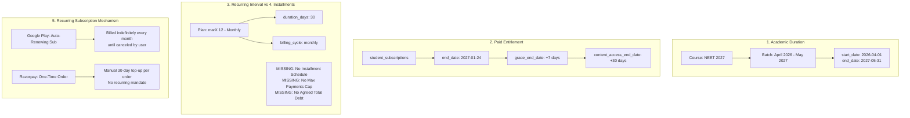
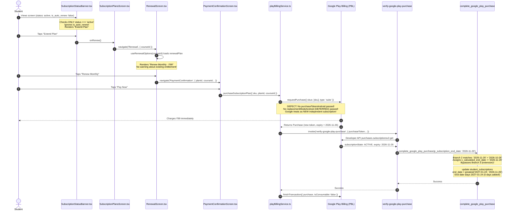
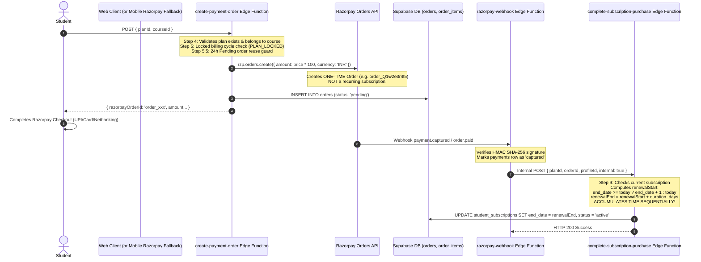
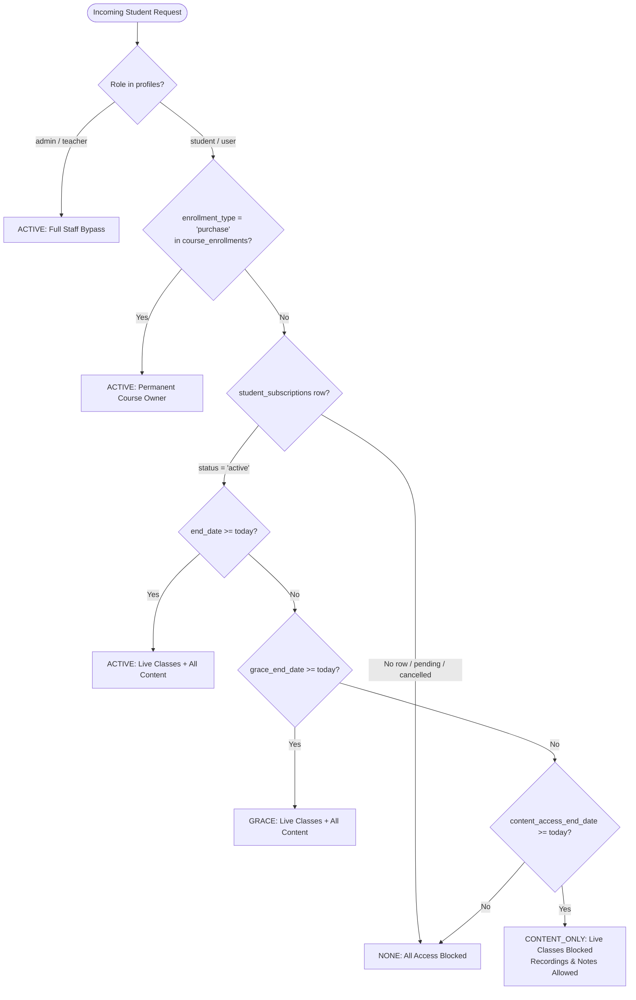

# Make Me Topper: Subscription, Installment, and Course Billing Model Investigation & Architecture Report

**Document Reference:** `MMT-ARCH-2026-BILLING-01`  
**Date of Audit:** October 27, 2026  
**Status:** Read-Only Technical & Architectural Analysis (No Code or Database Changes Applied)  
**Primary Repositories Analyzed:**
- Android App: `C:\Projects\MockTestApp` (React Native / `react-native-iap` v15.x)
- Backend & Admin: `C:\Projects\mocktest-admin` (Supabase, PostgreSQL 16, Deno Edge Functions)
- Public Website: `C:\Projects\makemetopper-web` (Next.js 15, `@supabase/ssr`, Tailwind CSS v4)

---

## 1. Executive Summary

### 1.1 Objective & Problem Statement
Make Me Topper distributes finite-duration educational test-preparation courses (e.g., a 6-month NEET or JEE preparation course priced at ₹12,000) across two customer touchpoints: an Android application using Google Play Billing and a public web platform using Razorpay, synchronized through a shared Supabase backend.

The platform faces a foundational architectural mismatch between three conflicting concepts:
1. **Academic Course Duration:** A finite educational delivery period (e.g., 6 months from batch start to exam date).
2. **Payment Modality:** Allowing students to break a ₹12,000 fee into monthly tranches (e.g., ₹2,000/month) rather than paying upfront.
3. **Billing Mechanism:** The existing implementation conflates recurring indefinite memberships with fixed-term installment agreements, while the mobile client presents an unconstrained "Extend Plan" button that treats auto-renewing subscriptions as ad-hoc prepaid top-ups.

### 1.2 Summary of Key Findings
* **Google Play Product Model:** The known monthly plan (`marX 12 - Monthly`, SKU `sub_fe232782d73440dab01b92a9cc27c47c`, base plan `p1m`) is implemented and treated in backend validation code as an **auto-renewing subscription** (`lineItem.autoRenewingPlan`), not a prepaid plan.
* **Google Play India Constraint:** **Google Play installment subscriptions are not available in India.** Google Play limits installment subscription products to France, Italy, Spain, and Brazil. In India, Google Play only supports Auto-Renewing Subscriptions (via UPI AutoPay and RBI-compliant cards) and Prepaid Plans (manual top-ups).
* **Client UI Flaw:** The Android app's `SubscriptionStatusBanner` unconditionally presents "Extend Plan" whenever `status === 'active'`, completely ignoring `is_auto_renew`. When tapped on a canceled-but-active subscription, the app launches a brand new checkout without passing the existing purchase token or replacement mode (`DEFERRED`).
* **Backend RPC Branch Precedence Flaw:** In PostgreSQL migration 218 (`complete_google_play_purchase`), Branch 2 evaluates `p_subscription_end_date > v_start_date` before Branch 3 (the renewal extension branch). When a user buys an unlinked 1-month subscription, Google reports an expiry of 1 month from today (`2026-11-26`). Because `2026-11-26 > 2026-10-26`, the RPC overrides `v_calculated_end_date` with Google's short expiry date. The monotonic date update `greatest(end_date, v_calculated_end_date)` then preserves the existing future date (`2027-01-24`). **The student was charged ₹99 and granted exactly 0 additional days of entitlement.**
* **Current Website Status:** The repository `C:\Projects\makemetopper-web` is currently in its initial scaffolding phase ("First draft" commit). The checkout, pricing, and subscription management pages have not yet been built into the frontend. Backend Edge Functions (`create-payment-order`, `razorpay-webhook`, `complete-subscription-purchase`) already exist in `mocktest-admin` and are used by the mobile app's fallback/Razorpay flows.
* **Actual Razorpay Implementation:** Razorpay is integrated as **one-time ad-hoc payment orders** (`razorpay.orders.create`), **not** Razorpay Subscriptions (`razorpay.subscriptions.create`). There are no recurring auto-debit mandates on Razorpay. Every "renewal" on Razorpay is an intentional, manual purchase that the backend accumulates sequentially (`end_date + duration_days`).
* **Total Absence of Installment Data Schema:** The database contains zero tables, columns, or triggers tracking installment numbers (e.g., "Installment 2 of 6"), remaining installments, total course fees owed, or scheduled termination dates.

---

## 2. Repositories Inspected & Project Status

| Repository Path | Project Role | Technology Stack | Status / Findings |
| :--- | :--- | :--- | :--- |
| `C:\Projects\MockTestApp` | Android Mobile Application | React Native 0.76.x, `react-native-iap` 15.x, Redux Toolkit, React Query | Fully active mobile codebase. Implements Google Play Billing with fallback to Razorpay SDK. Contains the defective "Extend Plan" UI path. |
| `C:\Projects\mocktest-admin` | Shared Backend, Admin & Migrations | Supabase, PostgreSQL 16 (218 migrations), Deno Edge Functions, React Admin | Authoritative source of truth for all commerce, subscriptions, and access control. Contains `verify-google-play-purchase`, `google-play-rtdn-webhook`, `create-payment-order`, and `complete-subscription-purchase`. |
| `C:\Projects\makemetopper-web` | Public Website | Next.js 15.5.0, React 19, `@supabase/ssr`, Tailwind CSS v4, Motion | Scaffolded Next.js project with design tokens, brand assets, and Supabase client/middleware. `lib/env.ts` configures `RAZORPAY_KEY_SECRET` and `NEXT_PUBLIC_RAZORPAY_KEY_ID`. Checkout and subscription purchase screens are **not yet implemented**. |

---

## 3. Data Model Audit: Course, Duration, Pricing, and Entitlement

### 3.1 Data Model Inventory

| Concept | Primary Database Table(s) | Primary Column(s) | Type / Semantics | Current Real Usage in Code |
| :--- | :--- | :--- | :--- | :--- |
| **Course** | `public.courses` | `course_id`, `institute_id`, `title`, `slug`, `status` | UUID, Enum (`draft`, `published`, `archived`) | The master catalog entity. Defines the educational offering. |
| **Course Academic Duration** | `public.courses` | `duration` | `integer null` | Display-only integer. Does not define a start/end date, nor does it constrain subscription duration. |
| **Batch Academic Schedule** | `public.batches`<br>`public.course_batches` | `batches.start_date`<br>`batches.end_date` | `date not null` | Defines the actual calendar schedule for live classes and timetable slots. Not connected to the billing engine. |
| **Course Total Price** | `public.courses` | `original_price`, `discounted_price`, `currency` | `numeric(10,2)` | Full upfront price for one-time permanent purchase (`enrollment_type = 'purchase'`). Used as the baseline in conversion calculation. |
| **Subscription Plan** | `public.subscription_plans` | `plan_id`, `course_id`, `name`, `price`, `billing_cycle`, `duration_days` | UUID, `plan_billing_cycle_type`, `smallint` | Defines access pricing and duration (e.g. 30 days for ₹99). Scoped to a specific course via `course_id` (Migration 089). |
| **Installment Amount / Count** | *None* | *None* | *Does not exist* | **Not modeled.** There is no field for installment number, total installments, or payment schedule. |
| **Orders & Items** | `public.orders`<br>`public.order_items` | `order_id`, `total_amount`, `status`<br>`item_id`, `item_type`, `plan_id`, `course_id` | UUID, `order_status`, `order_item_type` | Immutable financial ledger of transactions. Supports `item_type in ('course', 'pyq_package', 'subscription_plan')`. |
| **Payments** | `public.payments` | `payment_id`, `order_id`, `gateway`, `gateway_order_id`, `gateway_payment_id`, `status` | UUID, `payment_gateway` (`razorpay`, `google_play`), `payment_status` | Gateway-level capture records. Enforces uniqueness on Google Play order cycle IDs. |
| **Student Subscriptions** | `public.student_subscriptions` | `subscription_id`, `student_id`, `course_id`, `plan_id`, `order_id`, `status`, `start_date`, `end_date`, `grace_end_date`, `content_access_end_date`, `is_auto_renew` | UUID, `subscription_status_type`, `date`, `boolean` | Authoritative record for ongoing subscription access. Exactly one current row per student per course. |
| **Course Entitlement** | `public.course_enrollments` | `enrollment_id`, `course_id`, `student_id`, `enrollment_type`, `is_active`, `expires_at` | UUID, `varchar(20)` (`purchase`, `subscription`, `admin_grant`, `free`) | Permanent access ledger for one-time buyers (`enrollment_type = 'purchase'`, `expires_at = null`). For subscribers, row is synced for dashboards, but access is gated by `student_subscriptions`. |
| **Subscription History** | `public.subscription_history` | `history_id`, `subscription_id`, `status_before`, `status_after`, `change_reason`, `occurred_at` | UUID, `subscription_change_reason` | Append-only audit trail of transitions (`new_purchase`, `renewal`, `cancellation`, `expiration`, etc.). |

### 3.2 Evaluation of the 5 Distinct Concepts



The application currently conflates these concepts in the following ways:
1. **Academic Duration vs. Subscription Duration:** A course's academic calendar is defined in `batches` (e.g., April 1 to May 31 of the next year). However, `subscription_plans.duration_days` simply dictates how many days a single payment buys (typically 30 days). There is no mechanism to bind subscription termination to batch end date.
2. **Paid Entitlement vs. Course Fee:** A monthly subscription does not represent an installment toward the course fee; it purchases 30 days of access. The only bridge is the Full Course Conversion feature (Phase 11K.5 in `create-payment-order/index.ts:1010-1090`), which allows a student to pay the remaining balance:
   $$\text{Remaining Amount} = \max(0, \text{Course Price} - \text{Total Subscription Payments})$$
   However, if a student simply continues renewing monthly, the system will charge them past the course price indefinitely.
3. **Installment vs. Recurring Renewal:** The system cannot distinguish between "Payment 2 of 6" and "Renewal cycle 2 of an indefinite membership".

### 3.3 Answers to Specific Data Model Questions
* **Can a course have a fixed total fee and a separately defined installment schedule?**  
  *No.* The schema supports a fixed total fee (`courses.original_price`) and separate recurring plans (`subscription_plans`), but has no entity representing an installment schedule, payment due dates, or tranche amounts.
* **Can a student enroll for six months but pay monthly?**  
  *Only informally.* The student can purchase a monthly subscription and manually renew (or allow auto-renew) 6 times. However, the system does not enforce a 6-month contract.
* **Does a monthly plan represent one month of access or one installment toward a longer course?**  
  *One month of access.* It is modeled purely as a 30-day time entitlement.
* **Is the total amount payable known when the student enrolls?**  
  *For one-time course purchase: Yes.* For subscriptions: *No.* The student pays ₹99/month indefinitely until they stop or cancel.
* **Is there an explicit maximum number of payments?**  
  *No.* There is no `max_payments`, `total_installments`, or payment counter in `subscription_plans` or `student_subscriptions`.
* **Can the system distinguish between installment 2 of 6 and subscription renewal 2 of an indefinite recurring subscription?**  
  *No.* Both are recorded as standard order items referencing the same `plan_id`.
* **What happens when a student has paid some installments but stops paying?**  
  When auto-renewal fails or is canceled, the subscription transitions to `active` (until `end_date`), then `grace` (7 days), then `expired` (`content_only` for 30 days), and finally `none`. The student loses access to live classes and fresh content. No unpaid balance or debt is tracked.
* **What determines the student's final course-access date?**  
  *For one-time purchase:* Lifetime access (`course_enrollments.expires_at is null`).  
  *For subscriptions:* Strictly `student_subscriptions.end_date` + `grace_days` (7) + `content_access_days` (30). It is completely independent of the course's academic end date.

---

## 4. Android Google Play Billing Implementation Audit

### 4.1 Complete Execution Path of the Extend Plan Button



### 4.2 Code Locations & Exact Functions

1. **Status Banner:**  
   [`SubscriptionStatusBanner.tsx:86-103`](file:///c:/Projects/MockTestApp/src/components/subscription/SubscriptionStatusBanner.tsx#L86-L103)  
   Evaluates `status.status === 'active'`. Renders `ctaLabel: 'Extend Plan'`. Does not inspect `status.isAutoRenew`.
2. **Plans Screen Routing:**  
   [`SubscriptionPlansScreen.tsx:341-355, 597-601`](file:///c:/Projects/MockTestApp/src/screens/subscription/SubscriptionPlansScreen.tsx#L341-L355)  
   `handleManageSubscription()` navigates to `RenewalScreen`.
3. **Renewal Screen Action:**  
   [`RenewalScreen.tsx:113-130, 280-295`](file:///c:/Projects/MockTestApp/src/screens/subscription/RenewalScreen.tsx#L113-L130)  
   `handleRenew()` navigates to `PaymentConfirmationScreen` passing `planId` and `courseId`.
4. **Checkout Trigger:**  
   [`PaymentConfirmationScreen.tsx:265-285`](file:///c:/Projects/MockTestApp/src/screens/subscription/PaymentConfirmationScreen.tsx#L265-L285)  
   `handlePayNow()` derives SKU via `getSubscriptionPlanPlaySku(planId, billingCycle)` (`sub_<hex>`) and invokes `purchaseSubscriptionPlan()`.
5. **Billing Request Construction:**  
   [`playBillingService.ts:1154-1311`](file:///c:/Projects/MockTestApp/src/services/payment/playBillingService.ts#L1154-L1311)  
   Calls `requestPurchase({ request: { google: { skus: [sku], subscriptionOffers: [{ sku, offerToken }] } }, type: 'subs' })`.  
   **Omission:** Does not include `purchaseTokenAndroid` (the token of the active subscription) and does not specify `replacementModeAndroid` (e.g. `ReplacementMode.DEFERRED = 6`).
6. **Backend Verification & Ingestion:**  
   [`verify-google-play-purchase/index.ts:200-260, 580-620`](file:///c:/Projects/mocktest-admin/supabase/functions/verify-google-play-purchase/index.ts#L200-L260)  
   Queries Google API `subscriptionsv2`. Parses `expiryTime` (30 days from today). Invokes `complete_google_play_purchase`.
7. **Database RPC Expiry Calculation:**  
   [`218_fix_google_play_rtdn_state_transition_enum_type.sql:1130-1160, 1205-1225`](file:///c:/Projects/mocktest-admin/supabase/migrations/218_fix_google_play_rtdn_state_transition_enum_type.sql#L1130-L1160)  
   `complete_google_play_purchase` Step 14 assigns `v_calculated_end_date := p_subscription_end_date` because `p_subscription_end_date > v_start_date`. Then `end_date = greatest(end_date, v_calculated_end_date)` evaluates to `greatest('2027-01-24', '2026-11-26') = '2027-01-24'`.

---

## 5. Website Razorpay Billing Implementation Audit

### 5.1 Architecture & Flow in Code
While the public website repository `C:\Projects\makemetopper-web` has not yet built its customer-facing checkout UI, the entire Razorpay backend pipeline is fully implemented, verified, and running in `C:\Projects\mocktest-admin`.



### 5.2 Key Properties of the Razorpay Implementation
1. **Ad-Hoc One-Time Orders:** The system uses `razorpay.orders.create`. It does **not** use Razorpay Recurring Subscriptions or UPI AutoPay mandates.
2. **Sequential Entitlement Accumulation:** Unlike the Google Play RPC, `complete-subscription-purchase/index.ts:1210-1235` explicitly implements sequential stacking:
   ```typescript
   const renewalStart =
     currentSubscription.end_date && currentSubscription.end_date >= today
       ? addDays(currentSubscription.end_date, 1)
       : today;
   const renewalEnd = addDays(renewalStart, plan.duration_days);
   ```
   If a student pays for two 30-day plans consecutively on Razorpay, their entitlement advances by $30 + 30 = 60$ days.
3. **Optimistic Concurrency & Duplicate Prevention:** The update is guarded by `eq('end_date', currentSubscription.end_date)`. If two webhooks arrive concurrently for different orders, the second order fails the CAS condition, is marked as a duplicate (`markOrderAsDuplicate`), and is flagged for refund.
4. **Permanent Cycle Lock:** In `create-payment-order/index.ts:1175-1195`, if a student currently has a Monthly plan and attempts to create an order for a Quarterly plan, the request is rejected with `409 PLAN_LOCKED`.

---

## 6. Shared Backend Entitlement Architecture & Cross-Platform Dynamics

### 6.1 Source of Truth for Access Control
Course access is authoritatively evaluated by the shared backend helper [`supabase/functions/_shared/subscriptionAccess.ts`](file:///c:/Projects/mocktest-admin/supabase/functions/_shared/subscriptionAccess.ts):



### 6.2 Cross-Platform Dynamics
* **Shared Entitlement Record:** When a student purchases a subscription on Google Play or Razorpay, both gateways update the exact same `public.student_subscriptions` row.
* **Consumption Independence:** Access evaluation (`subscription-access-status`) is completely gateway-agnostic. A student who pays via Google Play on Android can log into the website and access live classes and notes. A student who pays via Razorpay on the web can log into the Android app and access all course material.
* **Multi-Gateway Conflict Risk:** Because both gateways write to the same `student_subscriptions` row, if a student has an active Google Play subscription and subsequently completes a Razorpay payment, `student_subscriptions.order_id` is overwritten by the Razorpay order, while Google Play continues to auto-renew in the background.

---

## 7. Deep-Dive Audit of Production Incident (`GPA.3385-9018-4325-71125`)

### 7.1 Incident Facts & Chronology

| Timestamp (UTC) | Component | Observed Action & State |
| :--- | :--- | :--- |
| **Historical** | `student_subscriptions` | Subscription `88b95b77-56bd-47d4-a245-c96ccf09d904` had `end_date = 2027-01-24`, `status = active`. |
| **Historical** | Google Play Store | User canceled subscription in Google Play. State became `CANCELED`, `autoRenewEnabled = false`, local access remained through Jan 24, 2027. |
| **2026-10-26 20:33:00** | Android App | `SubscriptionStatusBanner` showed "Active until Jan 24, 2027" and "Extend Plan". User tapped "Extend Plan" $\rightarrow$ "Renew Monthly". |
| **2026-10-26 20:33:48** | `playBillingService.ts` | Dispatched unlinked `requestPurchase` for `sub_fe232782d73440dab01b92a9cc27c47c`. No old purchase token supplied. |
| **2026-10-26 20:33:50** | Google Play Store | Charged ₹99 INR. Issued Order ID `GPA.3385-9018-4325-71125`. Created a **new** subscription expiring `2026-11-26`. |
| **2026-10-26 20:33:52** | `verify-google-play-purchase` | Queried Google API. Received `expiryTime = 2026-11-26`. Calculated `subscriptionEndDate = 2026-11-26`. |
| **2026-10-26 20:33:55** | `complete_google_play_purchase` | Invoked with `p_subscription_end_date = '2026-11-26'`, `v_start_date = '2026-10-26'`. |
| **2026-10-26 20:33:56** | Migration 218 RPC Logic | Branch 2 evaluated: `'2026-11-26' > '2026-10-26'` is **TRUE**. Overwrote `v_calculated_end_date := '2026-11-26'`. Skipped Branch 3 (extension). Ran `update student_subscriptions set end_date = greatest('2027-01-24', '2026-11-26')`. |
| **2026-10-26 20:33:57** | Post-Commit State | `student_subscriptions.end_date` remained `2027-01-24`. `order_id` updated to `d6e1241d-ba49-4b8d-9cf9-871016b9e143`. `is_auto_renew` set to `true`. |
| **2026-10-26 20:33:58** | RTDN Webhook | Event `e1c3530f-5977-4e72-9112-e21b9a1f9552` (Type 4 `SUBSCRIPTION_PURCHASED`) processed and marked completed. |

### 7.2 Root Cause Analysis

```
                              [Incoming Purchase: 2026-10-26, Google Expiry: 2026-11-26]
                                                           |
                                                           v
                                            Is historical reconciliation?
                                            /                           \
                                      YES /                               \ NO
                                         /                                 \
                     [Preserve established date]          p_subscription_end_date > v_start_date?
                                                                      /                 \
                                                                YES  /                   \ NO
                                                                    v                     v
                                                   +-------------------------------+   [Check existing sub & extend]
                                                   | v_calculated_end_date :=      |
                                                   |     p_subscription_end_date   |
                                                   |           ('2026-11-26')      |
                                                   +-------------------------------+
                                                                    |
                                                                    v
                                                     UPDATE student_subscriptions:
                                                     end_date = greatest(
                                                         '2027-01-24',
                                                         '2026-11-26'
                                                     ) = '2027-01-24'
                                                                    |
                                                                    v
                                                       [RESULT: 0 DAYS EXTENSION!]
```

The bug is the combination of:
1. **Client launching a duplicate purchase:** Because the app did not detect cancellation and guide the user to Resubscribe, it launched an unlinked purchase.
2. **RPC Branch 2 hijacking the extension logic:** In `complete_google_play_purchase`:
   ```sql
   elsif p_subscription_end_date is not null and p_subscription_end_date > v_start_date then
     v_calculated_end_date := p_subscription_end_date;
   elsif not v_skip_payment_insert and v_existing_sub_id is not null and v_existing_sub_end_date is not null and v_existing_sub_end_date >= v_start_date then
     v_calculated_end_date := (v_existing_sub_end_date + (coalesce(v_plan_duration_days, 30) || ' days')::interval)::date;
   ```
   Branch 2 precedes Branch 3. Any valid Google purchase has an expiry greater than today, so Branch 3 can never be reached when `p_subscription_end_date` is passed.
3. **Monotonic Clamp:** The update ran `greatest('2027-01-24', '2026-11-26')`, which correctly prevented date regression, but failed to grant the paid 30-day top-up.
4. **Active Google Play Auto-Renewal Hazard:** The student's Google Play subscription is now active with auto-renewal enabled. On November 26, 2026, Google Play will bill the student ₹99 again, even though their app shows access through January 24, 2027.

---

## 8. Detailed Comparison of Billing Models (A–D)

### Model A: Auto-Renewing Subscription
* **Description:** Continuous recurring billing every month or quarter until canceled by the user or backend.
* **Student Experience:** Frictionless ongoing access. The student enters payment details once (e.g. UPI AutoPay on Google Play), and is billed automatically every cycle.
* **Course Completion & Cap:** Neither Google Play nor basic recurring engines automatically stop after N cycles. To prevent indefinite billing when a 6-month course finishes, the **backend must execute an automated cancellation** via Google Play Developer API (`purchases.subscriptions.cancel`).
* **Early Cancellation:** If the student cancels at month 2, Google stops future billing. Access continues until month 2's end date, then expires. The student is not committed to paying the remaining course fee.
* **Platform Viability:** Supported on Android via Google Play Billing. On the website, this would require migrating from one-time Razorpay orders to the Razorpay Subscriptions API.

### Model B: Prepaid Subscription (Manual Top-Up)
* **Description:** Fixed-term access (e.g., 30 days) paid upfront. No auto-debit. The student manually taps "Extend Plan" to buy another period.
* **Student Experience:** High transparency. The student has complete control and never experiences unexpected bank debits. However, if they forget to top up, their live class access pauses.
* **Google Play Native Top-Up:** Google Play natively supports **Prepaid Base Plans**. When a user tops up an active prepaid base plan, Google Play accumulates the duration sequentially (`expiryTime` advances by 30 days) and returns `linkedPurchaseToken`.
* **Course Completion & Cap:** Inherently safe. When the course finishes, the student simply stops buying top-ups. The backend can also hide the top-up CTA once the batch end date is reached.
* **Platform Viability:** Fully supported on Google Play in India. Matches the existing Razorpay one-time payment architecture perfectly.

### Model C: Fixed-Term Installment Arrangement (Course EMI)
* **Description:** A student signs a formal agreement to pay for a ₹12,000 course in 6 installments of ₹2,000.
* **Google Play Policy & Geographic Restriction:** **Google Play installment subscriptions are not available in India** (only Brazil, France, Italy, Spain). Inside an Android app selling digital content, Google Play Billing is mandatory. Therefore, true native installment subscriptions cannot be deployed on Google Play in India.
* **Self-Managed Installment Flaw:** If the platform implements "pseudo-installments" (charging monthly installments and attempting to enforce 6 payments):
  - If a student stops paying after installment 2, the business has no legal or financial mechanism to enforce collection. The only sanction is revoking course access.
  - Consequently, an in-house installment plan with access revocation is mathematically and operationally identical to a monthly subscription capped at 6 payments.
* **Third-Party NBFC EMI (Web Only):** Outside Google Play (on the website), Make Me Topper can enable Razorpay EMI / Affordability widget (Credit Card EMI, Debit Card EMI, or BNPL such as ZestMoney/Axio). The NBFC pays Make Me Topper the full ₹12,000 upfront (minus MDR), the student owes the bank ₹2,000/month, and the student receives permanent access immediately.

### Model D: One-Time Purchase of the Entire Course (Baseline)
* **Description:** Student pays the full fee upfront (e.g., ₹12,000 or discounted ₹9,999) for permanent access throughout the course duration.
* **Student Experience:** Simplest experience. Pay once, permanent access to all live classes, recordings, notes, and tests.
* **Business & Operational Impact:** Maximum cash-flow certainty, 0 payment churn, 0 collection risk, and 0 recurring billing failures. Already 100% implemented and tested in the codebase (`course_<uuid>` SKU).
* **Limitation:** Higher entry price barrier for students who cannot afford the full course fee at enrollment.

### Hybrid Model: Subscription with Full Course Conversion (Phase 11K.5)
* **Description:** Students begin with flexible monthly access (Model A or B). At any point, they can convert to full course ownership by paying only the remaining balance:
  $$\text{Payable} = \text{Course Price} - \sum \text{Previous Subscription Payments}$$
* **Current Code State:** Fully implemented in `create-payment-order/index.ts:1010-1090`, `complete-course-purchase/index.ts:864-925`, and `RenewalScreen.tsx:135-155`.
* **Defect to Address:** When `remainingAmount <= 0`, `create-payment-order` throws `409 CONVERSION_FULLY_PAID` rather than automatically converting the student to a permanent owner.

---

## 9. Comprehensive Comparison Matrix

| Factor | Model A: Auto-Renewing Sub | Model B: Prepaid Top-Up | Model C: Installments (EMI) | Model D: One-Time Full Course |
| :--- | :--- | :--- | :--- | :--- |
| **Student Experience** | Automatic monthly debit; zero manual effort to stay enrolled | Manual renewal every month; total control over bank account | Fixed commitment; monthly debit via bank/mandate | Single upfront payment; lifetime course access |
| **Payment Frequency** | Monthly or Quarterly recurring | Fixed duration (30/90 days) per purchase | Fixed schedule (e.g. 6 monthly tranches) | One-time upfront |
| **Max Payments Cap** | Requires custom backend cron/cancel job | Natural: student or app stops purchasing at course end | Enforced by contract/bank (e.g. exactly 6) | Exactly 1 payment |
| **Automatic Billing** | Yes (via UPI AutoPay / e-Mandate) | No (student manually initiates each payment) | Yes (via NBFC or recurring mandate) | No (one-time) |
| **Early Cancellation** | User cancels; access ends at period close; no debt | User stops buying; access ends at period close | If NBFC: student still owes bank. If in-house: access revoked | Non-refundable after cooling-off period |
| **Missed Payment** | Handled by Google/bank retries $\rightarrow$ Grace $\rightarrow$ Expired | Grace period (7d) $\rightarrow$ Content-only (30d) $\rightarrow$ Revoked | Handled by NBFC (bank penalty) or access revoked | N/A (no future payments) |
| **Course Completion** | Must be canceled by backend API call | Student stops buying; access expires naturally | Completes after last installment; permanent access | Active through course lifetime |
| **Android App Compatibility** | Supported via Google Play `autoRenewingPlan` | Supported via Google Play `prepaidPlan` | **Unsupported on Google Play India** | Supported via Google Play In-App Product |
| **Website / Razorpay Support** | Requires implementing Razorpay Subscriptions API | Fully supported via existing Razorpay Orders flow | Supported via Razorpay Affordability / Third-Party EMI | Fully supported via existing Razorpay Orders flow |
| **Google Play Policy** | Standard Google Play Billing | Standard Google Play Billing | Installment subs disallowed in India | Standard Google Play Billing |
| **Backend Changes** | High (must build auto-cancel cron & webhook handlers) | Low/Medium (configure prepaid SKUs & adjust RPC) | High (requires loan/installment tracking schema) | None (already fully implemented) |
| **Schema Migration Impact** | Minimal (uses existing columns) | Minimal (uses existing columns) | High (new installment schedule & ledger tables) | None |
| **Duplicate-Charge Risk** | **High** (as demonstrated in incident GPA.3385) | **Low** (top-ups sequentially extend entitlement) | Medium (risk of parallel mandates) | **Zero** (unique constraint on enrollment) |
| **Implementation Complexity** | Medium-High | Low-Medium | High (if in-house) / Low (if Razorpay EMI) | Zero (existing baseline) |
| **Financial Predictability** | Medium (subject to monthly subscriber churn) | Low-Medium (voluntary student top-ups) | High (if NBFC loan) / Low (if in-house) | **Maximum** (100% revenue collected upfront) |
| **Suitable Use Case** | Continuous tutoring / test-series memberships | Finite courses where students want flexible monthly pay | High-ticket courses (>₹15,000) on website via EMI | Core flagship courses (NEET/JEE complete batches) |

---

## 10. Required Business Decisions (Pre-Implementation Alignment)

Before modifying code or creating database migrations, executive alignment is required on the following 10 questions:

1. **Commitment vs. Pay-As-You-Go:** Is a student purchasing month-to-month access that they can abandon anytime, or are they committing to pay the full course fee in installments?
   - *Impact:* If month-to-month, Model B (Prepaid) or Model A (Auto-renew) is appropriate. If a binding commitment, only third-party EMI (Website) is legally enforceable.
2. **Access Revocation on Default:** If a student on a 6-month course stops paying after month 3, should they permanently lose access to previous months' recordings and notes, or retain recordings of the months they paid for?
   - *Impact:* Dictates whether `content_access_end_date` should be infinite for past content or revoked after 30 days.
3. **Automatic Termination at Course End:** When a 6-month course finishes, should the backend automatically cancel Google Play auto-renewing subscriptions, or is the student expected to cancel manually in the Play Store?
   - *Impact:* If automatic, requires a scheduled Edge Function invoking Google Play Developer API cancellation endpoints.
4. **Course Price Ceiling (Conversion Cap):** When a student’s cumulative monthly subscription payments equal the full course price (e.g. 6 payments of ₹2,000 = ₹12,000), should the system automatically stop charging and grant permanent course ownership?
   - *Impact:* Requires an automated trigger to convert `enrollment_type` to `purchase` and cancel recurring billing.
5. **Prepaid Top-Up vs. Auto-Debit on Android:** Should Android users be put on automatic recurring debits (requiring UPI AutoPay setup and handling Play Store cancellation confusion), or should they make simple monthly top-ups?
   - *Impact:* Decides whether to use Google Play Auto-Renewing Base Plans or Prepaid Base Plans.
6. **Cross-Platform Parity:** Should the Android app and Website offer identical billing models, or can the Website offer third-party Bank EMI while the Android app offers Prepaid Top-Ups?
   - *Impact:* Preserves compliance with Google Play Billing rules while maximizing web conversion.
7. **Switching Billing Cycles:** Should a student who enrolled on a Monthly plan be allowed to switch to a Quarterly plan later?
   - *Impact:* Currently blocked by `409 PLAN_LOCKED` in `create-payment-order`.
8. **Handling Test/Accelerated Purchases:** How should the platform distinguish internal QA/reviewer accelerated test purchases from real production student renewals?
   - *Impact:* Modifies the heuristic in `verify-google-play-purchase/billingCore.ts`.
9. **Extension Beyond Academic Duration:** Can a student purchase an extension after the batch has ended (e.g., to review recordings before an exam)?
   - *Impact:* Governs visibility of the "Extend Plan" button after `batches.end_date`.
10. **Resolution for Incident `GPA.3385-9018-4325-71125`:** For the affected student who paid ₹99 and received 0 extra days, should we manually extend their entitlement by 30 days (`2027-02-23`) or refund the transaction in Google Play Console?
    - *Impact:* Immediate customer satisfaction and financial remediation.

---

## 11. Current Platform Requirements & Regulatory Constraints

### 11.1 Google Play Billing Policies (India)
* **Digital Content Mandate:** Educational content, live tutoring, mock tests, and lecture recordings sold within an Android app distributed on Google Play **must use Google Play Billing** (Google Play Payments Policy).
* **Installment Subscriptions Unavailable:** Google Play's documentation confirms installment subscriptions are **not available in India** (only Brazil, France, Italy, Spain).
* **Supported Models in India:**
  1. *Auto-Renewing Subscriptions:* Supported via UPI AutoPay and credit/debit cards adhering to RBI e-mandate rules (AFA - Additional Factor of Authentication for amounts >₹15,000).
  2. *Prepaid Plans:* Supported. Users purchase fixed access periods and top up. Google Play accumulates time natively.
* **Resubscribe Flow:** For canceled auto-renewing subscriptions that have not yet reached `expiryTime`, Google Play policy specifies that apps should direct users to **Resubscribe** (which restores auto-renew without immediate charge), rather than initiating a duplicate purchase.
* **Documentation Verification:**
  - [Google Play Subscriptions Overview](https://developer.android.com/google/play/billing/subscriptions) (Verified Oct 2026)
  - [Google Play Prepaid Plans Guide](https://developer.android.com/google/play/billing/subscriptions#prepaid) (Verified Oct 2026)
  - [Google Play Developer API `purchases.subscriptionsv2`](https://developers.google.com/android-publisher/api-ref/rest/v3/purchases.subscriptionsv2) (Verified Oct 2026)

### 11.2 Razorpay Capabilities (Website)
* **One-Time Orders API:** Current integration uses `POST /v1/orders`. Supports UPI, Netbanking, Cards, Wallets. No recurring mandate created.
* **Razorpay Subscriptions API:** Supports recurring billing with `total_count` (e.g. `total_count: 6` automatically stops after 6 monthly debits). Requires student to register an e-mandate via UPI AutoPay or card tokenization.
* **Affordability / EMI:** Razorpay provides a checkout widget for Credit Card EMI, Debit Card EMI, and Cardless EMI (BNPL). The merchant receives 100% upfront payment, and the financing partner collects installments from the student.
* **Documentation Verification:**
  - [Razorpay Subscriptions `total_count` Parameter](https://razorpay.com/docs/api/subscriptions/#create-a-subscription) (Verified Oct 2026)
  - [Razorpay Affordability & EMI Guide](https://razorpay.com/docs/payments/affordability/) (Verified Oct 2026)

---

## 12. Required Changes by Model (App, Website, Backend)

### If Adopting Model B: Prepaid Subscription (Recommended for Finite Courses)
* **Google Play Console:**
  - For SKU `sub_fe232782d73440dab01b92a9cc27c47c`, add a **Prepaid Base Plan** (e.g. `p1m-prepaid`) with 1-month duration.
* **Android App (`MockTestApp`):**
  - In `playBillingService.ts`: Query and select the prepaid base plan offer token.
  - In `SubscriptionStatusBanner.tsx`: When `status === 'active'`, display "Extend Plan" and days remaining. When tapped, open top-up checkout.
* **Supabase Backend (`mocktest-admin`):**
  - In `complete_google_play_purchase` (Database RPC): Reorder Step 14. If an active subscription row exists (`v_existing_sub_end_date >= v_start_date`), calculate:
    $$\text{end\_date} = \text{v\_existing\_sub\_end\_date} + \text{plan\_duration\_days}$$
  - In `verify-google-play-purchase/billingCore.ts`: Parse `lineItem.prepaidPlan` and handle `linkedPurchaseToken`.
* **Website (`makemetopper-web`):**
  - Implement checkout calling `create-payment-order` with `{ planId, courseId }`. Backend already supports sequential date stacking.

### If Retaining Model A: Auto-Renewing Subscription
* **Android App (`MockTestApp`):**
  - In `SubscriptionStatusBanner.tsx`: If `status === 'active'` AND `is_auto_renew === false`, change CTA to **"Resubscribe in Google Play"** and deep-link to `https://play.google.com/store/account/subscriptions` instead of launching a new purchase.
  - In `playBillingService.ts`: If replacement is intended, pass `purchaseTokenAndroid` and `replacementModeAndroid: 6` (`DEFERRED`).
* **Supabase Backend (`mocktest-admin`):**
  - Handle RTDN Type 7 (`SUBSCRIPTION_RESTARTED`): Reset `is_auto_renew = true`.
  - Create a scheduled cron Edge Function to automatically cancel subscriptions via Google Play API when course/batch end date is reached.

---

## 13. Risks: Duplicate Charges, Entitlement Mismatches, and Reconciliation

1. **Active Duplicate Billing Risk:** In the incident `GPA.3385-9018-4325-71125`, Google Play has an active auto-renewing subscription set to renew on November 26, 2026. If unaddressed, the student will be charged ₹99 every month while receiving zero additional entitlement.
2. **Infinite Payment Loop:** In `MockTestApp`, the banner continues to display "Extend Plan". A user can tap it multiple times, generating multiple simultaneous ₹99 Google Play charges that do not move the local end date.
3. **Cross-Platform Desynchronization:** If a user subscribes on Google Play and then purchases an extension via Razorpay on the website, the local record will point to the Razorpay order ID, causing subsequent Google Play renewal webhooks to encounter race conditions or mark orders as duplicates.
4. **Conversion Deadlock:** In `create-payment-order/index.ts:1070`, when a student’s subscription payments exceed or equal the course fee, the system throws `409 CONVERSION_FULLY_PAID` and blocks checkout, leaving the student stuck unless manual support intervention occurs.

---

## 14. Required Regression Test Suite

Prior to releasing any billing changes, the following automated regression test cases must be added to `src/services/admin/__tests__/googlePlayRenewalReconciliation.test.ts` and the mobile test suite:

1. **Test 1: Sequential Date Stacking on Early Extension**
   - Given: Local subscription exists with `end_date = 2027-01-24`.
   - When: A valid 30-day top-up payment is captured on `2026-10-26`.
   - Then: `end_date` must advance to `2027-02-23` (preserving the 89 unconsumed days).
2. **Test 2: Resubscribe vs. Re-Purchase Banner State**
   - Given: Subscription is `active` with `is_auto_renew = false`.
   - Then: Banner must NOT display "Extend Plan" with a checkout flow; must display "Resubscribe" with Play Store subscription link.
3. **Test 3: RTDN `SUBSCRIPTION_RESTARTED` (Type 7)**
   - Given: Subscription is `active` with `is_auto_renew = false`.
   - When: RTDN notification type 7 arrives.
   - Then: `is_auto_renew` flips to `true`, and `end_date` remains unchanged.
4. **Test 4: Prepaid Plan Ingestion with `linkedPurchaseToken`**
   - Given: An active prepaid plan token.
   - When: Google Play API returns a new token with `linkedPurchaseToken` pointing to the previous token.
   - Then: RPC updates the existing subscription record, linking the new order while sequentially extending the end date.
5. **Test 5: Full Course Conversion at Zero Balance**
   - Given: A student whose total subscription payments equal the course price.
   - When: Conversion is triggered.
   - Then: System automatically converts `enrollment_type` to `purchase` and grants lifetime access without requiring manual support intervention.

---

## 15. Unknowns & Manual Verification Checklist

The following items cannot be determined from local code inspection and must be verified in external consoles:

### Google Play Console Verification (`play.google.com/console`)
- [ ] Navigate to **Monetize > Products > Subscriptions**.
- [ ] Open subscription `sub_fe232782d73440dab01b92a9cc27c47c`.
- [ ] Verify whether base plan `p1m` is configured as **Auto-renewing** or **Prepaid**.
- [ ] Check if **Resubscribe** is enabled in the subscription settings.
- [ ] Inspect Google Play order `GPA.3385-9018-4325-71125`: Check its current status, next scheduled charge date, and cancel/refund the duplicate charge if necessary.

### Razorpay Dashboard Verification (`dashboard.razorpay.com`)
- [ ] Navigate to **Subscriptions > Plans**: Verify whether any recurring subscription plans are configured, or if only one-time Payments/Orders are used.
- [ ] Check if **Razorpay Subscriptions (e-Mandate / UPI AutoPay)** is activated on the merchant account.
- [ ] Check if **Razorpay Affordability / EMI** is activated for high-ticket courses.

---

## 16. Conditional Recommendation & Decision Framework

| If the Primary Business Goal Is... | Recommended Model | Primary Advantages | Trade-Offs & Required Work |
| :--- | :--- | :--- | :--- |
| **A. Maximizing Course Enrollment with Low Monthly Barrier** *(Recommended)* | **Model B: Prepaid Top-Ups (App & Web) + Conversion to Full Course** | • Fully compliant with Google Play India.<br>• Natively extends access without duplicate billing.<br>• Never charges indefinitely after course ends.<br>• Perfectly aligns with existing Razorpay order architecture. | • Students must manually initiate top-up each month.<br>• Requires adding Prepaid Base Plan in Play Console and reordering RPC date branch. |
| **B. Guaranteed Full Course Payment (Zero Student Drop-off)** | **Model D (Upfront) + Model C (Third-Party Bank EMI on Web)** | • 100% of revenue collected upfront.<br>• Zero collection risk or monthly churn.<br>• Financing partner handles collection. | • Cannot offer in-app installment plans on Android due to Google Play India restrictions.<br>• High-ticket upfront barrier on Android. |
| **C. Frictionless Automated Monthly Debits** | **Model A: Auto-Renewing Subscription** | • Automatic monthly debits via UPI AutoPay.<br>• Student never forgets to renew. | • Requires backend cron to cancel Google Play subs at course end.<br>• Must fix client UI to deep-link to Google Play for Resubscribe.<br>• Requires migrating web to Razorpay Subscriptions API. |

---
*Report prepared for executive and engineering review. No code edits, migrations, or database mutations have been made.*
