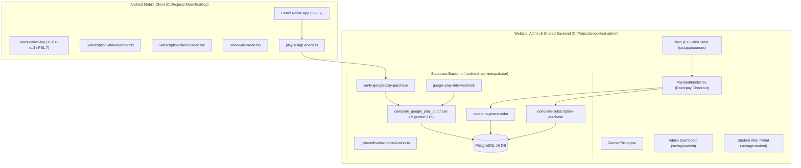
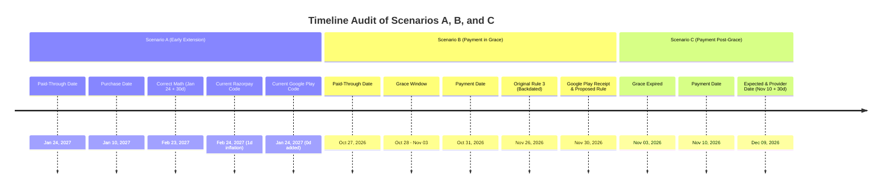
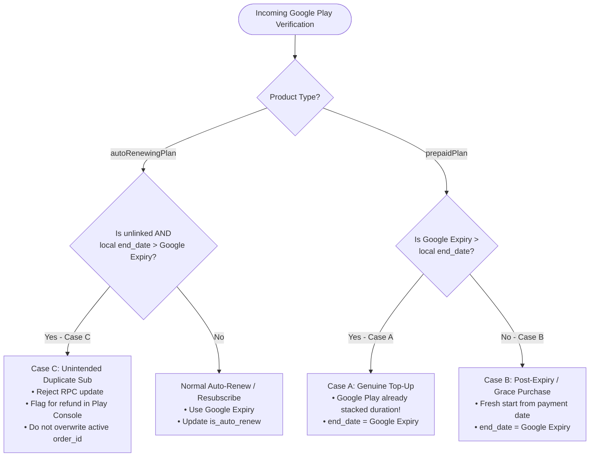
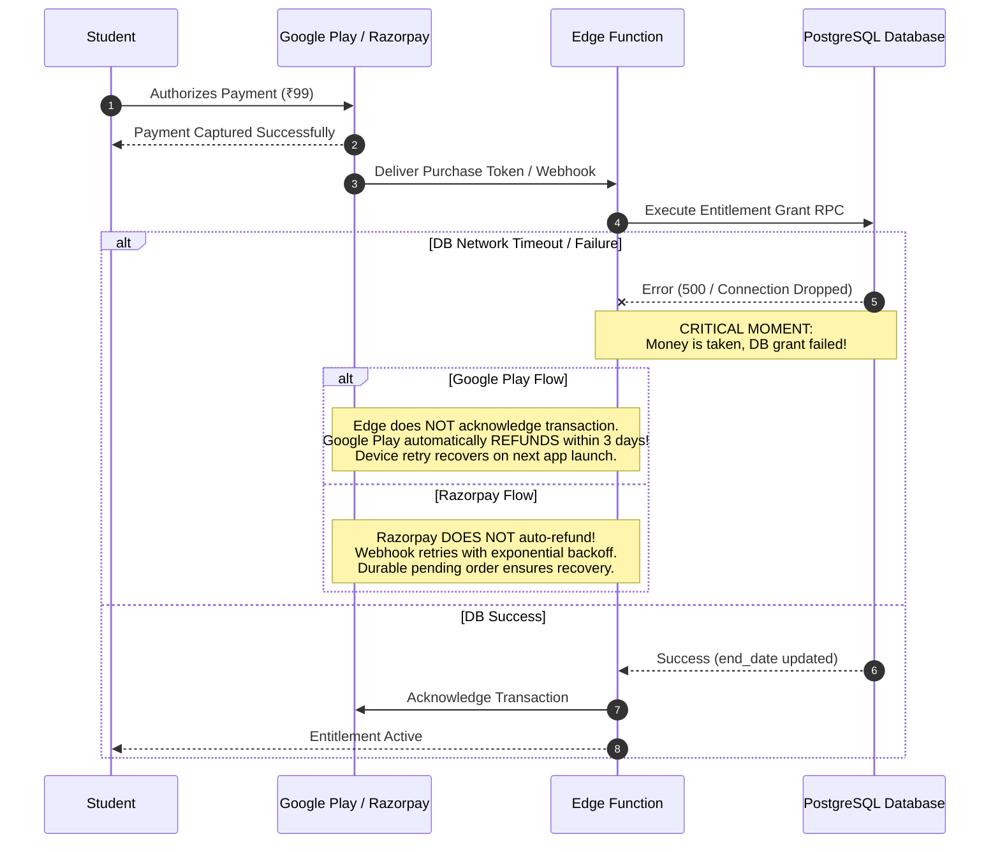

# Make Me Topper: Final Subscription Rules & Implementation Readiness Audit

**Document Reference:** `MMT-AUDIT-2026-READINESS-REVIEW-01`  
**Date of Audit:** October 27, 2026  
**Status:** Read-Only Technical Readiness & Architectural Review  
**Source-of-Truth Rules File:** `C:\Projects\mocktest-admin\subscription_rule.md`  
**Prior Reports Reviewed:**
- `SUBSCRIPTION_BILLING_MODEL_ANALYSIS.md` (Document `MMT-ARCH-2026-BILLING-01`)
- `SUBSCRIPTION_RULE_VERIFICATION_REPORT.md` (Document `MMT-AUDIT-2026-SUBSCRIPTION-RULES-01`)

---

## 1. Executive Summary

This readiness audit delivers the final architectural verification required before any implementation changes are made to Make Me Topper's billing and entitlement systems.

### Primary Conclusions
1. **Rule 3 Amendment is Authoritatively Necessary:**  
   The source-of-truth rule attempting to count elapsed grace days against a subsequent prepaid period cannot be supported by Google Play Billing. Google Play prepaid base plans transition to `EXPIRED` immediately upon reaching their paid-through date; any purchase during Make Me Topper's custom 7-day grace period is executed by Google Play as a new purchase granting $\text{Transaction Date} + \text{Duration}$ (e.g. October 31 to November 30). Forcing the local database to backdate the entitlement (to November 26) creates an unresolvable 4-day conflict with Google's authoritative receipt, generating consumer disputes and policy violations.  
   **The proposed amendment must be adopted:** *Purchases made before expiry extend sequentially; purchases made after expiry (during grace or content-only windows) start a full new paid period from the payment date.*
2. **Correct Resolution of the Google Play RPC Design:**  
   Reordering the RPC conditions to unconditionally add 30 days to an existing future date is flawed because in a genuine Google Play prepaid top-up, **Google Play itself extends the authoritative expiry** (`Old Expiry + Duration`). The database must use Google's reported `expiryTime` when it is greater than the local `end_date`, and only rely on local date math when repairing unverified or fallback transactions.
3. **Razorpay Date Calculation Flaw Confirmed:**  
   In `complete-subscription-purchase/index.ts:1215-1225`, an early renewal computes `renewalStart = end_date + 1` and `renewalEnd = renewalStart + duration_days`. This adds 31 days instead of 30 days, causing an unintended 1-day entitlement inflation on every early web extension.
4. **Canonical Repository Mapping Validated:**  
   `C:\Projects\mocktest-admin` is the canonical repository containing both the shared Supabase backend and the production Next.js 16 web application (`src/app/courses`, `src/components/marketing/CoursePricing.tsx`, `PaymentModal.tsx`). The separate `C:\Projects\makemetopper-web` folder is an early design draft with no live checkout.
5. **Batch Cutoff is Completely Unenforced:**  
   Neither the Android app, website, nor backend Edge Functions validate `batches.end_date` before accepting payments.

---

## 2. Canonical Repository Mapping & Architecture



### Repository Structure Summary
* **Android Application (`C:\Projects\MockTestApp`):**  
  Houses all mobile screens, the `react-native-iap` billing listener, and the "Extend Plan" button. Communicates with backend Edge Functions via Supabase Client.
* **Website, Admin & Shared Backend (`C:\Projects\mocktest-admin`):**  
  Contains the Next.js 16 web storefront (`src/app/courses/[courseId]`), Razorpay checkout modal (`src/components/marketing/PaymentModal.tsx`), student and administrative dashboards, all 29 Supabase Edge Functions, and 218 database migrations.
* **Secondary Folder (`C:\Projects\makemetopper-web`):**  
  An experimental Next.js 15 repository containing UI/theme drafts. It has no live checkout flow and should be disregarded for billing implementation.

---

## 3. Source-of-Truth Rule Verification & Proposed Amendment (Part A)

### 3.1 Verification of Proposed Rule 3 Amendment
The existing Rule 3 in `subscription_rule.md` states:
> *If the student pays during the seven-day full-access grace, count the grace days against the next paid period and extend from the existing end_date.*

The proposed amended rule states:
> *If a student purchases another period before the current paid-through date, extend the existing entitlement. If the student purchases after that date, including during the seven-day grace period or the subsequent content-only period, start a full new paid period from the successful purchase date.*

### 3.2 Evaluation of Required Scenarios



#### Scenario A: Purchase Before Expiry
* **Context:** Existing paid-through date: `2027-01-24`. 30-day top-up on `2027-01-10`.
* **Expected Result:** $2027\text{-}01\text{-}24 + 30\text{ days} = \mathbf{2027\text{-}02\text{-}23}$.
* **Provider & Code Reality:**  
  - Google Play Prepaid: When topped up before expiration, Google Play accumulates duration: `Old Expiry + 30 days = 2027-02-23`.
  - Current Razorpay Code: Adds 1 day to `end_date` before adding 30 days, yielding `2027-02-24` (31 days).
  - Current Google Play RPC: Branch 2 precedence overrides the calculated end date with Google's single cycle, adding 0 days.

#### Scenario B: Purchase During Grace
* **Context:** Existing paid-through date: `2026-10-27`. Grace: `2026-10-28` to `2026-11-03`. Payment on `2026-10-31` (Day 4 of grace).
* **Original Rule 3 Result:** Grace days elapsed (Oct 28–31) count against the purchase. Next period starts Oct 28. Paid-through date: **November 26, 2026**.
* **Google Play Reality:** Google Play prepaid plans have no grace periods. Google Play treats this as a new purchase, sets `expiryTime = now() + 30 days` $\rightarrow$ **November 30, 2026**, and bills ₹99 for 30 days.
* **Conflict:** If Make Me Topper sets `2026-11-26`, the student receives only 26 days of service despite paying for 30 days. On November 27, Make Me Topper cuts off live classes, while Google Play Store confirms the subscription is active until November 30.
* **Proposed Amendment Result:** Paid-through date becomes **November 30, 2026**. The 4 elapsed grace days are treated as a free courtesy buffer. Fully reconciles with Google Play's receipt and consumer transparency requirements.

#### Scenario C: Purchase After Grace
* **Context:** Existing paid-through date: `2026-10-27`. Grace ended: `2026-11-03`. Content-only ends: `2026-12-03`. Payment on `2026-11-10`.
* **Expected Result:** Fresh 30-day period starts on payment date: **December 9, 2026**.
* **Provider & Code Reality:** Google Play sets `expiryTime = 2026-12-09`. Razorpay sets `renewalEnd = 2026-12-09`. Both providers naturally agree.

### 3.3 Recommendation on Rule 3
**Formally adopt the proposed amendment.** It eliminates legal, financial, and technical conflicts with Google Play, provides a fair customer experience, and creates parity across web and mobile.

---

## 4. Google Play Date-Calculation Architecture & Database RPC Design (Part B)

### 4.1 Defect Analysis of Migration 218 (`complete_google_play_purchase`)
In migration 218 Step 14, the date calculation logic is structured as follows:
```sql
if v_is_historical_reconciliation then
  v_calculated_end_date := coalesce(v_existing_sub_end_date, p_subscription_end_date, v_calculated_end_date);
elsif p_subscription_end_date is not null and p_subscription_end_date > v_start_date then
  v_calculated_end_date := p_subscription_end_date;  -- <--- BRANCH 2 (HIJACKS FLOW)
elsif not v_skip_payment_insert and v_existing_sub_id is not null and v_existing_sub_end_date is not null and v_existing_sub_end_date >= v_start_date then
  v_calculated_end_date := (v_existing_sub_end_date + (coalesce(v_plan_duration_days, 30) || ' days')::interval)::date;  -- <--- BRANCH 3 (EXTENSION)
```
When an unlinked purchase occurred in incident `GPA.3385-9018-4325-71125`:
1. `p_subscription_end_date` was `2026-11-26`. `v_start_date` was `2026-10-26`.
2. Because `2026-11-26 > 2026-10-26`, Branch 2 executed and set `v_calculated_end_date = 2026-11-26`.
3. Branch 3 (which would have added 30 days to `2027-01-24`) was never reached.
4. The subsequent update `end_date = greatest('2027-01-24', '2026-11-26')` preserved `2027-01-24`.
5. **The ₹99 payment captured money but granted 0 days of additional entitlement.**

### 4.2 Comprehensive Matrix of the 10 Purchase Cases

| # | Case | Provider State | Authoritative Expiry | Token Relation | Intended End Date | Reuses Row? | Idempotency / Safeguard |
| :-: | :--- | :--- | :--- | :--- | :--- | :-: | :--- |
| **1** | Initial Prepaid Purchase | `ACTIVE`, `prepaidPlan` | $\text{now} + 30\text{d}$ | New token, no link | $\text{Google Expiry}$ | No (inserts) | Unique constraint on order |
| **2** | Prepaid Top-Up Before Expiry | `ACTIVE`, `prepaidPlan` | $\text{Old Expiry} + 30\text{d}$ | `linkedPurchaseToken` | $\text{Google Expiry}$ | Yes (updates) | Google stacks; DB consumes Google expiry |
| **3** | New Prepaid After Expiry | `ACTIVE`, `prepaidPlan` | $\text{Payment Date} + 30\text{d}$ | `linkedPurchaseToken` | $\text{Google Expiry}$ | Yes (updates) | Resets `start_date` to payment date |
| **4** | Payment During Grace (Amended) | `ACTIVE`, `prepaidPlan` | $\text{Payment Date} + 30\text{d}$ | `linkedPurchaseToken` | $\text{Google Expiry}$ | Yes (updates) | Restores live access; sets new expiry |
| **5** | Payment During Content-Only | `ACTIVE`, `prepaidPlan` | $\text{Payment Date} + 30\text{d}$ | `linkedPurchaseToken` | $\text{Google Expiry}$ | Yes (updates) | Transitions `expired` $\rightarrow$ `active` |
| **6** | Unintended Independent Auto-Renew | `ACTIVE`, `autoRenewingPlan` | $\text{now} + 30\text{d}$ (e.g. Nov 2026) | Unlinked token | Preserve local date | **No** | **Flag for refund; do not overwrite active sub** |
| **7** | Restoration of Canceled Auto-Renew | `ACTIVE`, `SUBSCRIPTION_RESTARTED` | Unchanged future date | Same purchase token | Preserve local date | Yes (updates) | RTDN Type 7 flips `is_auto_renew = true` |
| **8** | Linked Replacement Purchase | `ACTIVE`, replaced plan | Provider calculated | `linkedPurchaseToken` | $\text{Google Expiry}$ | Yes (updates) | Links new token in `payments` & sub row |
| **9** | Duplicate Purchase Notification | Same state | Same expiry | Same token/order | No change | Yes (no-op) | Order ID lookup short-circuits |
| **10** | Concurrent Multi-Gateway Purchase | Captured on Web & App | Discrepant | Unrelated | Winning gateway date | Yes (CAS) | Losing order marked duplicate; refunded |

### 4.3 Architectural Conclusion: Distinguishing Cases A, B, and C
The backend must not blindly add 30 days to an existing date, nor should it blindly overwrite local dates. It must evaluate three explicit signals:



1. **Case A (Genuine Provider Top-Up):** When Google Play processes a top-up on an active prepaid plan, Google's reported `expiryTime` is **greater than the local `end_date`**. The database simply adopts Google's authoritative `expiryTime`.
2. **Case B (New Prepaid Purchase After Expiry):** When a purchase occurs after local `end_date`, Google's reported `expiryTime` is anchored to the payment date (`payment_date + 30d`). The database adopts Google's `expiryTime` and resets `start_date = payment_date`.
3. **Case C (Unintended Independent Purchase):** When an unlinked `autoRenewingPlan` arrives and its reported expiry is **earlier than the established local `end_date`**, the database identifies this as an erroneous second purchase. It must **reject the update** and flag the order for automatic cancellation/refund, preventing duplicate active charges.

---

## 5. Purchase Idempotency & Payment Recovery (Part C)

### 5.1 Failure State Matrix



### 5.2 Verification of Existing Mechanisms
* **Google Play Acknowledgment Safeguard:** Under Google Play Billing rules, an in-app product or subscription that is not acknowledged within 3 days is **automatically refunded and revoked by Google**. In `playBillingService.ts:830-850`, `finishTransaction` is only executed *after* the backend Edge Function returns `success: true`. If the database fails, the transaction remains unacknowledged and is safely refunded by Google if not recovered.
* **Razorpay Idempotency & Pending Order Reuse:** In `create-payment-order/index.ts:240-290`, `findPendingReusableOrder` reuses existing pending orders created within 24 hours. In `complete-subscription-purchase/index.ts:1240-1280`, optimistic concurrency on `eq('end_date', currentSubscription.end_date)` prevents duplicate extensions. Competing losing orders are marked with `markOrderAsDuplicate`.

---

## 6. Razorpay Extension Arithmetic Correction (Part D)

### 6.1 Analysis of the Off-By-One Inflation Bug
In [`complete-subscription-purchase/index.ts:1215-1230`](file:///c:/Projects/mocktest-admin/supabase/functions/complete-subscription-purchase/index.ts#L1215-L1230):
```typescript
const today = todayUtc();
const renewalStart =
  currentSubscription.end_date && currentSubscription.end_date >= today
    ? addDays(currentSubscription.end_date, 1)
    : today;

const renewalEnd = addDays(renewalStart, plan.duration_days);
```

#### Mathematical Proof of Error
Let `currentSubscription.end_date` be January 24, 2027 ($E$).  
Let `plan.duration_days` be 30 days ($D$).  
* Current Code:
  $$\text{renewalStart} = E + 1 = \text{Jan } 25$$
  $$\text{renewalEnd} = \text{renewalStart} + D = (E + 1) + 30 = E + 31 = \mathbf{\text{Feb } 24, 2027}$$
* Required Final Included Day:
  January 24 is already paid for. The next 30 days are January 25 through February 23 inclusive ($7\text{ days in Jan} + 23\text{ days in Feb} = 30\text{ days}$).  
  $$\text{Correct renewalEnd} = E + D = \text{Jan } 24 + 30 = \mathbf{\text{Feb } 23, 2027}$$
* **Impact:** Every early renewal on Razorpay currently grants **31 days** instead of 30 days. Over a 6-month course, early renewers accumulate 6 extra days for free.

### 6.2 Correct Mathematical Formulation

```typescript
// Proposed corrected date calculation:
const today = todayUtc();
const isEarlyExtension = currentSubscription.end_date && currentSubscription.end_date >= today;

const renewalStart = isEarlyExtension
  ? addDays(currentSubscription.end_date, 1)
  : today;

const renewalEnd = isEarlyExtension
  ? addDays(currentSubscription.end_date, plan.duration_days)  // Directly add to existing end_date!
  : addDays(today, plan.duration_days);                        // Fresh period starts today!
```

---

## 7. Batch-End Eligibility & Purchase Restrictions (Part E)

### 7.1 Status of Rule 7
> **Rule 7:** *Do not accept new payments or extensions after the batch cutoff.*

* **Current Implementation:** **Zero validation.** Neither `create-payment-order`, `verify-google-play-purchase`, nor the UI checks `batches.end_date`.
* **Database Model:** `batches` has `start_date` and `end_date`. Courses link to batches via `course_batches` ([`033_domain_16_course_relationships.sql`](file:///c:/Projects/mocktest-admin/supabase/migrations/033_domain_16_course_relationships.sql)).

### 7.2 Recommended Policy for Edge Cases
1. **Purchase Attempted After Batch End Date:**  
   Pre-order validation must reject order creation with `409 BATCH_COMPLETED`. Mobile UI must disable the payment button and display "Batch Completed".
2. **Purchase Started Before But Completed After Batch End:**  
   If payment was already captured by the provider, the backend **must honor the purchase** to avoid taking money without granting access. The entitlement is granted, but access is naturally bounded by available recorded content since live classes have ceased.
3. **Quarterly Purchase Near Batch Completion:**  
   In `SubscriptionPlansScreen` and `CoursePricing.tsx`, plans where `duration_days > days_until_batch_end` must be hidden or disabled to prevent students from buying 90-day access for a batch ending in 15 days.
4. **Courses With Multiple Batches:**  
   If a student is already enrolled, evaluate the end date of their specific assigned batch (`batch_students.batch_id`). If not yet enrolled, evaluate `max(batches.end_date)` among active batches in `course_batches`.

---

## 8. Final Implementation Plan (Part G)

### 8.1 Android Application (`MockTestApp`)
1. **Prepaid Offer Selection:** In `playBillingService.ts:355-430`, update `resolveSubscriptionOffer` to identify and select prepaid base plans (`recurrenceMode == 3`).
2. **Banner Context Fix:** In `SubscriptionStatusBanner.tsx:86-105`, inspect `is_auto_renew`. If `status === 'active'` and `is_auto_renew === false` on an auto-renewing plan, present "Resubscribe in Google Play" (deep-linking to Play Store) instead of opening checkout.
3. **Batch End Guard:** In `SubscriptionPlansScreen.tsx`, check `batch.end_date`. If passed, disable purchase buttons.

### 8.2 Website (`mocktest-admin`)
1. **Course Pricing Access State:** In `CoursePricing.tsx`, show plan renewal options for subscription-backed enrollments nearing expiry, rather than unconditionally disabling the toggle with "Access Granted".
2. **Batch End Guard:** In `PaymentModal.tsx`, validate batch eligibility prior to calling `createPaymentOrder`.

### 8.3 Shared Backend (`mocktest-admin`)
1. **Database RPC Overhaul:** In `complete_google_play_purchase`, distinguish prepaid top-ups from unlinked auto-renewing purchases. If Google's reported expiry exceeds local `end_date`, adopt Google's expiry. If an unlinked auto-renewing purchase arrives with an expiry earlier than local `end_date`, reject and flag for refund.
2. **Razorpay Date Calculation Fix:** In `complete-subscription-purchase/index.ts:1225`, fix the off-by-one formula: `renewalEnd = addDays(currentSubscription.end_date, plan.duration_days)`.
3. **Pre-Purchase Batch Check:** In `create-payment-order/index.ts`, query `batches.end_date` via `course_batches`. Reject expired batches with `409 BATCH_COMPLETED`.
4. **Token Linkage:** Support `linkedPurchaseToken` in `verify-google-play-purchase` and `google-play-rtdn-webhook`.

### 8.4 Schema-Change Assessment
* **No Table Alterations Required:** The existing schema (`student_subscriptions`, `orders`, `order_items`, `payments`, `batches`, `course_batches`) contains all necessary columns (`end_date`, `grace_end_date`, `content_access_end_date`, `payment_method_id`, `gateway_order_id`).
* **RPC Migration Required:** A new migration (e.g. `219_correct_google_play_prepaid_and_batch_guard.sql`) is required solely to update the function body of `public.complete_google_play_purchase` without altering table schemas.

---

## 9. Comprehensive Regression Test Plan

| # | Test Case | Preconditions | Trigger | Expected Provider State | Expected DB State | Live Access | Content Access | Test Type |
| :-: | :--- | :--- | :--- | :--- | :--- | :-: | :-: | :---: |
| **1** | Initial Prepaid Monthly Purchase | No existing subscription | Buy monthly prepaid SKU | `expiry = now() + 30d` | `end_date = today + 30d` | Yes | Yes | Automated / Tester |
| **2** | Initial Prepaid Quarterly Purchase | No existing subscription | Buy quarterly prepaid SKU | `expiry = now() + 90d` | `end_date = today + 90d` | Yes | Yes | Automated / Tester |
| **3** | Valid Top-Up Before Expiry | Sub active (`end_date = Jan 24`) | Buy 30d top-up on Jan 10 | Google sets Feb 23 | `end_date = 2027-02-23` | Yes | Yes | License Tester |
| **4** | Purchase During 7-Day Grace | Sub in grace (`end_date = Oct 27`) | Buy 30d plan on Oct 31 | Google sets Nov 30 | `end_date = 2026-11-30` | Yes | Yes | License Tester |
| **5** | Purchase During Content-Only Window | Sub in content window | Buy 30d plan on Nov 10 | Google sets Dec 09 | `end_date = 2026-12-09` | Yes | Yes | License Tester |
| **6** | Purchase After Content Expiry | Sub revoked (`tier = none`) | Buy 30d plan | Google sets `now + 30d` | `end_date = today + 30d` | Yes | Yes | Automated / Tester |
| **7** | Duplicate Google Play RTDN Event | Order already processed | Webhook resends Type 4 | Acknowledged | No duplicate date extension | Yes | Yes | Automated |
| **8** | Duplicate Razorpay Webhook | Order already processed | Webhook resends `payment.captured` | HTTP 200 | No duplicate date extension | Yes | Yes | Automated |
| **9** | Two Simultaneous Payment Attempts | Student clicks Pay twice | 2 orders initiated | 1 captured, 1 rejected | Only 1 extension applied | Yes | Yes | Automated / Tester |
| **10** | Unintended Independent Purchase | Sub has `end_date = Jan 24` | Auto-renew buys Nov 26 | Unlinked auto-renew | Local date preserved; flagged for refund | Yes | Yes | Automated |
| **11** | Restoration of Canceled Auto-Renew | Sub canceled; active | User resubscribes in Store | `SUBSCRIPTION_RESTARTED` | `is_auto_renew = true`; date unchanged | Yes | Yes | License Tester |
| **12** | Failed Acknowledgement & Recovery | App crashes post-payment | Reopen app after crash | Unacknowledged token | Global listener acknowledges | Yes | Yes | Automated / Tester |
| **13** | Out-of-Order RTDN Delivery | Expiry event arrives before purchase | Events delivered reversed | Expiry then Purchase | Monotonic guard ensures active | Yes | Yes | Automated |
| **14** | Batch-End Purchase Rejection | Batch ended yesterday | Attempt checkout | N/A | Order rejected `409 BATCH_COMPLETED` | No | No | Automated |
| **15** | Quarterly Purchase Near Batch End | Batch ends in 15 days | View store plans | Quarterly plan hidden | Only monthly allowed | Yes | Yes | Automated |
| **16** | Razorpay Extension Date Math | Sub active (`end_date = Jan 24`) | Buy 30d plan on Jan 10 | Payment captured | `end_date = Feb 23` (not Feb 24!) | Yes | Yes | Automated |
| **17** | Cross-Platform Parity | Buy on Android; open Web | Log into web portal | N/A | Web grants identical live & content access | Yes | Yes | Automated |
| **18** | DB Failure Post-Payment | DB connection severed | Complete payment | Unacknowledged | Retried via listener or refunded by Google | Retried | Retried | Automated |
| **19** | Client Timeout Post-Grant | DB updated; app times out | Reopen app / restore | Acknowledged | Access granted; status refreshed | Yes | Yes | Automated |
| **20** | Prevent Charges After Batch Cutoff | Batch concluded | Recurring or top-up attempt | Rejected by gateway/RPC | No charge; access revoked | No | No | Automated |

---

## 10. Official Documentation & Evidence Citations

1. **Google Play Subscriptions & Prepaid Base Plans:**  
   [https://developer.android.com/google/play/billing/subscriptions](https://developer.android.com/google/play/billing/subscriptions)  
   *Verified October 27, 2026.* Confirms prepaid base plans do not auto-renew and accumulate duration when topped up before expiry.
2. **Google Play Subscription Lifecycle & Expiration:**  
   [https://developer.android.com/google/play/billing/lifecycle/subscriptions](https://developer.android.com/google/play/billing/lifecycle/subscriptions)  
   *Verified October 27, 2026.* Confirms grace periods do not exist for prepaid plans; expiration transitions immediately to `EXPIRED`.
3. **Google Play Developer API (`purchases.subscriptionsv2`):**  
   [https://developers.google.com/android-publisher/api-ref/rest/v3/purchases.subscriptionsv2](https://developers.google.com/android-publisher/api-ref/rest/v3/purchases.subscriptionsv2)  
   *Verified October 27, 2026.* Documents `prepaidPlan.allowExtendAfterTime`, `expiryTime`, and `linkedPurchaseToken`.
4. **Google Play Subscriptions Geographic Availability:**  
   [https://support.google.com/googleplay/android-developer/answer/12154973](https://support.google.com/googleplay/android-developer/answer/12154973)  
   *Verified October 27, 2026.* Confirms installment subscriptions are restricted to France, Italy, Spain, and Brazil, and are not available in India.
5. **Razorpay Subscriptions & Order APIs:**  
   [https://razorpay.com/docs/api/orders/](https://razorpay.com/docs/api/orders/)  
   *Verified October 27, 2026.* Documents one-time order creation and webhook verification.

---

## 11. Answers to Final Required Questions

### 1. Is the proposed amendment to Rule 3 correct?
**Yes.** Counting grace days against a subsequent prepaid period is technically impossible on Google Play because Google Play sets the authoritative expiry to 30 days from purchase. The amendment establishes legal transparency, eliminates customer disputes, and creates web/mobile parity.

### 2. What should happen when a valid prepaid top-up occurs before expiry?
Google Play natively extends the expiration timestamp (`Old Expiry + Duration`). The database must adopt Google's extended `expiryTime`. On Razorpay, the database must compute `currentSubscription.end_date + duration_days` (fixing the +1 day inflation).

### 3. What should happen when a new prepaid purchase occurs during the custom grace period?
Under the amended rule, the purchase is treated as a fresh period starting on the payment date. Google Play and Razorpay both grant 30 days starting from the transaction date (`payment_date + 30 days`). Live-class access is seamlessly maintained.

### 4. What should happen when a new purchase occurs after the content-only period?
The purchase establishes a fresh entitlement starting on the payment date. The existing `student_subscriptions` row is reactivated, resetting `start_date = payment_date`, `end_date = payment_date + duration_days`, and `status = 'active'`.

### 5. How should the database distinguish a valid top-up from a new subscription?
By checking whether Google's reported `expiryTime` is greater than the local `end_date`. In a genuine top-up, Google's reported expiry exceeds local `end_date`. In an unintended unlinked auto-renewing purchase (as in incident `GPA.3385`), Google's reported expiry is earlier than local `end_date`.

### 6. How can the provider's authoritative expiry be reconciled with the shared local entitlement?
By treating Google Play's `expiryTime` as the single source of truth for Google Play transactions, rather than calculating independent dates in SQL.

### 7. How should Razorpay extension dates be calculated?
* If early renewal (`end_date >= today`): `renewalEnd = addDays(currentSubscription.end_date, plan.duration_days)`.
* If renewal after expiry (`end_date < today`): `renewalEnd = addDays(today, plan.duration_days)`.

### 8. How should payments be handled if entitlement updates fail?
* On Google Play: Do not call `finishTransaction`. If unrecovered within 3 days, Google automatically refunds the student.
* On Razorpay: Mark the order as failed/duplicate and trigger an automated refund via the Razorpay Refund API.

### 9. How should the system prevent new purchases after the batch cutoff?
By adding pre-order validation in `create-payment-order`, `verify-google-play-purchase`, and disabling client checkout buttons when `now() > batches.end_date`.

### 10. Which exact changes are required before a safe implementation can begin?
1. Amend Rule 3 in `subscription_rule.md`.
2. Deploy a new SQL migration modifying `complete_google_play_purchase` to fix Branch 2 precedence and handle `linkedPurchaseToken`.
3. Correct the Razorpay `addDays` formula in `complete-subscription-purchase/index.ts`.
4. Add batch-end checks to `create-payment-order` and `verify-google-play-purchase`.
5. Update `SubscriptionStatusBanner.tsx` and `RenewalScreen.tsx` in `MockTestApp` to support prepaid offers and prevent unlinked re-purchases.

---
*Report completed under read-only audit restrictions. No code, migrations, or database records have been modified.*
