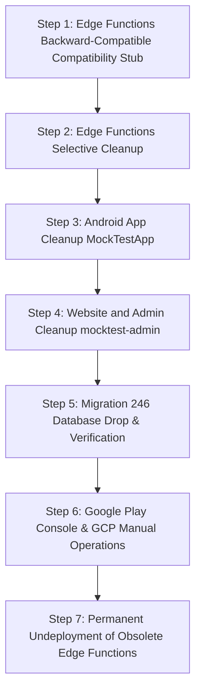

# Final Subscription Module Retirement — Read-Only Analysis & Complete Inventory

**Repositories:**
1. Android Application: `C:\Projects\MockTestApp`
2. Website & Admin Panel: `C:\Projects\mocktest-admin`
**Supabase Production Project:** `ocolfottogbybitfpdqy`  
**Analysis Date:** November 5, 2026  
**Status:** READ-ONLY COMPREHENSIVE AUDIT (Zero code or database changes executed)

---

## Executive Overview & Business Objective

Make Me Topper has permanently discontinued the subscription purchasing and access model. The platform will authoritatively support **only three revenue and access models**:

1. **Full Course Purchase**
   - **Android:** Google Play Billing (one-time in-app products `course_<hex>`).
   - **Website:** Razorpay one-time checkout (`mode = 'purchase'`).
   - **Entitlement:** Permanent lifetime access recorded in `public.course_enrollments` (`enrollment_type = 'purchase'`).
2. **Installment Course Purchase**
   - **Website:** Razorpay initial reservation and subsequent tranche payments.
   - **Android:** Redirect to website checkout.
   - **Entitlement:** Active enrollment in `public.course_enrollments` (`enrollment_type = 'installment'`) gated dynamically by installment agreement status, settlement ledgers, and arrears lockout without subscription dependencies.
3. **PYQ Package Purchase**
   - **Android:** Google Play Billing (one-time in-app products `pyq_<hex>`).
   - **Website:** Razorpay one-time checkout.
   - **Entitlement:** Permanent test pack access in `public.student_pyq_purchases` (`is_active = true`).

### Completed Preceding Database Migrations

- **Migration 240:** Decoupled FIFO installment settlement and course access from `student_subscriptions`.
- **Migration 241:** Fixed recording playback access verification to use dynamic course/batch authorization.
- **Migration 242:** Separated live class discovery from installment authorization.
- **Migration 243:** Decoupled runtime home-screen bootstrap (`get_home_screen_bootstrap`), batch subjects (`get_student_batch_subjects`), and account deletion (`delete_user_account_data`) from subscription tables.
- **Migration 244:** Purged all subscription runtime data, demo orders, payments, notifications, and legacy enrollments while preserving all 17 captured/failed installment orders.
- **Migration 245:** Dropped `order_items.plan_id`, `fk_order_items_plan`, and associated indexes; hardened polymorphic item check constraints; decoupled `complete_google_play_purchase`, `fulfill_standard_subscription_order` (fail-closed stub), and `revoke_standard_order_entitlements`.

**Migration 246** is the upcoming database migration designed to physically remove all obsolete subscription tables, functions, triggers, enums, cron jobs, and vault secrets.

---

## Classification Legend

| Classification | Meaning |
| :--- | :--- |
| **`DONE`** | Already completed and verified in migrations 240–245 or earlier phases. |
| **`PRESERVE`** | Must **NOT** be deleted or broken; critical for course, installment, or PYQ commerce/access. |
| **`NEEDS MODIFICATION`** | File or function must be retained, but specific subscription branches/queries must be removed. |
| **`NEEDS DELETION`** | File, database object, or Edge Function is 100% obsolete and must be permanently removed. |
| **`REMAINING`** | Planned task not yet executed. |
| **`MANUAL EXTERNAL ACTION`** | Action required in external third-party portals (Google Play Console, GCP Pub/Sub, Supabase Dashboard). |

---

## PART 1: Database Inventory (Migration 246 Scope)

### 1.1 Subscription Tables Status & Disposal Order

All 9 subscription tables and the 1 RTDN event ledger still exist in the PostgreSQL catalog. In Migration 244, runtime rows were deleted and verified at 0, while catalog tables (`subscription_plans`, `subscription_features`, `plan_unlocks`) were verified intact for snapshot safety.

Because of foreign key constraints between these tables, they must be dropped in strict dependency order using `RESTRICT` (avoiding blanket `CASCADE` to guarantee no unintended drops):

```
Child Tables (depend on student_subscriptions & subscription_features)
  ├── subscription_usage
  ├── subscription_grace_periods
  ├── subscription_cancellations
  ├── subscription_renewals
  └── subscription_history
        │
Parent Runtime Table (depends on subscription_plans, students, orders, courses)
  └── student_subscriptions
        │
Junction Table (depends on subscription_plans & subscription_features)
  └── plan_unlocks
        │
Parent Catalog Tables
  ├── subscription_plans
  └── subscription_features

Standalone RTDN Ledger Table (unrelated to foreign keys)
  └── google_play_rtdn_events
```

| Table Name | Schema | Current Row Count | Foreign Keys Referencing It | Classification | Planned Action (Migration 246) |
| :--- | :--- | :--- | :--- | :--- | :--- |
| `public.subscription_usage` | `public` | 0 (Purged in 244) | None | **`NEEDS DELETION`** | `DROP TABLE IF EXISTS public.subscription_usage RESTRICT;` |
| `public.subscription_grace_periods` | `public` | 0 (Purged in 244) | None | **`NEEDS DELETION`** | `DROP TABLE IF EXISTS public.subscription_grace_periods RESTRICT;` |
| `public.subscription_cancellations` | `public` | 0 (Purged in 244) | None | **`NEEDS DELETION`** | `DROP TABLE IF EXISTS public.subscription_cancellations RESTRICT;` |
| `public.subscription_renewals` | `public` | 0 (Purged in 244) | None | **`NEEDS DELETION`** | `DROP TABLE IF EXISTS public.subscription_renewals RESTRICT;` |
| `public.subscription_history` | `public` | 0 (Purged in 244) | None | **`NEEDS DELETION`** | `DROP TABLE IF EXISTS public.subscription_history RESTRICT;` |
| `public.student_subscriptions` | `public` | 0 (Purged in 244) | `subscription_usage`, `subscription_grace_periods`, `subscription_cancellations`, `subscription_renewals`, `subscription_history` | **`NEEDS DELETION`** | `DROP TABLE IF EXISTS public.student_subscriptions RESTRICT;` |
| `public.plan_unlocks` | `public` | Catalog baseline (Migration 244 snapshot) | None | **`NEEDS DELETION`** | `DROP TABLE IF EXISTS public.plan_unlocks RESTRICT;` |
| `public.subscription_plans` | `public` | Catalog baseline (Migration 244 snapshot) | `plan_unlocks`, `student_subscriptions` | **`NEEDS DELETION`** | `DROP TABLE IF EXISTS public.subscription_plans RESTRICT;` |
| `public.subscription_features` | `public` | Catalog baseline (Migration 244 snapshot) | `plan_unlocks`, `subscription_usage` | **`NEEDS DELETION`** | `DROP TABLE IF EXISTS public.subscription_features RESTRICT;` |
| `public.google_play_rtdn_events` | `public` | Ingestion audit ledger | None | **`NEEDS DELETION`** | `DROP TABLE IF EXISTS public.google_play_rtdn_events RESTRICT;` *(Requires updating `complete_google_play_purchase` first)* |

---

### 1.2 Database Triggers & Trigger Functions

All table-level triggers on the 10 tables will be dropped automatically when their parent tables are dropped. However, standalone trigger functions must be explicitly dropped:

| Trigger Function | Target Table | Defined in Migration | Classification | Planned Action (Migration 246) |
| :--- | :--- | :--- | :--- | :--- |
| `trgfn_subscription_auto_history()` | `student_subscriptions` | `012_domain_11_subscription_access_control.sql` | **`NEEDS DELETION`** | `DROP FUNCTION IF EXISTS public.trgfn_subscription_auto_history() CASCADE;` |
| `trgfn_subscription_check_capacity()` | `student_subscriptions` | `012`, `229_fix_subscription_capacity_check_for_installments.sql` | **`NEEDS DELETION`** | `DROP FUNCTION IF EXISTS public.trgfn_subscription_check_capacity() CASCADE;` |
| `trgfn_subscription_validate_course()` | `student_subscriptions` | `090_course_scoped_subscriptions_phase_2.sql` | **`NEEDS DELETION`** | `DROP FUNCTION IF EXISTS public.trgfn_subscription_validate_course() CASCADE;` |
| `trgfn_subscription_validate_status()` | `student_subscriptions` | `012_domain_11_subscription_access_control.sql` | **`NEEDS DELETION`** | `DROP FUNCTION IF EXISTS public.trgfn_subscription_validate_status() CASCADE;` |

---

### 1.3 Subscription-Specific SQL Functions & RPCs

The following database functions are exclusively dedicated to the obsolete subscription lifecycle and must be dropped:

| Function Signature | Purpose | Defined in Migration | Classification | Planned Action (Migration 246) |
| :--- | :--- | :--- | :--- | :--- |
| `public.apply_google_play_rtdn_state_transition(...)` | Ingests Google Play RTDN events and updates `student_subscriptions` | `216`, `217`, `218` | **`NEEDS DELETION`** | `DROP FUNCTION IF EXISTS public.apply_google_play_rtdn_state_transition;` |
| `public.reconcile_google_play_renewal_batch(...)` | Reconciles intermediate renewal cycles into `subscription_renewals` | `216`, `217`, `218` | **`NEEDS DELETION`** | `DROP FUNCTION IF EXISTS public.reconcile_google_play_renewal_batch;` |
| `public.transition_subscription_to_grace(uuid)` | Moves expired subscription to grace period status | `103_transition_subscription_to_grace.sql` | **`NEEDS DELETION`** | `DROP FUNCTION IF EXISTS public.transition_subscription_to_grace(uuid);` |
| `public.total_subscription_payments(uuid, uuid)` | Aggregated historical subscription payments for entitlement | `096_subscription_entitlement_ownership.sql` | **`NEEDS DELETION`** | `DROP FUNCTION IF EXISTS public.total_subscription_payments(uuid, uuid);` |
| `public.diag_assigned_notes_access(...)` | Diagnostic routine querying `student_subscriptions` for notes access | `099_assigned_notes_access_diagnostic.sql` | **`NEEDS DELETION`** | `DROP FUNCTION IF EXISTS public.diag_assigned_notes_access;` |
| `public.fulfill_standard_subscription_order(uuid)` | Replaced in Migration 245 with fail-closed stub raising `SUBSCRIPTIONS_RETIRED` | `235`, `245` | **`NEEDS DELETION`** | `DROP FUNCTION IF EXISTS public.fulfill_standard_subscription_order(uuid);` |

---

### 1.4 PostgreSQL Enum Types

| Enum Type Name | Labels Defined | Used By | Classification | Planned Action (Migration 246) |
| :--- | :--- | :--- | :--- | :--- |
| `subscription_status_type` | `'pending'`, `'active'`, `'grace'`, `'expired'`, `'cancelled'`, `'refunded'` | Exclusively `student_subscriptions.status` and `subscription_history` | **`NEEDS DELETION`** | `DROP TYPE IF EXISTS public.subscription_status_type RESTRICT;` |
| `subscription_change_reason_type` | `'new_purchase'`, `'renewal'`, `'upgrade'`, `'downgrade'`, `'manual_activation'`, `'payment_failure'`, `'payment_recovery'`, `'admin_action'`, `'expiry'`, `'cancellation'`, `'refund'` | Exclusively `subscription_history.change_reason` | **`NEEDS DELETION`** | `DROP TYPE IF EXISTS public.subscription_change_reason_type RESTRICT;` |
| `cancellation_reason_type` | `'student_request'`, `'admin_action'`, `'payment_failure_unresolved'`, `'fraud_detected'`, `'institute_deactivated'`, `'plan_discontinued'` | Exclusively `subscription_cancellations.reason` | **`NEEDS DELETION`** | `DROP TYPE IF EXISTS public.cancellation_reason_type RESTRICT;` |
| `grace_period_resolution_type` | `'payment_recovered'`, `'expired_no_payment'`, `'admin_waived'`, `'cancelled'` | Exclusively `subscription_grace_periods.resolution` | **`NEEDS DELETION`** | `DROP TYPE IF EXISTS public.grace_period_resolution_type RESTRICT;` |
| `plan_billing_cycle_type` | `'monthly'`, `'quarterly'`, `'half_yearly'`, `'yearly'`, `'lifetime'`, `'custom'` | Exclusively `subscription_plans.billing_cycle` | **`NEEDS DELETION`** | `DROP TYPE IF EXISTS public.plan_billing_cycle_type RESTRICT;` |
| `feature_category_type` | `'live_classes'`, `'recorded_classes'`, `'mock_tests'`, `'pyq_papers'`, `'notes'`, `'assignments'`, `'analytics'`, `'downloads'`, `'premium_support'`, `'batch_access'`, `'api_access'` | Exclusively `subscription_features.category` | **`NEEDS DELETION`** | `DROP TYPE IF EXISTS public.feature_category_type RESTRICT;` |
| `public.item_type` (Shared) | Includes `'subscription_plan'` | `order_items`, `payments`, etc. | **`PRESERVE (L1)`** | Retain enum type in catalog; check constraint `ck_order_items_item_type_consistency` (enforced in 245) strictly prevents new subscription items. |
| `public.notification_event_type` (Shared) | Includes `'subscription_expiring'`, `'subscription_expired'` | `notifications` | **`PRESERVE (L1)`** | Retain enum type in catalog; zero runtime notifications exist. |

---

### 1.5 Database Indexes (To Be Dropped With Tables)

All 27 indexes created across the 9 subscription tables (such as `idx_student_subs_student_active`, `idx_student_subs_expiry_autorenew`, `idx_grace_periods_expiry_job`, `idx_plan_unlocks_plan_id`, etc.) and the 3 indexes on `google_play_rtdn_events` will automatically drop when their respective tables are dropped.

---

### 1.6 Database RLS Policies (To Be Dropped With Tables)

All 18 table-level RLS policies created across the 9 subscription tables in `021_rls_policies.sql` (e.g. `"Admins have full access to student_subscriptions"`, `"Students can read their own student_subscriptions"`, etc.) and `"service_role_full_access_on_google_play_rtdn_events"` will automatically drop when their respective tables are dropped.

---

### 1.7 Scheduled Cron Jobs & Vault Secrets

| Infrastructure Object | Location / Identifier | Created In | Purpose | Classification | Planned Action (Migration 246) |
| :--- | :--- | :--- | :--- | :--- | :--- |
| **pg_cron Job** | `jobname = 'subscription-lifecycle-daily'` | `097`, `104` | Fired daily at 02:00 UTC to call Edge Function `subscription-lifecycle` | **`NEEDS DELETION`** | `SELECT cron.unschedule('subscription-lifecycle-daily');` |
| **Supabase Vault Secret** | `name = 'subscription_lifecycle_url'` | `104` | Stores environment URL for lifecycle cron job | **`NEEDS DELETION`** | `DELETE FROM vault.secrets WHERE name = 'subscription_lifecycle_url';` |
| **Protected Timetable Cron** | `jobname = 'timetable-materialization-daily'` | `110` | Daily timetable refresh | **`PRESERVE`** | Do NOT touch. |
| **Protected Live Watchdog Cron**| `jobname = 'live-class-watchdog'` | `112` | Live class watchdog | **`PRESERVE`** | Do NOT touch. |
| **Protected Mock Test Cron** | `jobname = 'release-scheduled-mock-tests'` | `142` | Auto-release scheduled tests | **`PRESERVE`** | Do NOT touch. |
| **Protected Audit Log Cron** | `jobname = 'audit-log-retention-weekly'` | `145` | Weekly audit log retention | **`PRESERVE`** | Do NOT touch. |

---

## PART 2: Verification of Shared Database Functions

Each shared function was audited in detail against its latest migration:

| Shared Function | Latest Defined In | Current Subscription Dependency Status | Audit Verdict |
| :--- | :--- | :--- | :--- |
| `complete_google_play_purchase()` | Migration 245 | **PARTIALLY DECOUPLED.** Course and PYQ purchases are 100% functional without `order_items.plan_id`. Rejects `p_item_type = 'subscription_plan'` immediately. **Remaining dependency:** Lines 161–177, 450, and 802 query and update `public.google_play_rtdn_events`. | **NEEDS MODIFICATION** in Migration 246: Excise RTDN lines before dropping `google_play_rtdn_events`. |
| `process_installment_payment()` | Migration 240 | **100% DECOUPLED.** Operates completely on installment ledgers and agreements; zero queries to `student_subscriptions`. | **PASS (PRESERVE)** |
| `can_student_access_content()` | Migration 240 | **100% DECOUPLED.** Checks permanent course enrollment (`enrollment_type = 'purchase'`) or active installment agreement without arrears lockout. | **PASS (PRESERVE)** |
| `can_student_access_live_course()` | Migration 240 | **100% DECOUPLED.** Checks permanent ownership or active installment agreement. | **PASS (PRESERVE)** |
| `authorize_live_class_access()` | Migration 240 | **100% DECOUPLED.** Quad-Check live authorization runs on batch schedule, enrollment, and installment arrears without subscription checks. | **PASS (PRESERVE)** |
| `verify_recording_playback_access()` | Migration 241 | **100% DECOUPLED.** Validates recording session, course association, enrollment, and arrears lockout. | **PASS (PRESERVE)** |
| `get_home_screen_bootstrap()` | Migration 243 | **100% DECOUPLED.** Returns consolidated 10 top-level keys based on confirmed orders and active enrollments. | **PASS (PRESERVE)** |
| `get_student_batch_subjects()` | Migration 243 | **100% DECOUPLED.** Resolves batch subjects for active batch memberships and entitled courses. | **PASS (PRESERVE)** |
| `delete_user_account_data()` | Migration 243 | **100% DECOUPLED.** Excised deletions of all 6 runtime subscription tables. | **PASS (PRESERVE)** |
| `reconcile_standard_paid_order()` | Migration 235 | **100% DECOUPLED.** Performs payment ledger reconciliation; calls `revoke_standard_order_entitlements` which was fully decoupled in Migration 245. | **PASS (PRESERVE)** |

---

## PART 3: Android Application Inventory (`C:\Projects\MockTestApp`)

### 3.1 Files Requiring Deletion (Obsolete Subscription Components & Hooks)

| Relative File Path | Component / Hook Name | Reason for Deletion |
| :--- | :--- | :--- |
| `src/providers/SubscriptionProvider.tsx` | `SubscriptionProvider`, `useSubscriptionContext` | App-wide context that polled `subscription-access-status` and displayed renewal dialogs. |
| `src/hooks/useSubscription.ts` | `useSubscription`, `useSubscriptionGate` | Hook gating screens on subscription access tiers (`canViewRecorded`, `canAttemptMockTests`, etc.). |
| `src/hooks/useSubscriptionStatus.ts` | `useSubscriptionStatus`, `invalidateSubscriptionStatus` | TanStack Query hook calling `subscription-access-status`. |
| `src/hooks/useRenewalOptions.ts` | `useRenewalOptions` | Hook calling Edge Function `subscription-renewal-options`. |
| `src/services/subscriptionService.ts` | `subscriptionService` | Service calling `/functions/v1/subscription-access-status`. |
| `src/services/renewalService.ts` | `renewalService` | Service calling `/functions/v1/subscription-renewal-options`. |
| `src/services/subscription/subscriptionBannerService.ts` | `subscriptionBannerService` | Service managing subscription expiry banners and FCM notifications. |
| `src/components/subscription/SubscriptionBadge.tsx` | `SubscriptionBadge` | Visual badge showing subscription tier/status. |
| `src/components/subscription/SubscriptionSummaryCard.tsx` | `SubscriptionSummaryCard` | Card showing subscription plan, expiry, and days remaining. |
| `src/components/subscription/SubscriptionStatusBanner.tsx` | `SubscriptionStatusBanner` | Banner prompting renewal when in grace or expired state. |
| `src/components/subscription/SubscriptionExpiryBanner.tsx` | `SubscriptionExpiryBanner` | Expiry warning banner displayed globally in `App.tsx`. |
| `src/components/subscription/RenewSubscriptionDialog.tsx` | `RenewSubscriptionDialog` | Dialog modal prompting student to renew subscription. |
| `src/types/subscription.ts` | `SubscriptionAccessSummary`, `SubscriptionTier`, etc. | Obsolete subscription TypeScript models. |
| `src/types/renewal.ts` | `RenewalOption`, `RenewalResponse`, etc. | Obsolete renewal TypeScript models. |
| `__tests__/subscription/authSubscriptionRecovery.test.tsx` | Test suite | Obsolete subscription auth test. |
| `__tests__/subscription/renewalNavigationFix.test.tsx` | Test suite | Obsolete renewal navigation test. |
| `__tests__/subscription/useSubscriptionFlow.test.tsx` | Test suite | Obsolete subscription hook flow test. |
| `__tests__/payment/checkSubscriptionActivation.test.ts` | Test suite | Obsolete subscription polling test. |
| `__tests__/payment/subscriptionAccessParityAndIsolation.test.ts` | Test suite | Obsolete subscription access test. |

---

### 3.2 Files Requiring Modification (Removing Subscription Branches & Queries)

| Relative File Path | Required Changes |
| :--- | :--- |
| `App.tsx` | Remove `<SubscriptionProvider>` and `<SubscriptionExpiryBanner />` wrappers. |
| `src/providers/AuthProvider.tsx` | Remove `useSubscriptionStatus` imports and subscription query invalidation on auth state change. |
| `src/screens/tabs/ProfileTabScreen.tsx` | Remove `SubscriptionBadge` import and subscription tier rendering. Preserve profile details, batch info, and purchase restore button. |
| `src/screens/subscription/PaymentConfirmationScreen.tsx` | **PRESERVE SCREEN.** Move/refactor to remove `useSubscription`, `useSubscriptionStatus`, and `fetchSubscriptionStatus`. Retain one-time course purchase confirmation, receipt details, and navigation to Course / Dashboard. |
| `src/hooks/home/useEnrolledCourseIds.ts` | Remove query to `student_subscriptions`. Query exclusively `course_enrollments` (`status = 'active'`). |
| `src/hooks/home/useEnrolledCourses.ts` | Remove query to `student_subscriptions`. Query exclusively `course_enrollments`. |
| `src/services/home/demoService.ts` | Remove query to `student_subscriptions`. |
| `src/services/payment/paymentService.ts` | Remove `pollSubscriptionActivation` and queries to `student_subscriptions` / `subscription_plans`. Replace with `pollCourseEnrollmentActivation` querying `course_enrollments`. |
| `src/services/payment/playBillingService.ts` | **PRESERVE.** Remove `sub_` SKU handling from `resolveEffectiveProduct`. Preserve `course_` and `pyq_` SKU handling. Preserve `restoreUserPurchases()` for legitimate one-time course and PYQ products. |
| `src/utils/playSkuHelper.ts` | Remove legacy `sub_` SKU parser `parsePlanIdFromSku`. Preserve `formatCourseSku`, `formatPyqSku`, `parseCourseIdFromSku`, `parsePackageIdFromSku`. |
| `src/services/payment/orderHistoryService.ts` | Remove `'subscription_plan'` from `item_type` union; retain `'course'`, `'pyq_package'`, `'installment'`. |
| `src/screens/liveClasses/RecordedClassesScreen.tsx` | Remove `useSubscriptionGate('canViewRecorded')`. Rely on batch enrollment and server-side RPC `verify_recording_playback_access`. |
| `src/screens/tabs/MockTestsTabScreen.tsx` | Remove `useSubscriptionGate('canAttemptMockTests')`. Rely on course enrollment / PYQ purchase. |
| `src/screens/tests/ExamPackDetailScreen.tsx` | Remove `useSubscriptionGate('canOpenPdf')`. Rely on course/package entitlement. |
| `src/screens/tests/PyqPapersScreen.tsx` | Remove `useSubscriptionGate('canOpenPdf')` and `useSubscriptionGate('canAttemptMockTests')`. Rely on `student_pyq_purchases`. |
| `src/hooks/useNotifications.ts` | Remove subscription expiry notification listeners. |
| `src/services/fcm/fcmService.ts` | Remove subscription renewal push handling. |

---

## PART 4: Website and Admin Panel Inventory (`C:\Projects\mocktest-admin`)

### 4.1 Verification of Admin Subscription Management Phase 3

- **Audit Result:** Verified that zero files or folders named `subscription` exist under `src/app/admin/`. The admin subscription management pages (plan creation, subscriber list, cancellation overrides) were **completely removed in Phase 3**. No recreation or repetitive deletion is required.

---

### 4.2 Files Requiring Modification in Website / Admin

| Relative File Path | Required Changes |
| :--- | :--- |
| `src/types/courseCatalog.ts` | Remove obsolete `interface SubscriptionPlan` and `plans: SubscriptionPlan[];` from `interface Course`. |
| `src/services/courseCatalogService.ts` | Remove import of `SubscriptionPlan` and unused stub `const plans: SubscriptionPlan[] = [];`. |
| `src/components/marketing/CoursePricing.tsx` | **PRESERVE.** Verified already supports exclusively `Buy full course` (`mode = 'purchase'`) and `Pay in Installments` (`mode = 'installment'`). Retain untouched. |
| `src/app/admin/commerce/orders/page.tsx` | Remove obsolete filter dropdown option `{ value: 'subscription_plan', label: 'Subscription' }` and case mapping. |
| `src/services/admin/commerceService.ts` | Update `type ItemType` from `'subscription_plan' \| 'pyq_package' \| 'course'` to `'course' \| 'pyq_package' \| 'installment'`. |
| `src/types/notification.ts` | Remove obsolete event types `'subscription_expiring'` and `'subscription_expired'`. |
| `src/utils/notification.ts` | Remove formatters and switch cases for `'subscription_expiring'`, `'subscription_expired'`, and `'subscription_plan'`. |
| `src/services/notification/notificationService.ts` | Remove priority mappings for `subscription_expired` and `subscription_expiring`. |
| `src/services/student/studentNotificationWebService.ts` | Remove subscription event filters. |
| `src/app/admin/notifications/[id]/page.tsx` | Remove `subscription_plan` case in notification target renderer. |

---

### 4.3 Obsolete Test Files in Admin

The following test suites test obsolete subscription renewal reconciliation and RTDN webhook auth:
- `src/services/admin/__tests__/googlePlayRenewalReconciliation.test.ts` (**`NEEDS DELETION`**)
- `src/services/admin/__tests__/googlePlayRtdnAuthSecurity.test.ts` (**`NEEDS DELETION`**)
- `src/services/admin/__tests__/googlePlayPaymentRecording.test.ts` (**`NEEDS MODIFICATION`**: remove subscription test cases; preserve one-time course/PYQ recording tests)
- `src/services/admin/__tests__/googlePlayVerificationCore.test.ts` (**`NEEDS MODIFICATION`**: remove `sub_` SKU test cases)

---

## PART 5: Supabase Edge Functions Inventory

### 5.1 Functions Requiring Complete Deletion

| Function Directory Path | Repository | Purpose | Reason for Deletion |
| :--- | :--- | :--- | :--- |
| `supabase/functions/complete-subscription-purchase/` | `mocktest-admin` | Onboards Razorpay subscription purchases into `student_subscriptions`. | Subscriptions permanently discontinued. |
| `supabase/functions/subscription-access-status/` | `mocktest-admin` | Returns global and course-scoped subscription access summary. | Subscriptions permanently discontinued. |
| `supabase/functions/subscription-lifecycle/` | `mocktest-admin` | Daily cron handler for subscription grace periods and expiry. | Subscriptions permanently discontinued. |
| `supabase/functions/subscription-renewal-options/` | `mocktest-admin` | Calculates renewal pricing and options. | Subscriptions permanently discontinued. |
| `supabase/functions/google-play-rtdn-webhook/` | Both repos | Ingests Google Play Pub/Sub RTDN subscription events. | Subscriptions permanently discontinued; one-time products do not use RTDN. |
| `supabase/functions/cron-subscription-deactivation/` | `MockTestApp` | Redundant legacy lifecycle deactivation function. | Subscriptions permanently discontinued. |
| `supabase/functions/_shared/subscriptionAccess.ts` | `mocktest-admin` | Backend helper evaluating `student_subscriptions` access tiers. | Subscriptions permanently discontinued. |

---

### 5.2 Functions Requiring Selective Cleanup (Preserving Shared Commerce)

| Edge Function Path | Specific Branches to Modify | What Must Be PRESERVED |
| :--- | :--- | :--- |
| `mocktest-admin/supabase/functions/verify-google-play-purchase/index.ts` & `billingCore.ts` | 1. Remove `isSub` checking (`productType === 'subs'`, `productId.startsWith('sub_')`).<br>2. Remove queries to `subscription_plans` and `student_subscriptions` (lines 343, 507, 811).<br>3. Remove fallback query referencing `order_items.plan_id` (line 666).<br>4. Remove `calculateSubscriptionExpiry`, `calculateSubscriptionWindows`, and `getInstituteSubscriptionSettings`. | **STRICTLY PRESERVE:**<br>1. Google Play Developer API verification for one-time in-app products (`course_<hex>`, `pyq_<hex>`).<br>2. Purchase acknowledgement via `purchases.products.acknowledge`.<br>3. Idempotent fulfillment via `complete_google_play_purchase()` RPC for courses and PYQs.<br>4. Role elevation to student and permanent course enrollment. |
| `mocktest-admin/supabase/functions/create-payment-order/index.ts` | 1. Remove `item_type === 'subscription_plan'` validation.<br>2. Remove queries to `subscription_plans` and `student_subscriptions`.<br>3. Remove renewal check branch (lines 4174–4200). | **STRICTLY PRESERVE:**<br>1. Full Course Razorpay order creation (`mode = 'purchase'`).<br>2. Installment initial tranche order creation (`mode = 'installment'`).<br>3. Subsequent installment payment order creation.<br>4. PYQ package Razorpay order creation. |
| `mocktest-admin/supabase/functions/razorpay-webhook/index.ts` | 1. Remove `routeToSubscriptionPurchase` (lines 756–916).<br>2. Remove `if (orderItem.item_type === 'subscription_plan')` branches.<br>3. Remove selection of `plan_id` from `order_items`. | **STRICTLY PRESERVE:**<br>1. Full Course fulfillment via `complete-course-purchase`.<br>2. Installment tranche fulfillment via `process_installment_payment()`.<br>3. PYQ fulfillment via `complete-pyq-purchase`.<br>4. Replay-protection, signature verification, and audit ledgers. |

---

### 5.3 Backward-Compatibility Analysis for Older Android Clients

**Question:** *Do older installed Android versions in the field still depend on `subscription-access-status`? Is a temporary backward-compatible course entitlement implementation necessary?*

**Analysis:**
1. Older installed Android builds query `GET /functions/v1/subscription-access-status?courseId=<uuid>`.
2. If `subscription-access-status` is deleted immediately, older clients will receive HTTP 404 and display error states.
3. If `student_subscriptions` is dropped in Migration 246 while `subscription-access-status` is still deployed, the function will throw database errors (`relation "student_subscriptions" does not exist`).
4. **Recommended Implementation Strategy:**
   - **Phase A (Immediate Deployment):** Deploy a lightweight, backward-compatible stub for `subscription-access-status` that checks `course_enrollments` (`enrollment_type IN ('purchase', 'installment')`):
     - If the student has an active enrollment for the course, return `{ success: true, data: { hasSubscription: true, status: 'active', tier: 'active', canJoinLive: true, canViewRecorded: true, canDownloadNotes: true, canOpenPdf: true, canAccessCourseLesson: true, canAccessPyq: true, canAttemptMockTest: true } }`.
     - If not enrolled, return `{ success: true, data: { hasSubscription: false, status: 'none', tier: 'none', canJoinLive: false, ... } }`.
   - **Phase B (After New Android App Release):** Once the updated Android app (which does not call `subscription-access-status`) is released, permanently undeploy `subscription-access-status`.

---

## PART 6: Google Play & External Infrastructure

| Infrastructure Domain | Specific Item | Current State | Required Action | Classification |
| :--- | :--- | :--- | :--- | :--- |
| **Google Play Console** | Subscription Products (`sub_*`) | Active/Inactive in Play Console | In Google Play Console $\rightarrow$ Monetize $\rightarrow$ Subscriptions, deactivate all subscription base plans and products. Do NOT delete course or PYQ in-app products (`course_*`, `pyq_*`). | **`MANUAL EXTERNAL ACTION`** |
| **Google Cloud Pub/Sub** | RTDN Subscription Topic | Sends push messages to `google-play-rtdn-webhook` | In Google Play Console $\rightarrow$ Monetization setup $\rightarrow$ Real-Time Developer Notifications, remove the Pub/Sub topic association. In GCP Console, disable the subscription topic. | **`MANUAL EXTERNAL ACTION`** |
| **Google Play In-App Products**| `course_<hex>`, `pyq_<hex>` | Active one-time products | Must remain 100% active and configured in Google Play Console. | **`PRESERVE`** |
| **Supabase pg_cron** | `subscription-lifecycle-daily` | Active daily schedule | Unschedule in Migration 246: `SELECT cron.unschedule('subscription-lifecycle-daily');`. | **`REMAINING (M246)`** |
| **Supabase Vault** | `subscription_lifecycle_url` | Secret in `vault.secrets` | Remove in Migration 246: `DELETE FROM vault.secrets WHERE name = 'subscription_lifecycle_url';`. | **`REMAINING (M246)`** |
| **Razorpay Dashboard** | Webhooks | Sends `payment.captured` | Preserve existing webhook URL (`razorpay-webhook`). Razorpay webhooks handle course, installment, and PYQ orders. | **`PRESERVE`** |

---

## PART 7: Protected Functionality (Zero-Disruption Guarantee)

The following core revenue and student access modules are **strictly protected** and must remain completely untouched:

1. **Full Course Purchase Channel:**
   - Android Google Play Billing one-time course purchase (`course_<hex>`).
   - Website Razorpay full payment checkout (`mode = 'purchase'`).
   - Permanent lifetime course ownership in `public.course_enrollments` (`enrollment_type = 'purchase'`).
   - Content access via `can_student_access_content()`.
2. **Installment Purchase Channel:**
   - Website installment checkout with tranche selection.
   - Installment tables: `course_installment_plans`, `student_course_agreements`, `student_installment_schedule`, `installment_payment_allocations`, `installment_dispute_cases`, `installment_schedule_modifications`.
   - Installment settlement RPC: `process_installment_payment()`.
   - Installment fulfillment Edge Function: `complete-installment-purchase`.
   - Dynamic arrears calculation and live/recording lockout.
   - Agreement settlement and status transitions.
3. **PYQ Package Purchase Channel:**
   - Android Google Play Billing one-time PYQ purchase (`pyq_<hex>`).
   - Website Razorpay PYQ purchase.
   - PYQ entitlement records in `public.student_pyq_purchases` (`is_active = true`).
4. **Student Workflow Integrity:**
   - After purchasing a course, it appears immediately on the student's Home screen.
   - Batch-specific features (live classes, timetable, doubt resolution) become accessible after the administrator manually assigns the student to a batch.
5. **Historical Ledger Protection:**
   - All 17 captured/failed installment fulfillment records preserved intact.
   - Zero retroactive payment recovery, reconciliation, or backfill.

---

## PART 8: Migration 246 Scope Specification

Migration 246 will be authored in a future turn with the following precise execution scope:

```sql
-- Migration 246 Execution Blueprint:
-- 1. Update complete_google_play_purchase to remove RTDN queries/updates (lines 161–177, 450, 802).
-- 2. Drop 6 obsolete subscription RPCs:
--    - apply_google_play_rtdn_state_transition
--    - reconcile_google_play_renewal_batch
--    - transition_subscription_to_grace
--    - total_subscription_payments
--    - diag_assigned_notes_access
--    - fulfill_standard_subscription_order
-- 3. Drop 4 standalone trigger functions:
--    - trgfn_subscription_auto_history
--    - trgfn_subscription_check_capacity
--    - trgfn_subscription_validate_course
--    - trgfn_subscription_validate_status
-- 4. Unschedule pg_cron job 'subscription-lifecycle-daily'.
-- 5. Delete Supabase Vault secret 'subscription_lifecycle_url'.
-- 6. Drop 9 subscription tables + 1 RTDN table in strict dependency order (RESTRICT):
--    - DROP TABLE IF EXISTS public.subscription_usage RESTRICT;
--    - DROP TABLE IF EXISTS public.subscription_grace_periods RESTRICT;
--    - DROP TABLE IF EXISTS public.subscription_cancellations RESTRICT;
--    - DROP TABLE IF EXISTS public.subscription_renewals RESTRICT;
--    - DROP TABLE IF EXISTS public.subscription_history RESTRICT;
--    - DROP TABLE IF EXISTS public.student_subscriptions RESTRICT;
--    - DROP TABLE IF EXISTS public.plan_unlocks RESTRICT;
--    - DROP TABLE IF EXISTS public.subscription_plans RESTRICT;
--    - DROP TABLE IF EXISTS public.subscription_features RESTRICT;
--    - DROP TABLE IF EXISTS public.google_play_rtdn_events RESTRICT;
-- 7. Drop 6 obsolete subscription enum types:
--    - DROP TYPE IF EXISTS public.subscription_status_type RESTRICT;
--    - DROP TYPE IF EXISTS public.subscription_change_reason_type RESTRICT;
--    - DROP TYPE IF EXISTS public.cancellation_reason_type RESTRICT;
--    - DROP TYPE IF EXISTS public.grace_period_resolution_type RESTRICT;
--    - DROP TYPE IF EXISTS public.plan_billing_cycle_type RESTRICT;
--    - DROP TYPE IF EXISTS public.feature_category_type RESTRICT;
-- 8. Post-migration automated assertions confirming removal of tables, triggers, enums,
--    and intact status of course, PYQ, and installment tables/constraints.
```

---

## PART 9: Final Implementation Sequence

To avoid breaking production at any intermediate point, the remaining retirement work must be executed in the following sequential order:



1. **Step 1: Deploy Compatibility Stub for `subscription-access-status`**
   - Updates `subscription-access-status` Edge Function to check `course_enrollments` directly without querying `student_subscriptions`. Ensures older Android clients do not crash when the database tables are dropped.
2. **Step 2: Clean up Shared Edge Functions**
   - Clean up `verify-google-play-purchase` (remove `isSub` and `student_subscriptions` queries).
   - Clean up `create-payment-order` (remove subscription order validation).
   - Clean up `razorpay-webhook` (remove subscription routing).
3. **Step 3: Android Application Cleanup (`MockTestApp`)**
   - Remove `student_subscriptions` queries from `useEnrolledCourseIds`, `useEnrolledCourses`, `paymentService`, `demoService`.
   - Remove `useSubscriptionGate` from screens (`RecordedClassesScreen`, `MockTestsTabScreen`, `ExamPackDetailScreen`, `PyqPapersScreen`).
   - Refactor `PaymentConfirmationScreen.tsx` to handle one-time course confirmations without subscription hooks.
   - Delete obsolete subscription providers, hooks, dialogs, banners, and tests.
4. **Step 4: Website & Admin Panel Cleanup (`mocktest-admin`)**
   - Remove `SubscriptionPlan` types from `courseCatalog.ts` and `courseCatalogService.ts`.
   - Remove subscription filter from `admin/commerce/orders/page.tsx`.
   - Clean up notification types and formatters.
5. **Step 5: Execute Migration 246 in Database**
   - Update `complete_google_play_purchase` to excise RTDN lines.
   - Drop the 10 tables, 6 RPCs, 4 trigger functions, 6 enums, cron job, and vault secret.
6. **Step 6: Google Play Console & GCP External Cleanup**
   - Deactivate subscription base plans in Google Play Console.
   - Disable RTDN Pub/Sub topic subscription in GCP.
7. **Step 7: Undeploy Obsolete Edge Functions**
   - Undeploy `complete-subscription-purchase`, `subscription-lifecycle`, `subscription-renewal-options`, `google-play-rtdn-webhook`, and `subscription-access-status`.

---

## Concise Checklist of Genuinely Remaining Work

- [ ] **Edge Functions:** Deploy compatibility stub for `subscription-access-status` querying `course_enrollments`.
- [ ] **Edge Functions:** Remove subscription branches from `verify-google-play-purchase`, `create-payment-order`, and `razorpay-webhook`.
- [ ] **Android App:** Remove `student_subscriptions` queries from `useEnrolledCourseIds.ts`, `useEnrolledCourses.ts`, `paymentService.ts`, `demoService.ts`.
- [ ] **Android App:** Remove `useSubscriptionGate` from `RecordedClassesScreen.tsx`, `MockTestsTabScreen.tsx`, `ExamPackDetailScreen.tsx`, `PyqPapersScreen.tsx`.
- [ ] **Android App:** Refactor `PaymentConfirmationScreen.tsx` (preserve for one-time course purchases).
- [ ] **Android App:** Remove `SubscriptionProvider` and `SubscriptionExpiryBanner` from `App.tsx`.
- [ ] **Android App:** Delete obsolete subscription components, hooks, services, types, and test suites.
- [ ] **Website/Admin:** Remove `SubscriptionPlan` from `courseCatalog.ts` and `courseCatalogService.ts`.
- [ ] **Website/Admin:** Clean up order filter dropdown in `app/admin/commerce/orders/page.tsx`.
- [ ] **Website/Admin:** Clean up notification types and formatters.
- [ ] **Database (Migration 246):** Update `complete_google_play_purchase` to remove RTDN lines.
- [ ] **Database (Migration 246):** Unschedule `subscription-lifecycle-daily` and delete `subscription_lifecycle_url` from vault.
- [ ] **Database (Migration 246):** Drop 6 subscription RPCs and 4 trigger functions.
- [ ] **Database (Migration 246):** Drop 9 subscription tables and `google_play_rtdn_events` using `RESTRICT`.
- [ ] **Database (Migration 246):** Drop 6 subscription enum types.
- [ ] **External:** Deactivate subscription products in Google Play Console.
- [ ] **External:** Remove RTDN Pub/Sub topic in GCP / Google Play Console.
- [ ] **Edge Functions:** Permanently delete obsolete subscription Edge Functions from repository.
