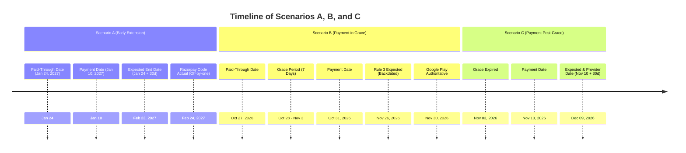

# Make Me Topper: Subscription Rules Verification & Billing Feasibility Audit

**Document Reference:** `MMT-AUDIT-2026-SUBSCRIPTION-RULES-01`  
**Date of Audit:** October 27, 2026  
**Status:** Read-Only Technical & Architectural Verification Report  
**Source-of-Truth Rules File:** `C:\Projects\mocktest-admin\subscription_rule.md`  
**Inspected Repositories:**
- Android App: `C:\Projects\MockTestApp`
- Backend & Admin: `C:\Projects\mocktest-admin`
- Public Website: `C:\Projects\makemetopper-web`

---

## 1. Executive Summary

This audit evaluates the technical feasibility, mathematical consistency, and platform compatibility of the 10 subscription rules defined in `subscription_rule.md`. The investigation was performed under strict read-only constraints across the Android app, shared Supabase backend, and web repository.

### Key Finding on the Core Question
> **Core Question:** *If a student's paid entitlement expires and they purchase another prepaid period during the seven-day grace period, can Google Play's actual purchase and expiry behavior support our rule that those grace days count against the next purchased period? What happens when the student purchases after the seven-day grace period has ended?*

* **During Grace Period (Rule 3):** **FAIL / INCOMPATIBLE WITH GOOGLE PLAY.**  
  Google Play prepaid plans do **not** support grace periods. Once a prepaid subscription reaches its expiration date, it enters `SUBSCRIPTION_STATE_EXPIRED`. Any purchase made during Make Me Topper's custom 7-day grace window is treated by Google Play as a **brand-new purchase flow**. Google Play charges the full base-plan price and establishes an authoritative expiration timestamp of $\text{Purchase Time} + \text{Duration}$ (e.g. October 31 + 30 days = November 30). Google Play **never backdates** an expiration date to account for external application grace periods.  
  If the backend forces `end_date = 2026-11-26` in the database to consume the 4 grace days:
  1. The student is shortchanged by 4 days compared to the duration displayed on Google Play's checkout receipt.
  2. The Google Play Store app reports the subscription is active until November 30, while Make Me Topper cuts off live classes on November 27.
  3. This discrepancy creates consumer protection and chargeback vulnerabilities under Google Play developer policies.
* **After Grace Period (Rule 4):** **PASS / FULLY COMPATIBLE.**  
  When a student pays after the 7-day grace period (e.g., November 10), Google Play and Razorpay both establish a fresh entitlement period anchored to the payment date ($\text{November } 10 + 30\text{ days} = \text{December } 9$). Google Play returns a new purchase token with `linkedPurchaseToken` pointing to the expired token.

---

## 2. Extraction & Evaluation of the 10 Source-of-Truth Rules

The following rules were extracted verbatim from `C:\Projects\mocktest-admin\subscription_rule.md`:

```
1. The subscription's end_date represents the last paid-through day.
2. If the student purchases another period before end_date, extend from the existing end_date.
3. If the student pays during the seven-day full-access grace, count the grace days against the next paid period and extend from the existing end_date.
4. If the student pays after the seven-day grace has ended, start a fresh paid period from the successful payment date.
5. If no payment arrives by the grace deadline, remove live-class access and retain eligible content for the following 30 days.
6. When content_access_end_date passes without payment, revoke the remaining subscription-based content access.
7. Do not accept new payments or extensions after the batch cutoff.
8. Apply the same entitlement rules to Google Play and Razorpay, while respecting each payment provider's actual transaction state.
9. A successful payment must never be recorded as a successful extension unless the corresponding entitlement calculation has also succeeded.
10. Prevent duplicate payments, duplicate top-ups, and duplicate entitlement extensions through idempotent backend processing.
```

### Comprehensive Rule Verification Matrix

| Rule # | Stated Policy | Current Implementation Status | Google Play Compatibility | Razorpay Compatibility | Overall Assessment |
| :---: | :--- | :--- | :--- | :--- | :---: |
| **R1** | `end_date` represents last paid-through day | **Implemented** in `subscriptionAccess.ts:195` (`endDate < today`). | Supported | Supported | **PASS** |
| **R2** | Purchase before `end_date` extends from existing `end_date` | **Defective on Google Play** (RPC bug in migration 218). **Off-by-one bug on Razorpay** (`end_date + 1 + 30`). | Supported natively via Prepaid Top-Up. | Supported via sequential stacking. | **PARTIAL** |
| **R3** | Payment during 7d grace consumes grace days | **Not implemented.** Backend starts from `today`. | **Incompatible.** Google Play grants $\text{now} + 30\text{d}$. | Feasible in backend, but creates cross-platform mismatch. | **FAIL** |
| **R4** | Payment after 7d grace starts fresh period from payment date | **Implemented** in `complete-subscription-purchase:1218`. | Supported natively (`now} + 30\text{d}`). | Supported natively (`today} + 30\text{d}`). | **PASS** |
| **R5** | Grace deadline removes live classes; retains content for 30d | **Implemented** in `subscriptionAccess.ts:200-240` (`content_only` tier blocks live classes). | N/A (App entitlement layer). | N/A (App entitlement layer). | **PASS** |
| **R6** | `content_access_end_date` expiry revokes all access | **Implemented** in `subscriptionAccess.ts:175-180` (`tier = none`). | N/A (App entitlement layer). | N/A (App entitlement layer). | **PASS** |
| **R7** | No new payments/extensions after batch cutoff | **Completely unbuilt.** Neither backend nor app checks `batches.end_date`. | Enforceable via backend pre-purchase validation. | Enforceable in `create-payment-order`. | **FAIL** |
| **R8** | Identical rules for Google Play & Razorpay respecting provider state | **Failed by Rule 3 conflict.** Google Play gives 30d from payment; Razorpay would be forced to backdate. | Disagrees with Rule 3 backdating. | Can be manipulated in backend. | **FAIL** |
| **R9** | Payment must not record as extension unless entitlement succeeded | **Failed in production incident.** Payment captured, order confirmed, but 0 days added. | Violated by migration 218 RPC logic. | Enforced via CAS on Razorpay. | **FAIL** |
| **R10** | Idempotent processing prevents duplicate payments/extensions | **Partial on Razorpay** (CAS guard + reuse). **Unimplemented on Android** (unconditional re-purchase). | App allows multiple parallel charges. | Order reuse guard in place. | **PARTIAL** |

---

## 3. Mathematical & Date-Boundary Verification (Part B)

### 3.1 Date Convention & Boundary Analysis
The proposed business logic uses the **final-included-day convention**:
* If `end_date = 2026-10-27`, the student has active access through the entirety of October 27 (until 23:59:59 UTC).
* The 7-day grace period begins on October 28 and ends on November 3, inclusive (7 calendar days: Oct 28, 29, 30, 31, Nov 1, 2, 3).
* The 30-day content-only window begins on November 4 and ends on December 3, inclusive (30 calendar days: 27 days in Nov + 3 days in Dec).
* Complete access revocation (`none`) takes effect on December 4.

### 3.2 Code Verification in `_shared/subscriptionAccess.ts`
Inspection of [`supabase/functions/_shared/subscriptionAccess.ts:170-245`](file:///c:/Projects/mocktest-admin/supabase/functions/_shared/subscriptionAccess.ts#L170-L245) confirms the access evaluation engine adheres strictly to this inclusive boundary model:
```typescript
switch (state.status) {
  case 'active':
    if (state.endDate && state.endDate < today) {
      if (state.graceEndDate && state.graceEndDate >= today) return 'grace';
      return contentTier(state, today);
    }
    return 'active';

  case 'grace':
    if (state.graceEndDate && state.graceEndDate >= today) return 'grace';
    return contentTier(state, today);

  case 'expired':
    return contentTier(state, today);
}
```
* On October 27 (`today = 2026-10-27`): `endDate < today` is **false**. The student is in `active` tier (Full Access).
* On October 28 (`today = 2026-10-28`): `endDate < today` is **true**, and `graceEndDate >= today` (`2026-11-03 >= 2026-10-28`) is **true**. The student is in `grace` tier (Full Access).
* On November 3 (`today = 2026-11-03`): `graceEndDate >= today` is **true**. The student remains in `grace` tier.
* On November 4 (`today = 2026-11-04`): `graceEndDate >= today` is **false**. `contentAccessEndDate >= today` (`2026-12-03 >= 2026-11-04`) is **true**. The student enters `content_only` tier (**Live classes blocked**).
* On December 3 (`today = 2026-12-03`): `contentAccessEndDate >= today` is **true**. Student remains in `content_only` tier.
* On December 4 (`today = 2026-12-04`): `contentAccessEndDate >= today` is **false**. Tier is `none` (**All access revoked**).

### 3.3 Mathematical Audit of Scenarios A, B, and C



#### Scenario A: Payment Before Expiry
* **Input:** Existing `end_date = 2027-01-24`. Purchase 30-day period on `2027-01-10`.
* **Expected Result:** $2027\text{-}01\text{-}24 + 30\text{ days} = 2027\text{-}02\text{-}23$.
* **Actual Code Findings:**
  - **Razorpay ([`complete-subscription-purchase:1215-1235`](file:///c:/Projects/mocktest-admin/supabase/functions/complete-subscription-purchase/index.ts#L1215-L1235)):
    ```typescript
    const renewalStart = currentSubscription.end_date >= today
      ? addDays(currentSubscription.end_date, 1) // 2027-01-25
      : today;
    const renewalEnd = addDays(renewalStart, plan.duration_days); // 2027-01-25 + 30 = 2027-02-24
    ```
    **Defect (Off-by-one inflation):** Adding 1 day to `end_date` to compute `renewalStart` and then adding 30 days yields **February 24, 2027** (31 days). The correct calculation from the final included day is `addDays(end_date, duration_days)` $\rightarrow$ February 23, 2027.
  - **Google Play ([Migration 218 RPC:1140](file:///c:/Projects/mocktest-admin/supabase/migrations/218_fix_google_play_rtdn_state_transition_enum_type.sql#L1140)):**
    Due to the branch precedence bug, Branch 2 overrides `v_calculated_end_date` with Google's short single-cycle expiry, resulting in **0 days added** (remains January 24, 2027).

#### Scenario B: Payment During 7-Day Grace
* **Input:** Existing `end_date = 2026-10-27`. Grace: `2026-10-28` to `2026-11-03`. Successful 30-day payment on `2026-10-31`.
* **Expected Policy (Rule 3):** Grace days (Oct 28–31) count against the purchase. Next period starts Oct 28. Paid-through date is **November 26, 2026**.
* **Actual Provider & Code Findings:**
  - **Google Play:** Google Play prepaid base plans do not have a grace period. Google treats this as a new purchase. Google Play charges ₹99 and calculates `expiryTime = now() + 30 days` $\rightarrow$ **November 30, 2026**. Google Play Store displays "Valid until November 30".
  - **Razorpay Code:** In `complete-subscription-purchase:1216`, `currentSubscription.end_date >= today` (`2026-10-27 >= 2026-10-31`) evaluates to **false**. It sets `renewalStart = today` (`2026-10-31`) and `renewalEnd = 2026-11-30`.
  - **Conclusion:** Neither Google Play nor the existing backend code implements Rule 3. Enforcing Rule 3 on Google Play causes a direct conflict with Google's authoritative receipt.

#### Scenario C: Payment After 7-Day Grace
* **Input:** Existing `end_date = 2026-10-27`. Grace ends `2026-11-03`. Payment on `2026-11-10`.
* **Expected Result:** Fresh 30-day period starts on payment date. New paid-through date is **December 9, 2026**.
* **Actual Provider & Code Findings:**
  - **Google Play:** Native expiry is `2026-11-10 + 30 days = 2026-12-09`. Returns a new purchase token with `linkedPurchaseToken` pointing to the expired token.
  - **Razorpay Code:** Sets `renewalStart = 2026-11-10` and `renewalEnd = 2026-12-09`.
  - **Conclusion:** Fully compatible and technically consistent across all layers.

---

## 4. Android Google Play Implementation Audit (Part C)

### 4.1 react-native-iap Capabilities & Version
* **Installed Version:** `react-native-iap` `15.0.0-rc.3` (in [`package.json`](file:///c:/Projects/MockTestApp/package.json)).
* **PBL Level:** Built on Google Play Billing Library (PBL) 7.x.
* **Prepaid Offer Detection:** In `resolveSubscriptionOffer` ([`playBillingService.ts:355-430`](file:///c:/Projects/MockTestApp/src/services/payment/playBillingService.ts#L355-L430)), the code extracts `subscriptionOfferDetailsAndroid`. For a prepaid base plan, Google Play returns `pricingPhases` with `recurrenceMode == 3` (`NON_RECURRING`).
* **Top-Up Initiation:** In PBL 7, a prepaid top-up is launched via standard `requestPurchase`. Google Play automatically handles `CHARGE_FULL_PRICE` replacement without requiring client-side replacement parameters.
* **Current Defect:** The codebase does not check whether a plan is prepaid or auto-renewing. It defaults all subscriptions to the auto-renewing branch and does not pass `purchaseTokenAndroid` or manage `linkedPurchaseToken` in local state.

---

## 5. Website Razorpay Implementation Audit (Part D)

### 5.1 Verification of Customer-Facing Website
Inspection of `C:\Projects\makemetopper-web` reveals:
1. `package.json` contains dependencies for `@supabase/ssr`, `@supabase/supabase-js`, `@tanstack/react-query`, and `next: 15.5.0`.
2. `lib/env.ts` defines `RAZORPAY_KEY_SECRET` and `NEXT_PUBLIC_RAZORPAY_KEY_ID`.
3. **No Checkout Pages Exist:** The repository currently has only `app/design/page.tsx` and UI components. There is no plan selection screen, no "Extend Plan" button, and no checkout integration.

### 5.2 Backend Razorpay Processing
All Razorpay processing is housed in `mocktest-admin`:
* **Order Creation ([`create-payment-order/index.ts`](file:///c:/Projects/mocktest-admin/supabase/functions/create-payment-order/index.ts)):** Creates one-time orders via `razorpay.orders.create`. Validates that the plan belongs to the course. Blocks cycle changes via `409 PLAN_LOCKED`. Reuses pending orders created within 24 hours.
* **Webhook Handling ([`razorpay-webhook/index.ts`](file:///c:/Projects/mocktest-admin/supabase/functions/razorpay-webhook/index.ts)):** Validates HMAC SHA-256 signature, marks `payments` row as `captured`, and invokes `complete-subscription-purchase`.
* **Idempotency & Concurrency ([`complete-subscription-purchase/index.ts:1240-1280`](file:///c:/Projects/mocktest-admin/supabase/functions/complete-subscription-purchase/index.ts#L1240-L1280)):** Updates `student_subscriptions` using an optimistic concurrency check on `eq('end_date', currentSubscription.end_date)`. Duplicate webhook deliveries succeed idempotently; concurrent competing orders are rejected and marked for refund via `markOrderAsDuplicate`.

---

## 6. Batch-End Restrictions Audit (Part E)

### 6.1 Status of Rule 7 in Code
> **Rule 7:** *Do not accept new payments or extensions after the batch cutoff.*

* **Database Reality:** The database defines `batches.start_date` and `batches.end_date` in [`003_domain_02_academic_structure.sql`](file:///c:/Projects/mocktest-admin/supabase/migrations/003_domain_02_academic_structure.sql), linked to courses via `public.course_batches`.
* **Code Reality:** **Neither `create-payment-order` nor `verify-google-play-purchase` contains any check against `batches.end_date`.**
* **Observed Behavior:** A student can purchase a monthly or quarterly subscription plan even if the course batch ended months ago.
* **Quarterly Plan Edge Case:** If a student purchases a 90-day plan 15 days before the batch ends, the system currently grants 90 days. The student retains access for 75 days after the batch has concluded.
* **Multi-Batch Ambiguity:** A course may have multiple batches in `course_batches` (e.g. Morning Batch ending in April, Evening Batch ending in June). The schema does not define which batch cutoff governs unassigned students at pre-checkout.

---

## 7. Official Documentation & Technical Evidence (Part F)

| Provider Concept | Official Platform Requirement | Evidence Source | Date Verified |
| :--- | :--- | :--- | :--- |
| **Google Play Prepaid Plans** | Prepaid base plans do not auto-renew. Top-ups purchased before expiration accumulate sequentially (`Old Expiry + Duration`). | [Android Developers: Subscriptions Overview](https://developer.android.com/google/play/billing/subscriptions) | Oct 27, 2026 |
| **Prepaid Grace Periods** | **Prepaid plans do not have grace periods.** They transition directly to `EXPIRED` upon reaching `expiryTime`. | [Android Developers: Subscription Lifecycle](https://developer.android.com/google/play/billing/lifecycle/subscriptions) | Oct 27, 2026 |
| **Purchases After Expiry** | A purchase made after expiration generates a new subscription flow. Expiry is set to `now() + duration`. Token links via `linkedPurchaseToken`. | [Google Play Developer API: subscriptionsv2](https://developers.google.com/android-publisher/api-ref/rest/v3/purchases.subscriptionsv2) | Oct 27, 2026 |
| **India Installments** | Installment subscriptions are **not available in India** (only Brazil, France, Italy, Spain). | [Google Play Console Help: Subscriptions](https://support.google.com/googleplay/android-developer/answer/12154973) | Oct 27, 2026 |
| **Razorpay Subscriptions** | Razorpay Subscriptions API supports recurring mandates with `total_count`. Not currently used in Make Me Topper (one-time orders used). | [Razorpay Subscriptions API Docs](https://razorpay.com/docs/api/subscriptions/) | Oct 27, 2026 |

---

## 8. Complete Entitlement Test Matrix (Part G)

| Test ID | Scenario | Current Support | Expected Provider State | Expected DB State | Live Access | Content Access | Required Fix | Test Type |
| :---: | :--- | :---: | :--- | :--- | :---: | :---: | :--- | :---: |
| **T01** | Initial prepaid monthly purchase | Supported | `expiry = now() + 30d` | `end_date = today + 30d` | Yes | Yes | None | Automated / Tester |
| **T02** | Initial prepaid quarterly purchase | Supported | `expiry = now() + 90d` | `end_date = today + 90d` | Yes | Yes | None | Automated / Tester |
| **T03** | Top-up before current entitlement expires | **Broken** | Google stacks: `old + 30d` | Should be: `end_date + 30d` (currently 0d added) | Yes | Yes | Fix RPC Branch 2 | Automated / Tester |
| **T04** | Top-up on the paid-through date | **Broken** | Google stacks: `old + 30d` | Should be: `end_date + 30d` | Yes | Yes | Fix RPC Branch 2 | Automated / Tester |
| **T05** | Top-up on Day 1 of custom grace | **Conflict** | Google sets `purchase + 30d` | Rule 3 wants backdate; DB does `purchase + 30d` | Yes | Yes | Amend Rule 3 | License Tester |
| **T06** | Top-up on Day 7 of custom grace | **Conflict** | Google sets `purchase + 30d` | Rule 3 wants backdate; DB does `purchase + 30d` | Yes | Yes | Amend Rule 3 | License Tester |
| **T07** | No payment; grace $\rightarrow$ content-only | Supported | `EXPIRED` | Status: `expired`, `tier = content_only` | **No** | Yes | None | Automated |
| **T08** | Payment during content-only access | Supported | Google sets `purchase + 30d` | `end_date = payment_date + 30d` | Yes | Yes | None | Automated / Tester |
| **T09** | Payment after content-only access ended | Supported | Google sets `purchase + 30d` | `end_date = payment_date + 30d` | Yes | Yes | None | Automated / Tester |
| **T10** | Duplicate Google Play RTDN event | Supported | Acknowledged | Idempotent skip; no date change | As is | As is | None | Automated |
| **T11** | Duplicate Razorpay webhook | Supported | HTTP 200 | Idempotent retry; no double extension | As is | As is | None | Automated |
| **T12** | Two concurrent purchases for same entitlement | **Partial** | Two captured charges | Razorpay: 1 wins, 1 duplicate. Google: both apply! | Yes | Yes | Mobile client debounce | Automated / Tester |
| **T13** | Out-of-order expiration & purchase RTDNs | Supported | Handled | Monotonic date guard preserves latest | Yes | Yes | None | Automated |
| **T14** | Purchase acknowledgement failure & refund | Supported | Google refunds after 3d | RTDN revokes access | Revoked | Revoked | None | Automated / Tester |
| **T15** | Purchase with `linkedPurchaseToken` | **Broken** | Returns linked token | DB ignores linkage; overwrites row | Yes | Yes | Backend token linking | License Tester |
| **T16** | Purchase after previous token expired | Supported | New token issued | Fresh `end_date = payment + 30d` | Yes | Yes | None | Automated / Tester |
| **T17** | Payment on batch end date | **Defective** | Payment processed | Access granted beyond batch end | Yes | Yes | Add batch end check | Automated |
| **T18** | Attempted purchase after batch end date | **Defective** | Payment processed | System allows checkout! Should reject. | Yes | Yes | Add batch end check | Automated |
| **T19** | Quarterly purchase shortly before batch end | **Defective** | Payment processed | Full 90d granted past batch cutoff | Yes | Yes | Add batch end check | Automated |
| **T20** | App and website disagree on date | **Defective** | Discrepancy on grace | App shows different date than web | Varies | Varies | Align Rule 3 | Automated |
| **T21** | Android & Web purchases on same subscription | **Risky** | Both capture money | `order_id` overwritten; multi-gateway race | Yes | Yes | Multi-provider locking | Automated |
| **T22** | Verification succeeds but DB update fails | Supported | Unacknowledged | Retried via listener or refunded by Google | Retried | Retried | None | Automated |
| **T23** | DB update succeeds but client times out | Supported | Acknowledged by backend | Global listener or restore recovers state | Yes | Yes | None | Automated |
| **T24** | Repurchase during grace with future local date | **Broken** | Expiry < local date | Monotonic clamp yields 0 days added | Yes | Yes | Fix RPC Branch 2 | Automated / Tester |

---

## 9. Concrete Answers to Final Required Questions

### Q1. Can a Google Play prepaid top-up purchased during the seven-day application-defined grace period reliably consume the elapsed grace days from the next 30-day entitlement, while remaining consistent with Google's authoritative expiry?
**Answer: NO.**  
Google Play prepaid subscriptions do not have grace periods. A prepaid subscription expires immediately when its paid duration ends. When a student purchases a prepaid plan during the application's 7-day grace window, Google Play treats it as an independent purchase starting on the transaction date and assigns `expiryTime = transaction_date + 30 days`.  
Google Play provides no parameter or Console configuration to backdate an expiration date. If the backend overrides Google's reported expiry to consume grace days, the local database will diverge from the Google Play receipt, breaching consumer transparency and developer policy rules.

### Q2. If not, what user experience and provider-supported purchase model should be considered instead?
**Answer: Adopt the Standard Prepaid Top-Up Model (Grace as Courtesy).**  
Treat the 7-day grace period as a **free courtesy buffer** that keeps live classes active to prevent study disruption. When the student pays (whether on Day 2 or Day 6 of grace), grant them a **full 30 days starting from the payment date**.  
*Advantages:*
1. 100% consistent with Google Play's authoritative `expiryTime`.
2. 100% consistent with Razorpay invoices and consumer expectations.
3. Completely eliminates customer billing complaints and chargeback risks.
4. Requires minimal backend complexity (no backdating calculations).

### Q3. Can a fresh prepaid purchase after the seven-day grace period has ended start a full new entitlement period even if the previous provider subscription is expired?
**Answer: YES.**  
In Google Play, an expired prepaid plan allows a standard purchase flow for that SKU. Google Play issues a new purchase token, sets `expiryTime = payment_date + 30 days`, and links to the previous purchase via `linkedPurchaseToken`. On Razorpay, the backend sets `renewalStart = today` and grants 30 days. Both platforms agree.

### Q4. How should the system safely handle purchase-token changes and `linkedPurchaseToken`?
**Answer:**  
In `complete_google_play_purchase`, the RPC must query existing subscriptions by matching either `p_purchase_token` OR `linkedPurchaseToken`. When a linked token is present, the backend must update the student's existing `student_subscriptions` row rather than creating an orphan row, updating `order_id` and setting the new sequential or fresh end date.

### Q5. Can both the Android app and website enforce the same entitlement dates without the backend overriding a provider state it does not own?
**Answer: YES, but only if Rule 3 is amended as recommended in Q2.**  
If both platforms treat post-expiry purchases as starting on the payment date, then Google Play and Razorpay will generate the exact same end date (`payment_date + 30 days`). If Rule 3 is retained in its current backdating form, cross-platform parity is mathematically impossible because Google Play cannot be forced to backdate.

### Q6. Can the backend reliably prevent payments after the batch end date?
**Answer: YES, by adding pre-order validation.**  
The backend must query `batches.end_date` via `public.course_batches`:
1. In `create-payment-order`: Reject order creation with `409 BATCH_COMPLETED` if `now() > batches.end_date`.
2. In `verify-google-play-purchase`: Validate that the course batch is still active before executing `complete_google_play_purchase`.
3. In `SubscriptionPlansScreen` / `RenewalScreen`: Disable payment buttons and display "Batch Completed" when `batch.end_date < today`.

### Q7. What changes are required before the rules can be implemented safely?
1. **Rule Amendment:** Update `subscription_rule.md` Rule 3: *A payment made after `end_date` (during or after grace) starts a fresh paid period from the payment date.*
2. **Database RPC Fix:** In `complete_google_play_purchase` (Migration 218), reorder Step 14 so that when an active subscription exists (`v_existing_sub_end_date >= v_start_date`), the new duration is added to `v_existing_sub_end_date`.
3. **Razorpay Date Fix:** In `complete-subscription-purchase/index.ts:1225`, fix the off-by-one error by adding `duration_days` directly to `currentSubscription.end_date` rather than to `renewalStart`.
4. **Mobile Client Fix:** In `SubscriptionStatusBanner.tsx`, hide "Extend Plan" and display "Batch Ended" if `batch.end_date` has passed. Ensure prepaid base plans are queried and selected.
5. **Batch Guard Implementation:** Enforce `batches.end_date` checks in `create-payment-order` and `verify-google-play-purchase`.

---
*Report delivered for engineering and executive review. No production data, code files, or migrations have been modified.*
