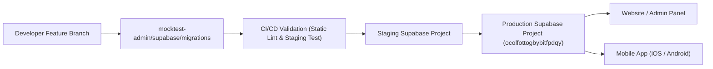

# Make Me Topper — Database Migration Ownership & Governance Architecture

**Status:** Canonical & Active  
**Effective Date:** November 20, 2026  
**Authoritative Directory:** `C:\Projects\mocktest-admin\supabase\migrations`

---

## 1. Architectural Mandate

`mocktest-admin/supabase/migrations` is the **single authoritative source of truth** for all Supabase database migrations for the Make Me Topper platform.

Both client applications:
- **Website & Admin Portal** (`C:\Projects\mocktest-admin`)
- **Mobile Application (iOS & Android)** (`C:\Projects\MockTestApp`)

connect to the same Supabase database backend. All future migrations, schema modifications, database extensions, RLS policies, indexes, and RPCs must be created and maintained exclusively within this repository.

---

## 2. Rules of Engagement for Engineers

### 2.1 Single Migration Stream
- All new migrations must be sequenced sequentially in `mocktest-admin/supabase/migrations/` using the project's naming standard (`<seq_number>_<description>.sql`).
- Mobile developers must **never** create or maintain independent migration files in `MockTestApp/supabase/migrations`.
- The historical migrations directory in `MockTestApp` is frozen and read-only.

### 2.2 Immutability of Historical Migrations
- Historical migrations `001` through `249` are permanently **byte-immutable**.
- Never edit, renumber, reorder, or delete an applied historical migration to fix a bug or clean up history.
- All database fixes, schema evolution, and performance optimizations must proceed strictly **forward-only** (e.g. Migration `250+`).

### 2.3 Idempotence Requirement for Schema Consolidations
- Consolidation and parity migrations (such as `250_consolidate_mobile_schema_parity.sql`) must use defensive, idempotent DDL (`IF NOT EXISTS`, `CREATE OR REPLACE`, explicit constraint existence checks).
- This guarantees safety across:
  - **Production:** Where objects may have been previously applied.
  - **Staging / Local Baselines:** Where environments are initialized from schema snapshots.

---

## 3. Migration Parity Milestone (`250_consolidate_mobile_schema_parity.sql`)

Migration 250 represents the official unification milestone, pulling all previously divergent mobile schema elements into the canonical source:
1. `mock_attempts.last_question_id` (UUID FK)
2. `mock_attempts.last_activity_at` (TIMESTAMPTZ)
3. `set_last_activity_at()` trigger function & trigger
4. `content-pdfs` Storage bucket RLS policy for authenticated students
5. `student_details.selected_stream_id` & RLS update policy
6. `profiles.selected_stream_id` & FK constraint
7. Column-level privilege: `GRANT UPDATE (email) ON public.profiles TO authenticated`
8. Live Chat module: `conversations` & `messages` tables, indexes, touch trigger, RLS policies, Realtime publication
9. RPC `register_device_token(p_fcm_token, p_platform, ...)`
10. RPC `get_course_batch_subject_ids(p_course_id)`
11. RPC `persist_mock_answer_live(...)`
12. RPC `persist_mock_answers_batch(...)`
13. RPC `get_public_catalog(p_stream_id)`
14. Non-recursive course enrollment helper `is_student_enrolled_in_course(p_course_id)` & published courses read policy

---

## 4. Environment Governance & Workflow

1. **Feature Development:** Author migration in `mocktest-admin/supabase/migrations/`.
2. **Review & Static Lint:** Verify SQL syntax, dependency ordering, and security search paths.
3. **Staging Verification:** Apply migration to Staging database via automated pipeline.
4. **Production Deployment:** Apply forward-only migration to Production via authorized CI/CD pipeline or deployment gate.

